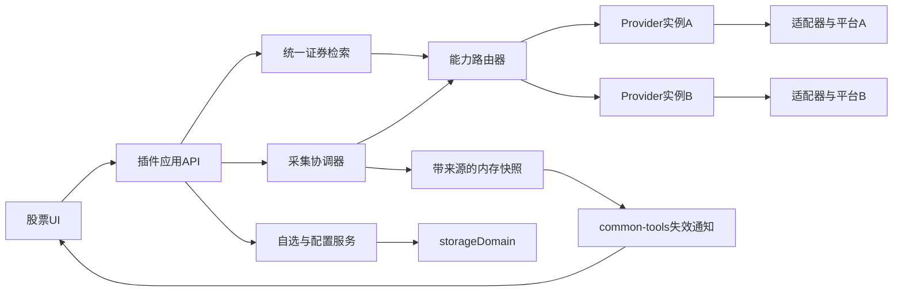

# 股票单页面工具开发规格

日期：2026-10-29。目标包：`@mzzsfy/dsh-stock-sidebar`。状态：P0源码已落地，本地回归与隔离宿主接入验证已执行；真实账户及完整环境验收按记录保留未验证项。源码见[插件说明](../packages/dsh-stock-sidebar/README.md)，验收证据见[兼容性测试](../packages/dsh-stock-sidebar/兼容性测试.md)。用户已授权“开始实施”，明确要求抽象数据提供层、支持更换和混合平台、全局单页面，以及独立数据存储；全程不使用子 agent，不标记独立审查通过。不修改生产profile、不使用真实行情账户、不发布。

## 文档职责与流程边界

[调研文档](./调研-股票侧边栏插件.md)负责开源参考、选型依据、候选能力及视觉线框。本文件是后续实施时 P0 的接口、状态、BDD、TDD 步骤和完成条件的权威输入。两文不同处，以本文件明确标出的收敛决策为准；研究中的 P1/P2 不自动进入 P0。

用户已授权按本规格实现代码；购买数据、修改生产profile和发布不在本轮范围。实际数据账户的权限及展示许可仍需账户所有者提供，固定行情与隔离宿主测试不代表真实账户验收。

设计阶段按指定feat流程完成需求、现状边界、方案比较、BDD、决策收敛和step级TDD计划。股票工具为新增插件包，当前源码已落地；实施阶段的RED/GREEN与本地审查证据另见验收记录，不将文档阶段的规划当作已执行结果。

最新产品约束（2026-10-29）：用户要求单页面工具，不随不同DSH会话销毁。采用根作用域main工具页，左侧导航只承担入口；废止此前会话绑定右侧页签方案。包名和本文路径保留以维持引用稳定，产品显示名使用“股票”。当前实现遵循该单页面约束。2026-10-29补充存储约束：不使用DSH默认设置系统，采用插件自有结构与专用stock_sidebar数据域；storageDomain仅作为底层持久化能力，不使用settings/configEditor。

阅读顺序：范围与决策 → 数据提供层 → 持久化与接口 → 调度与 UI → BDD → 开发步骤 → 验证与交付。

## 本轮实现基线

| 项目 | 定案 | 理由/边界 |
|---|---|---|
| 产品位置 | 左侧sidebar.panellist入口 + 根作用域main单页面工具 | 无会话也能打开；不占用会话右栏；与对话通过宿主主区域导航切换 |
| 首期证券 | 沪深人民币普通 A 股，主板/创业板/科创板 | 不包含 B 股、北交所、ETF、指数、债券、港美股；模型保留市场/品种身份，扩市场需独立验收 |
| P0 UI | 自选、名称/代码搜索、基础详情、别名、置顶/移动、涨跌排序、删除撤销、来源/路由设置、刷新、暂停 | 单一自选列表；不做分组、拖拽、图表、资讯、持仓、提醒、Agent 工具 |
| 数据架构 | 统一 Provider 合同 + 能力声明 + 路由器 + 标准模型 | UI不包含平台分支；支持替换、分市场分能力混用、显式备用源 |
| P0 真实适配器 | Tushare 一个；运行时多实例，分别有凭据/预算 | 第二平台可直接新增适配器；P0用两个独立测试适配器验证混合与切换，不宣称已有第二真实平台 |
| 混合策略 | 可把证券目录、交易日历、报价路由到不同实例；同一份报价的价格/昨收/涨跌属于同一源 | 不做字段级价格拼接；历史图表日后单独注明来源和复权 |
| 前端 | 宿主 React、ModuleLoader、common-tools，原生表格/按钮 | 不引入 React 副本、Redux、Query、图表库、新共享UI包或额外 WebSocket |
| Host | Node ESM、原生 fetch、Zod 数据校验、storageDomain | 无 Python SDK、Redis、独立数据库或抓取进程 |
| 存储 | 一个域、一条权威控制记录 + 可重建目录/日历缓存表 | 控制记录一次写入保证配置/自选/revision一致；报价仅内存 |
| 实例 | 一个Host控制实例；每个浏览器页面一个PageRuntime和一个全局工具入口 | 会话切换/关闭不销毁运行时；不同浏览器标签页各自保持浏览状态并共享Host数据 |
| 样式 | `ssb-` 前缀，宿主 token，`data-plugin` 完整包名 | 实施前再次检查前缀冲突；不改宿主 DOM/CSS |
| 测试 | Node `node:test`、`.test.mjs`、固定时钟/网络替身、有头浏览器 | 仓库规则优先于通用 skill 的 Bun/Query 建议 |

### 与调研提案的收敛差异

1. 原先“首期一个来源”细化为“一个真实适配器、多个 Provider 实例、P0必须实现能力路由”；这是用户新增的可替换/混合平台需求。
2. 来源不是单一全局字符串，改为 ProviderInstance + RouteTable + routingRevision。按市场/能力改变路由必须使受影响缓存失效。
3. 证券搜索不强制每个适配器提供网络模糊搜索。目录型供应商由 Host 建索引；远端搜索能力存在时才调用。前端保留统一两阶段查询。
4. P0有手动指定主源/备用源和自动故障转移策略，但默认关闭自动故障转移。启用需明确配置兼容源；不能无提示绕过付费权限。
5. 凭据引用由 Host 环境变量提供，UI只编辑变量名和显示存在状态，不提供浏览器明文保存 Key 的路径。避免另造秘密存储；未来需要UI凭据编辑时再接宿主正式凭据服务。
6. 标准报价采用十进制定点字符串与明确精度，不将不同来源的单位差异交给UI猜测。

7. 工具由根作用域main承载，与sessionId完全解耦；删除原先sidebarRight/tabInfo/multiple依赖和多pane需求聚合。隐藏只控制采集，不销毁页面运行时。

### 方案比较与必要性核对

选用局部 Provider 接口与路由器：多平台适配是当前明确需求，其复杂度有依据。未选整体 fork：现有候选的浮窗/主页面、存储和请求机制均需大改。未选通用数据插件框架：动态安装驱动、热加载第三方脚本、任意用户URL、多租户路由都没有当前需求，扩大测试和维护面。

P0保留：标准身份映射、能力探测、配额隔离、来源标记、路由代次、故障策略、可测试时钟。P0删除：为图表预建缓存表、后台提醒调度、空Agent路由、自动SDK发现、插件内自有认证、第二套事件连接。Provider仅声明实际已实现能力，不为将来方法返回假成功。

## 复用与边界证据

| 能力 | 复用依据 | 实施约束 |
|---|---|---|
| 自选列表交互 | [stock-quotes 固定源码](https://github.com/AhaCrazy/dsh-stock-quotes/blob/b400f6fbe8771e8baa18fe9fd6e4bb48733ff779/client.js) | 借鉴稳定id、搜索和排序行为；复用main+panellist的全局承载模式；不复制localStorage权威或浏览器直连 |
| 原生视图习惯 | [韭菜盒子 StockProvider](https://github.com/LeekHub/leek-fund/blob/425bc79484218064e4ecdb1dea272733befabbd4/src/explorer/stockProvider.ts) | 原生列表/分层操作；不复制VS Code API与Pro能力 |
| 请求控制 | [stock-market 调度](https://github.com/AnacondaKC/dsh-stock-market/blob/02278af12330102c534c843a668d1c8407dbde1b/src/client/StockMarketView.tsx#L305) | 借鉴取消/退避；不用body挂载 |
| 共享连接 | [common-tools 合同](../packages/dsh-common-tools/README.md) | apply初始化；失效合并、单飞快照；消息只是业务payload |
| 包装配 | [包规范](../DEVELOPMENT/structure-and-release.md)、[示例manifest](../packages/dsh-boss-simulator/package.json) | 新包自动发现；不改包清单；新包需README及兼容性记录 |
| 兼容性 | [API 对齐规则](../DEVELOPMENT/dsh-api-alignment.md) | 服务注入、缺服务干净禁用；不为旧宿主维持两套实现 |
| UI | [UI规范](../DEVELOPMENT/plugin-ui-design.md)、[client规范](../DEVELOPMENT/plugin-client-conventions.md) | token、switch、导航图标声明和样式归属遵循仓库 |

本机静态核查宿主为0.2.1-rc.2；这不是“已确认最低API引入版本”，也不是运行验收通过。开发开始需重新记录实际主测版本，兼容性声明只填有证据的状态。

## 数据提供层：合同与职责

### 分层与依赖方向



UI只认识标准 Security/Quote/ProviderStatus，应用层不解析 `ts_code`、腾讯数组字段或SDK响应。适配器只调用供应商和归一数据，不修改自选、不注册HTTP、不决定页面可见性、不发送通知。路由器选择来源，不自行启动周期timer。采集协调器拥有单飞、预算、取消、结果发布。存储服务不发外部网络请求。

### 三个不同身份

| 身份 | 示例 | 用途 |
|---|---|---|
| 标准证券id | `XSHG:equity:600519` | 跨源自选、报价key、UI焦点；不可使用裸代码 |
| 适配器id | `tushare` | 代码实现类型，静态注册表key |
| Provider实例id | `ts-personal` | 凭据引用、配额、健康状态、路由目标；同适配器可以有多个账号实例 |

交易所使用标准内部枚举 `XSHG/XSHE`，供应商 `SSE/SZSE/.SH/.SZ` 在适配器映射。币种CNY、品种equity、证券代码六位字符串。字段可扩展不代表P0支持其他市场。更换平台不能改已保存的标准id；无法映射的标的返回UNSUPPORTED_SYMBOL，保留自选并显示原因。

### Provider 合同

以下为类型规格，实施用JavaScript + JSDoc，不要求新建TypeScript构建链。

```ts
type Capability = 'catalog' | 'search' | 'quotes' | 'calendar';
interface ProviderDescriptor {
  adapterId: string;
  capabilities: Capability[];
  markets: string[];
  instruments: string[];
  maxQuoteBatch?: number; // 声明quotes能力时必填
  timestampSemantics: 'trade' | 'snapshot' | 'unknown';
}
interface ProviderContext {
  fetch: typeof fetch;
  now: () => number;
  credential: () => string;
  signal: AbortSignal;
}
interface MarketProvider {
  descriptor: ProviderDescriptor;
  probe(request: ProbeRequest, ctx: ProviderContext): Promise<ProbeResult>;
  quotes?: (request: QuoteRequest, ctx: ProviderContext) => Promise<QuoteBatch>;
  catalog?: (request: CatalogRequest, ctx: ProviderContext) => Promise<CatalogBatch>;
  search?: (request: SearchRequest, ctx: ProviderContext) => Promise<SearchBatch>;
  calendar?: (request: CalendarRequest, ctx: ProviderContext) => Promise<CalendarBatch>;
}
```

可选方法必须与capabilities一致，缺能力在保存路由时拒绝；不靠调用失败发现。P0注册表只含tushare，测试注册表可注入fakeA/fakeB。`probe`返回每项能力的ready/denied/unavailable/unchecked及可解释错误，不把一次成功请求推导为整个账号权限齐全。任何网络调用都经协调器提供的预算包装fetch，不能在SDK内部绕过次数统计、取消和超时。

Request共同字段：`providerInstanceId/requestId/routingRevision/routeEpoch`。quotes另含标准securities数组；catalog含market及cursor；search含q/limit；calendar含market/startDate/endDate。Batch共同字段：`providerInstanceId/fetchedAt/items/errors/nextCursor`，只对分页接口使用nextCursor。报价按id返回，缺行生成逐证券错误，不能按返回顺序对齐自选。

适配器错误统一为 `{code,retryable,retryAfterMs,providerInstanceId,message}`。message必须脱敏。区分：AUTH、PERMISSION、RATE_LIMIT、TIMEOUT、NETWORK、BAD_PAYLOAD、UNSUPPORTED_SYMBOL、NO_DATA、CANCELLED。取消不增加源失败计数；无数据不等于网络故障；权限错误不循环重试。

### 标准模型与字段来源

| 实体 | 字段与约束 |
|---|---|
| Security | id、exchange、code、officialName、instrument、currency、timezone、priceScale、listingStatus；名称可更新，id不变 |
| Quote | securityId、last/previousClose/open/high/low/change为十进制字符串或null；changePct字符串或null；volume/amount字符串或null并注明单位；不使用NaN/Infinity |
| Provenance | providerInstanceId、adapterId、providerSymbol、routeId、routingRevision、routeEpoch、quoteAt、timestampKind、receivedAt、delayKind、delaySeconds |
| MarketStatus | sessionState与securityState分离；前者竞价/开盘前/交易/午休/休市/未知，后者停牌/正常/未知；日历不能证明个股没有停牌 |
| QuoteEntry | quote可空、health、lastError、lastAttemptAt；失败保留同路由代次的最后成功quote |
| CatalogCache | source实例、routingRevision、fetchedAt、securities、complete；不完整目录不能宣称覆盖全部市场 |
| CalendarDay | exchange、date(YYYY-MM-DD)、isOpen、previousOpenDate、source；无该日记录就是未知 |

P0沪深普通A股priceScale=2，解析器拒绝无解释的更高价格精度，避免悄悄舍入。金额使用整数分计算change，百分比用整数分子/分母进行四舍五入至两位（恰好半分单位时向远离零方向舍入）；展示`+0.00%`还是`0.00%`统一采用零不带正号。有效零变动保留；占位现价0归为缺价，不从昨收补成现价。量按股，额按人民币元；不做手/股猜测。

quoteAt仅当来源提供可解析时间才有值，timestampKind注明交易时间或快照时间。只有日期不补本机当前时刻。上游未知延迟恒显示“延迟未知”，即使endpoint名称含“实时”。receivedAt为该份数据成功收到的时间，不能作为成交时间。派生涨跌必须使用同一次同源报价中的last与previousClose；任一缺失则派生为空。

### 可直接实施的配置结构

以下为配置结构示例，实例名称是示例，不包含凭据。默认初始化为providers/routes空数组，UI显示未配置，不自动启用演示配置。

```json
{
  "revision": 0,
  "routingRevision": 0,
  "watchlist": {"order": [], "items": {}},
  "preferences": {"refreshSeconds": 15, "colorMode": "red-up"},
  "providers": [
    {
      "id": "ts-personal",
      "adapterId": "tushare",
      "enabled": true,
      "credentialEnv": "DSH_STOCK_TUSHARE_TOKEN",
      "quotaGroup": "ts-account-one",
      "budget": {
        "requestsPerMinute": 20,
        "dailyRequestLimit": null,
        "billingUnit": "request",
        "symbolCreditsPerMinute": null,
        "capabilityLimits": {"quotes": 10, "catalog": 2, "calendar": 2}
      }
    }
  ],
  "routes": [
    {
      "id": "sh-quotes",
      "capability": "quotes",
      "market": "XSHG",
      "instrument": "equity",
      "primaryInstanceId": "ts-personal",
      "fallbackInstanceIds": [],
      "failoverMode": "off",
      "maxDelaySeconds": null,
      "acceptUnknownDelay": true
    }
  ]
}
```

示例预算只是演示用户下调后的值，不是Tushare套餐保证。maxDelaySeconds=null表示不承诺已知延迟上界；acceptUnknownDelay必须由设置页明确说明。路由只有沪市quotes时，只提供该能力；深市报价、目录、日历需要分别配置，不隐式复制沪市规则。新增真实平台只换adapterId和凭据配置，路由结构不变。

P0配置边界：最多8个实例、每种能力/市场/品种一条路由、自选最多100只、别名最多30个Unicode码点、搜索100码点、候选20条。Provider实例id与routeId使用`[a-z][a-z0-9-]{0,47}`，页面id/operationId使用UUID。watchlist.items按标准id存Security与alias/pinned，order无重复且与items键集合一致；任一引用不一致拒绝写入。持久preferences只含刷新周期和配色，排序/滚动/暂停不落Host。

### 混合平台与路由合同

持久配置为有序 RouteRule：`id, capability, market, instrument, primaryInstanceId, fallbackInstanceIds, failoverMode`。P0只允许exact枚举匹配，不做任意表达式或正则；同capability/market/instrument最多一条，保存冲突报422。未配置即NO_ROUTE，不隐式挑一个“可用平台”。

| 组合 | 允许方式 | 禁止方式 |
|---|---|---|
| A提供证券目录，B提供报价 | 按标准id映射，B返回供应商符号与同源报价 | 根据同名字符串盲合证券 |
| A给沪市、B给深市 | 拆批、独立预算、各行显示来源 | 把整表标成单一来源/统一更新时间 |
| A给报价、B给日历 | 日历只判断市场时段；个股状态未知仍保留 | 用交易日历断言股票未停牌 |
| A主报价，B备用 | 经兼容性校验后整条Quote切换；可见切源状态 | A价格+B昨收；隐藏替换来源 |
| A报价、未来B历史图 | 两块分别标来源/复权/币种/时区 | 把复权历史价和当前未复权现价直接混算 |

P0自动故障转移仅适用于quotes路由，目录/日历/search只支持显式修改主源，保存时拒绝这些能力的自动备用配置。每条quotes路由最多一个备用，排除跨实例循环；扩展多级备用属于后续需求。自动故障转移默认off。开启条件：主备用都支持目标市场/品种、币种和标识映射一致，用户配置允许的时效等级；对缺少明确时效的备用源只能选择“接受未知”，不能自动视为实时。仅主路由连续3轮采集全部因NETWORK/TIMEOUT失败触发（同轮多批只计一次，任一有效成功轮重置计数）；AUTH/PERMISSION/429不自动换源以规避权限或额度，逐证券NO_DATA不切整市场。切换是整条路由的当前运行选择，使用新的routeEpoch使旧请求失效；失效广播注明原因。

自动切换后至少保持10分钟，不后台探测主源；用户点击“检查并切回”执行一次受预算约束的probe，成功后切回。配置主源变更直接提交新routingRevision并重置选择。运行期routeEpoch不改变配置revision，重启恢复配置主源并公开“已重启，重新连接”，不复制旧故障状态。

新增平台交付清单：实现Provider → 字段/单位/时间映射夹具 → 能力与批量限制 → 错误映射 → 预算计费规则 → 标准证券映射 → 合同测试 → 许可/使用条件与README → 真实账户验收。无需改UI、HTTP路由或自选模型。这里的“可随时换平台”指替换代码边界稳定，不承诺不同平台拥有相同数据和授权。

## Tushare 首个适配器

证据核查于2026-10-28，开发时权限以账号当前授权为准：

- [HTTP协议](https://tushare.pro/document/1?doc_id=130)：POST JSON，`api_name/token/params/fields`；响应`code/msg/data.fields/data.items`，2002为权限问题。文档示例使用HTTP，实施仅采用经验证可用的HTTPS端点，不降级明文携带token；HTTPS不可用属于连接失败，不能偷偷回退HTTP。
- [实时日线 rt_k](https://tushare.pro/document/2?doc_id=372)：支持逗号分隔多个证券、单次最多6000条，独立“A股日线RT”权限；`close`为最新价，`vol`股、`amount`元，`trade_time`非默认字段，须显式请求。
- [stock_basic](https://tushare.pro/document/2?doc_id=25)：2000积分起、50次/分钟、单次最多6000条；有name、cnspell、exchange、curr_type等字段。
- [trade_cal](https://tushare.pro/document/2?doc_id=26)：2000积分，包含is_open和pretrade_date；不等于个股停牌接口。
- [额度与权限](https://tushare.pro/document/1?doc_id=290)、[服务协议](https://tushare.pro/document/1?doc_id=405)：实时权限与基础积分分开；个人凭据不自动取得团队展示权。

固定请求字段：rt_k为`ts_code,name,pre_close,open,high,low,close,vol,amount,trade_time`；stock_basic为`ts_code,symbol,name,cnspell,market,exchange,curr_type,list_status,list_date`；trade_cal为`exchange,cal_date,is_open,pretrade_date`。按fields名称映射items，允许列顺序变化，缺必须字段报BAD_PAYLOAD，额外字段忽略。禁止直接按固定数组下标解释供应商响应。

P0不使用通配符抓全市场报价；100只上限按20只分批顺序发起。目录按交易所查询，只接收curr_type=CNY、已上市、受支持板块/品种；若达到接口上限，标不完整，按接口已支持过滤条件细分查询，不编造offset参数。目录和日历有独立权限检查，只有rt_k权限时现有自选可查看，但不能宣称中文全市场搜索已就绪。无目录时允许仅对已保存标准证券进行查询，新增未知证券入口显示目录未就绪，不猜身份。

trade_time解析只接受经夹具覆盖的完整日期时间/ISO格式；没有时区的完整日期时间按Asia/Shanghai。其他格式返回quoteAt=null并保留时间未知状态，不自行拼日期。rt_k不含可靠的个股停牌标志时securityState=unknown，不能从vol=0推断停牌。

默认凭据引用`DSH_STOCK_TUSHARE_TOKEN`。实例配置可指其他合法环境变量名，只允许`[A-Z][A-Z0-9_]{0,63}`。配置/快照/日志/导出只保存变量名和是否存在，不回传值。环境变量更新由宿主启动环境负责，UI不声称保存引用后能修改运行进程环境。

## 模块与文件规划

以下是设计阶段的模块职责规划；当前新包已创建，初始版本0.1.0。具体实现将应用装配拆为application.mjs、预算拆为budget.mjs、请求执行拆为executor.mjs，不创建无独立职责的constants.mjs。生产client仍为单入口；测试目录以实际源码为准。

```text
packages/dsh-stock-sidebar/
  package.json
  cordis.patch.yml
  README.md
  兼容性测试.md
  src/
    index.js                  Host装配/注入/生命周期
    client.js                 ModuleLoader注册、组件、样式、导航
    constants.mjs             Host常量与协议枚举
    schemas.mjs               Zod输入/持久数据校验
    state.mjs                 storageDomain与写入串行队列
    service.mjs               自选/配置/查询应用操作
    routes.mjs                HTTP适配，不放行情算法
    provider-registry.mjs     静态适配器注册与能力校验
    provider-router.mjs       路由/回退/routeEpoch
    providers/tushare.mjs     供应商HTTP与归一
    market-model.mjs          标准身份/数值/时间纯函数
    catalog.mjs               目录/日历缓存与名称索引
    collector.mjs             单飞/预算/退避/快照发布
    demand.mjs                page租约与需求合并
  test/
    model.test.mjs
    provider-contract.test.mjs
    tushare.test.mjs
    routing.test.mjs
    state.test.mjs
    service.test.mjs
    collector.test.mjs
    demand.test.mjs
    routes.test.mjs
    client-model.test.mjs
    client-lifecycle.test.mjs
    manifest.test.mjs
    fixtures/
      providers.mjs
      clock.mjs
      tushare-cases.mjs
```

生产路径不引入打包器，也不新增内部client模块装载合同。esbuild/React/ReactDOM只作为devDependencies用于隔离测试夹具与实际组件测试，不用于发布client构建。所有client生产代码放在单入口client.js：factory内部定义createPageRuntime及纯函数，返回对象除apply/inject外提供内部测试入口`__testing`，由Node VM执行实际client.js并捕获ModuleLoader factory进行测试。`__testing`仅暴露本包纯函数/构造器，不暴露ctx、密钥或活跃总线，不声明为跨插件公共API。对应client-model.test.mjs测试实际入口中的同一份逻辑，禁止复制算法为测试镜像。

Host依赖方向：routes→service→state/router/catalog/collector；collector→router→provider；market-model无IO；providers不import service。client.js不import Host文件。测试替换fetch/时钟/存储边界，不替换内部算法。

manifest主入口`src/index.js`、client导出`src/client.js`、type=module、Node>=22；scripts.test为`node --test "test/*.test.mjs"`。dependencies使用common-tools当前已核0.3.0代际；Zod使用与宿主匹配的4.x版本。peer只声明实际import的宿主API；不得从boss示例照抄zod3或旧storage版本。默认不静态import defineDomain，用已注入storageDomain.open接受符合DomainSpec的对象，减少脆弱模块导出。版本支持表先填unknown，L1/L2/L3通过后才改compatible。

patch只插入一个`stock-sidebar`控制行，name完整包名，不自行安装storage backend或第二条common-tools占位。前置宿主已有webServer、storageDomain及其有效backend；client依赖slots、locale、layout，common-tools按[公共依赖规约](../DEVELOPMENT/client-dependency.md)声明dependencies和external，session-manager代挂顺序必须先于消费者。

## 持久化与并发

### 域定义

域名`stock_sidebar`，version=1，layout=single。不启用compatibleVersions或坏记录跳过：自选和路由是权威数据，损坏不能静默清空。表：

| 表/key | 值 | 写入规则 |
|---|---|---|
| control/root | revision、watchlist、preferences、providers、routes、routingRevision、近期operation结果 | 每次用户写操作整条更新，保证一次持久化边界 |
| cache/catalog:<instance>:<market> | 标准目录、fetchedAt、complete | 只在用户触发同步或缓存缺失时写；坏缓存可由明确重建操作替换，不连带清空control |
| cache/calendar:<instance>:<market> | 日期范围、day数组、fetchedAt | 按需更新，无无限日历回填 |

cache表的外层schema只校验key对应的容器（kind、source、时间、payload），payload在catalog服务读取时做细校验；细校验失败按缓存缺失处理并显式重建。若底层JSON损坏或外层schema都不合法，整个域open仍必须失败，不宣称能从未打开的域里单独修缓存。恢复由操作者备份后处理；插件不自动丢权威control。

表声明为`{valueSchema: z.object(...)}`，调用`await ctx.storageDomain.open(spec)`，再`domain.table('control')`。首次缺root时`await table.put('root', initial)`，之后通过`table.update('root', current => next)`做原子读改写；transform同步、无IO、不得修改current对象。API依据[域合同](<C:/Users/yuanhao/AppData/Roaming/nvm/v24.14.1/node_modules/@deepseek-ai/dsh/node_modules/@deepseek-ai/dsh-storage-domain/lib/types/domain.d.ts>)，没有假设跨表事务方法。

control同一记录内包括版本和幂等结果，避免“自选写成功、幂等凭证没落盘”的重试漏洞。目录缓存不参加控制写事务；来源配置验证先在事务外完成，进入update后检查expectedRevision及探针所对应配置摘要，防止验证的不是实际提交的配置。

### 写入操作

`add/remove/restore/move/pin/alias/preferences/providers/routes`都携带expectedRevision和operationId。统一先检查相同operationId：相同请求摘要返回原成功结果，不同摘要返回409 OPERATION_REUSED。再比较revision，冲突返回409及当前revision，不自动重放用户意图。

幂等记录最多256项、保留24小时，裁剪随下一次真实写入发生，不为清理单独定时写盘。窗口外请求依赖revision冲突保护，客户端不得把旧operationId换新revision自动强推。无变化操作返回unchanged，不增长revision、不广播；相同证券重复添加定位原行，不改顺序。响应丢失后先对账，仍不确定则同operationId重试。

删除返回一份带原证券信息/别名/置顶/前后邻居id的恢复凭证。撤销在8秒内作为新的restore操作提交当前revision，恢复原邻居附近；邻居消失则同置顶区域末尾，证券已存在则unchanged。凭证不是旧列表快照，不得覆盖别人改动。Host验证restore内的标准证券与删除记录；过期提示重新搜索添加。

revision只在持久化成功后公布；磁盘写失败返回503 STORAGE_WRITE_FAILED并保持内存/通知不变。所有control操作先经过本包单一串行队列，在队列内判断幂等、revision及unchanged；需要变更时再调用table.update并在transform中复核revision。unchanged直接返回，避免update写入同值仍发域事件。成功后用应用通知器发布，不额外订阅同一control域事件重复通知。probe和上游fetch不在控制队列/存储写锁内。初始化失败日志说明且不注册功能路由/总线；client只出现不可用诊断，不用localStorage冒充持久化成功。

## HTTP 与事件合同

所有路径前缀`/api/stock-sidebar`。服务注册使用`ctx.webServer.register({kind:'exact',path,handler})`，handler接Node req/res并拥有响应生命周期；必须回收返回disposer。见[webServer合同](<C:/Users/yuanhao/AppData/Roaming/nvm/v24.14.1/node_modules/@deepseek-ai/dsh/node_modules/@deepseek-ai/dsh-host-webserver/lib/types/index.d.ts#L169>)。

成功响应`{ok:true,data}`，失败`{ok:false,error:{code,message,retryable,retryAfterMs},revision?}`。所有JSON响应`Cache-Control:no-store`；请求体最大64KiB，UTF-8 JSON；错误方法405，未知路径404，输入无效400，能力不匹配422，版本冲突409。密钥不出现在响应/日志。身份由宿主承担，不自建token/Host白名单；写路由最多使用同源Origin比对。

| 方法/路径 | 输入 | 响应与副作用 |
|---|---|---|
| GET /snapshot | 无 | control可公开部分、报价map、source状态、serverEpoch/snapshotSeq/routingRevision/routeSelections（含各routeEpoch）；不发上游请求 |
| GET /search | q、phase=local或remote、limit≤20 | 标准候选、完整性/来源；local仅已有索引，remote按配置search能力或现有目录索引查询；300ms防抖在client |
| POST /watchlist | action、payload、expectedRevision、operationId | 新revision、操作结果；仅持久化成功通知 |
| POST /preferences | patch、expectedRevision、operationId | 颜色/请求周期偏好；不得携带provider密钥 |
| POST /provider-check | 候选providers/routes、待查capabilities | 一次受预算的多能力检查；不保存配置，不宣称许可通过 |
| POST /configuration | providers/routes、expectedRevision、operationId、检查结果引用 | 原子替换控制记录对应字段、递增routingRevision、取消受影响任务并清缓存 |
| POST /catalog-sync | market、expectedRoutingRevision | 按路由更新目录/日历并返回状态；明确用户操作，不周期HTTP |
| POST /route-selection | routeId、target=primary、expectedRoutingRevision、expectedRouteEpoch | 显式检查主源并切回；10分钟驻留期内409，检查失败不切源，成功递增routeEpoch并返回快照 |
| POST /refresh | securities可选子集、expectedRoutingRevision | 加入对应采集批次并等完成，直接回快照；同价也返回新receivedAt；不等广播 |

provider-check输入同时包含本次候选providers/routes（由客户端仅发送被检查实例和引用它们的路由），摘要覆盖凭据引用、预算及能力/市场/品种。每个实例返回checkId，Host保留各能力结果5分钟；最多64项，超额返回429，失效项按需清理。configuration携带各启用实例的checkIds，所有活跃路由的目标能力及市场必须被同摘要ready检查覆盖；未变且仍有效的检查可复用。仅修改显示偏好无需probe；无凭据的实例可保存为disabled，但任何路由不得指向disabled实例。这避免保存无效活跃路由，同时允许先整理配置。检查失败可保存禁用配置，不能启用数据能力。检查完成不是展示授权确认。

search返回`queryId`由客户端提供并回显，客户端仍以本地查询代次及routingRevision丢弃迟到结果；remote补充按标准id合并，保持已选id。IME组合期不查询/提交。上游不支持search时Host查询目录索引，不能假装实现供应商未提供的模糊API。

refresh整体等待上限10秒，单次上游超时8秒。排队预算不足立即429+retryAfter，不将用户HTTP挂到下一分钟；进行中同批复用。批次部分成功200+逐证券错误；全部上游失败502并携带可用旧快照；到10秒504，迟到结果仍由代次守卫处理。用户取消只移除其waiter；存在周期需求或其他waiter时不取消共有fetch。暂停页显式刷新允许一次请求并更新本页静态快照，但不恢复周期需求。

### 写操作 payload 与初次使用路径

watchlist的payload：add=`{securityId}`（Host必须从已核目录/搜索缓存取完整Security，不信任client名称/市场）；remove=`{securityId}`；restore=`{removeOperationId}`；alias=`{securityId,alias}`（空串清别名）；pin=`{securityId,pinned}`；move=`{securityId,beforeId:null|string}`。move只能在同置顶区域内操作；beforeId=null表示当前区域末尾，禁止用完整旧数组覆盖新顺序。pin变更移到目标区域末尾，既有其他条目相对顺序不变。preferences只接受refreshSeconds=15/30/60与colorMode=red-up/green-up。未知action/字段拒绝，不静默忽略拼错字段。

首次使用顺序：配置Host环境变量 → 添加实例并设账号预算 → 为沪/深需要的能力选择路由 → 检查并保存 → 同步目录/日历 → 搜索候选并添加 → 可见列表开始采集。provider-check按能力逐次执行，每次只做该能力最小一笔受预算请求，10秒超时；UI显式“检查全部”可顺序发送各能力检查并合并checkIds，不后台轮询检查进度。quotes用该市场固定已知标准证券进行一次请求，catalog按交易所请求一次，calendar查当天，search用固定代码查询；空行情属于NO_DATA，不等于证明账号无权限，但也不能把未验证字段结构标为ready。

只启用quotes的账号可保留现有自选；新安装若目录不可用，UI直接给“配置目录来源”，允许目录来自其他平台，不让用户在空结果中猜原因。remote搜索来源存在时，可用它返回的受支持标准Security添加，不强制另付catalog权限；候选在Host内保存5分钟、最多200项，提交过期候选返回409 CANDIDATE_EXPIRED并保留输入供重新查询。

GET /search仅local阶段绝不发上游请求；remote阶段按search路由调用，否则读catalog索引。缺失目录时返回CATALOG_NOT_READY并引导POST /catalog-sync，不因每次键入自动同步全目录。搜索排序：标准代码精确→名称精确→代码前缀→名称包含→可用拼音缩写前缀，组内按标准id稳定排序；只展示实际目录拥有的拼音能力。目录/日历同步按实例单飞，每次总等待30秒、无客户端状态轮询；超时结束按钮状态，下次由用户重试，成功通过失效消息更新。日历默认拉当前日期前7日至后45日，缺未来覆盖时保留unknown。

### 总线与顺序保护

client和host都在apply内`setupCommonTools(ctx)`。host发`{type:'invalidate',serverEpoch,snapshotSeq,scopes}`，通过createChangeNotifier合并。client一个共享createSnapshotRefresh串行读取snapshot，最小启动间隔遵循工具的一秒窗口，失败无自循环重试。首连/重连onReset先对账，再重发当前需求。

快照有进程随机serverEpoch、进程内递增snapshotSeq；同epoch只接受不小于已应用seq的响应；snapshotSeq在每次可返回快照内容变化时增长，包括receivedAt更新，即使该变化不触发广播。epoch改变视为Host重启，清旧报价/租约代次并重新对账。所有HTTP请求另带客户端本地requestGeneration守卫；onReset增加generation并中止旧请求，已接受新epoch后将旧epoch列为本页面退休epoch，拒绝迟到响应把页面切回旧Host。routingRevision或routeEpoch不匹配的报价永远不能合并。写响应只更新操作结果/revision，随后合并一次snapshot刷新，不把局部写响应覆盖整个行情状态。

当价格/quoteAt/health/市场状态都未变，内部lastPollSuccessAt更新但不广播；receivedAt更新可通过显式刷新或下次业务快照取得，UI标“当前快照获取于”。错误恢复即使同价也必须广播。暂停页继续更新自选/路由元数据，保留暂停行情；路由代次改变时清掉不匹配行情，仍保持暂停。

## 需求、采集与平台预算

### 可见需求

工具可见性取`ctx.layout.panelInfo`的getSnapshot/subscribe，`activePanelId === PANEL_ID`表示主区域选中股票工具，再结合document.visibilityState。不订阅sessionId，不使用会话AbortSignal。依据[main槽位合同](<C:/Users/yuanhao/AppData/Roaming/nvm/v24.14.1/node_modules/@deepseek-ai/dsh/node_modules/@deepseek-ai/dsh-client-ui-layout/lib/types/client/index.d.ts#L49>)及[layout服务合同](<C:/Users/yuanhao/AppData/Roaming/nvm/v24.14.1/node_modules/@deepseek-ai/dsh/node_modules/@deepseek-ai/dsh-client-ui-layout/lib/types/client/service.d.ts#L16>)。视图组件卸载不等于PageRuntime卸载，不能在React组件清理中释放全局运行时。

浏览器页管理器按股票主页面被选中、内部处于列表/详情、document非hidden、未暂停形成报价需求；设置/搜索或离开股票页面不保持连续报价。切换DSH会话本身不触发清理；若宿主因此选回对话，只撤销行情需求，保留全部工具状态。每页一个pageId，WS消息`{type:'watch-demand',pageId,generation,active}`；generation严格递增，Host忽略旧代。active=false或到期后保留该pageId最高generation墓碑至少90秒，防迟到active复活；正常隐藏后恢复可使用同pageId的更高generation，重连/刷新则生成新pageId，不重用旧连接id。墓碑和有效条目分别有界（各256），满额时拒绝新id而不驱逐仍有效的高代次记录。active每30秒续租，90秒到期；active=false立即释放。WS断开发布失败不另开HTTP心跳，重连onReset对账后重发。正常离开股票工具或隐藏浏览器页面立即停采集；关闭浏览器的异常退出最迟租约到期停。

pageId最多256个有效条目，过期条目定点清理；新页面超过上限拒绝并提示，不无限增长。纯显示摘要P0不单独订阅；元数据接收presence不作为行情需求。HMR必须旧代管理器dispose，先撤销需求、清timer/abort、退订，再注册新代，防止旧续租复活。

### 采集算法

1. 读取当次control与路由代次，生成标准id集合；按选中Provider实例分组，每组按适配器maxBatch和本插件20只上限切批。
2. 每quotaGroup一个顺序队列，最多一条上游请求在途；不同quotaGroup最多两个并发，防混合平台把网络放大无界。
3. 预约各实例预算，若无额度则标limited并安排下一可用时刻；手动waiter无法在其10秒期限内完成则立即429。
4. 传AbortSignal调用适配器，校验结构与标准身份；忽略不在请求中的证券、重复冲突行报BAD_PAYLOAD。
5. 持有generation/routingRevision/routeEpoch复核；过期结果丢弃。逐证券合并同源成功数据，失败保留同代旧值。
6. 快照内容变化递增snapshotSeq，其中业务状态变化才合并通知；批次完成只结算该批覆盖范围已全部完成的waiter（其他继续等待剩余批次或截止时间）；下次timer从上次启动时间和预算、退避、市场日历共同计算，不能setInterval重叠。
7. 无有效租约且无手动waiter，取消timer和当前可取消fetch；后台提醒不在P0。

不同平台/账号预算隔离；同账号的多个实例必须共用quotaGroup，不能重复计算额度。配置包含quotaGroup、requestsPerMinute、dailyRequestLimit可空、billingUnit=request或symbol、symbolCreditsPerMinute可空。Tushare实例额外按能力分桶：rt_k、stock_basic、trade_cal的权限和额度分别配置；同quotaGroup共享账户总上限，各能力还受自己的子上限。相同adapter+同凭据引用强制同quotaGroup；不同变量引用但实际同账号由配置者指定相同组，客户端不比较/读取密钥。默认预算取账号确认额度与用户更低限制的最小值；未知额度时只允许用户主动probe，每组最多1次/10秒，周期采集保持禁用。任一quotaGroup上游启动间隔至少1秒，且预算按60秒滑窗计，不只看平均值。

effectiveInterval=max(用户周期15/30/60秒、批次数×最小请求间隔、按实例额度计算的完整一轮下界)。周期采集最多使用每分钟预算的90%，其余留给手动/目录检查；当每日预算耗尽停止周期直到交易所日期换日并提示。跨端共享同账号无法由本插件准确计数，实际429优先，Retry-After覆盖本地估算。

NETWORK/TIMEOUT按15/30/60/120秒退避加0–20%抖动；429遵守Retry-After，否则60秒；AUTH/PERMISSION暂停该能力直到用户检查/修改；BAD_PAYLOAD暂停并显示接口格式变化，不用无止境重试。备用选择遵循前文规则，不能把所有错误统一failover。

### 交易时间与缓存

目录24小时TTL、日历7天TTL，均只在明确同步或产生需要时检查，不新增永久刷新任务；过期目录可继续标记使用并请求更新，新增证券必须来自有效标准身份记录。日历覆盖当前日期才能据此休市；缺覆盖则unknown，可见时按至少60秒保守采集，不编造节假日。

A股交易日按Asia/Shanghai：09:15–09:25竞价，09:25–09:30开盘前，09:30–11:30及13:00–15:00交易，11:30–13:00午休，其余非交易。边界采用左闭右开，15:00后允许一份收盘对账；来源返回的是最新快照而非保证最终收盘。午休/休市停止周期，但允许打开面板/手动操作取一次最后快照；下个已知开盘时点仅在存在租约时唤醒。计划状态和个股状态分别显示。

## UI 实施合同

列表、搜索、详情和设置的内容操作参考[调研交互章节](./调研-股票侧边栏插件.md#交互设计提案)；其中320px侧栏尺寸、会话右栏和多pane生命周期已废止。以下main页面组件、响应式布局和页面级状态合同替代旧承载规则，功能内容不再依赖会话。

| 组件/控制器 | 输入 | 负责行为 |
|---|---|---|
| StockEntry | 宿主传入的size/active | sidebar.panellist图标入口；宿主选择同id主面板，无会话也可用，重复点击不创建实例 |
| StockPage | PageRuntime、usePanelInfo | 提供列表/搜索/详情/设置四种内部视图，从运行时读取导航/滚动/焦点，重新挂载可恢复 |
| WatchlistTable | 标准条目、报价、临时排序 | 固定key、置顶区、价格/涨跌列、行菜单；列表高度不足时滚动 |
| SecuritySearch | q/selectedId/代次 | 300ms防抖、IME、local/remote合并、显式确认、失败保留输入 |
| QuoteDetail | securityId | 基础价、涨跌、开高低昨收、单位、逐字段缺值、来源时间；不出现空图表按钮 |
| ProviderSettings | provider实例、路由表、check状态 | 选择适配器、凭据变量名、预算、按市场能力选主备用、检查/保存、错误回显 |
| StatusStrip | 汇总health、来源数量 | 混合源显示“N个来源”；每行/详情显示具体源；快照时间不代表全部证券的成交时间 |
| PageRuntime | layout.panelInfo、bus、snapshot刷新器、viewState | 页面级唯一运行时，持有暂停/报价/导航/搜索词/选中证券/滚动/设置草稿；与会话无关，不同浏览器页面互不控制暂停 |

页面使用宿主main可用宽高，内层内容最大1200px居中；≥960px时列表与已选基础详情双栏，<960px时单栏内部导航，<480px优先收起辅助列。验收视口360/768/1280px且无整页横向滚动；不再采用会话右栏的768px全屏阈值或320px宽度约束。正文12px、辅助11px、列表32px量级，双行40/48px。使用原生table及名称按钮；Tab进工具栏/活动行，方向键在列表内移动，Enter打开详情，Esc先关菜单再返回；输入框不劫持聊天按键。颜色跟宿主token，行情正负号保留，零值中性。

涨跌排序是页面临时视图，不重写持久手动序；相同涨幅用手动序稳定tie-break，null在末尾。菜单打开或键盘连续导航时冻结行序、仅更新数值，退出后重新排序且焦点跟随securityId；目标被别页删除则关闭菜单并聚焦相邻行。默认不自动选模糊查询首项；中文Enter选字不触发添加。

设置页新增“数据路由”区域：按catalog/search/calendar/quotes行展示目标市场与主实例，备用列表和“自动切换”开关默认关闭。无第二个兼容实例时禁用备用选择并说明原因。启用新路由前逐能力probe；保存中禁用重复提交，409保留草稿并展示当前配置供用户重新检查。隐藏路由不是偷偷丢配置；不支持能力的选项禁用且显示“不提供该能力”。

删除成功显示8秒撤销；写入失败不先消失再无提示回滚。请求状态仅影响对应按钮，旧行情保持可读。读屏不每次播报所有报价，添加/删除/路由切换/故障恢复可礼貌播报。触屏菜单常可达，操作命中区44px；桌面按宿主紧凑密度。

## 初始化、失败与卸载

Host顺序：探测webServer.register/registerUpgrade、storageDomain.open → 打开域并初始化control → 构建服务/Provider/协调器 → setupCommonTools → 注册路由/订阅。每步先登记清理，异步open后复查disposed；若期间卸载，立即close而不注册后续资源。缺宿主能力干净返回，不抛到宿主启动；持久化打不开记录明确错误，不创建内存版自选替代。

client先由注入门控等待slots/locale/layout，factory不持有总线或订阅。apply中创建唯一PageRuntime并登记插件级disposer，再注册locale/style和NAV_ICON。固定PANEL_ID=`stock-sidebar`，main注册key=PANEL_ID，sidebar.panellist注册id=PANEL_ID；通过ctx.slots.inject分别等待槽位并用ctx.effect回收注册，参考[cron-board全局面板](../packages/dsh-cron-board/src/client.js#L1243)。main属于root作用域且不绑定Session，不注册sidebarRight kind、会话children或以sessionId为key的React根。宿主导航负责打开/返回；需要显式返回对话时调用ctx.layout.selectPanel(null)。

Host卸载：标disposed与推进代次 → 注销入口路由/订阅 → 取消timer/队列/请求并结算waiter为503 STOPPED → dispose合并通知 → await domain.close。client卸载：撤销本页面需求 → dispose刷新器/abort → 释放组件及总线订阅 → 回收样式/locale/槽位。其他插件共享WS保持存活。注销动作幂等；在途存储写等待durability再close，不中途假报写成功。

### 页面状态存续矩阵

| 事件 | PageRuntime及视图状态 | 网络与采集 |
|---|---|---|
| 切换/关闭DSH会话、当前无会话 | 不dispose、不重置、不换pageId；保留详情、排序、搜索、滚动和未保存草稿 | 股票仍被选中则原采集继续；主区域变对话则仅撤销需求 |
| 股票→对话/其他工具→股票 | 运行时保留；视图若被宿主卸载，回来从viewState重建 | 隐藏停采集，回来一次对账并续租，不重复注册bus |
| 关闭最后一条会话 | 股票工具仍可打开且数据保留 | 仅按工具可见性决定需求 |
| 浏览器标签页隐藏/恢复 | 状态保留 | 撤销/恢复需求，不后台轮询 |
| 页面刷新、关闭浏览器、插件禁用/HMR | 本代运行时销毁，清临时UI状态；Host自选/配置持久化不受影响 | 回收旧代资源；下一代重新对账 |
| Host重启 | 保留当前页面导航/草稿，旧行情失效 | 按新epoch恢复需求，不能因重连重建整个工具运行时 |

草稿、临时排序、详情与滚动存PageRuntime.viewState；组件只持短暂的DOM焦点句柄，卸载前更新可恢复焦点id。保存成功或用户明确放弃才清设置草稿。会话切换不能关闭行菜单并重置业务导航；若视图卸载，临时菜单可关闭，但返回行id必须保留。数据与路由变化仍按Host权威对账，保留草稿不代表强行覆盖远端修改。

## BDD 权威验收

以下57条是权威场景，不以测试总数推导全部覆盖。当前已实现的自动化与有头验证证据见[验收记录](../packages/dsh-stock-sidebar/兼容性测试.md)；未覆盖的真实环境组合继续标未验证。测试名保留历史ID时以具体断言语义为准，记录不得把扩展边界用例误认成同ID全部验收。

| ID | Given | When | Then | 测试落点 |
|---|---|---|---|---|
| H01 | 缺webServer或storageDomain | 激活Host | 不注册功能资源，说明禁用原因 | manifest/lifecycle |
| H02 | 域打开尚未返回 | 插件卸载 | 迟到handle关闭，零路由残留 | lifecycle |
| H03 | 主测宿主已加载股票插件 | 点击股票导航 | 根作用域main显示唯一工具页，不创建会话或右栏页签 | 有头L3 |
| H04 | 当前没有会话 | 点击股票入口 | 正常打开工具并可配置/查看自选，不要求先创建会话 | client-lifecycle/L3 |
| H05 | 股票工具打开且有搜索/详情/设置草稿 | 切换到另一DSH会话 | PageRuntime身份不变、状态保留、订阅不重复 | client-lifecycle/L3 |
| H06 | 视口宽360px | 打开股票工具 | 单栏可操作，无横向滚动，可通过宿主导航返回对话 | 有头L3 |
| H07 | 股票工具已有自选且只剩一条会话 | 关闭最后会话 | 工具运行时不销毁，仍能重新打开使用 | client-lifecycle/L3 |
| H08 | 股票工具停在详情且有列表滚动位置 | 离开工具后返回 | 同一运行时恢复详情与滚动，不重置为初始空页 | client-lifecycle/L3 |
| H09 | 股票入口已经打开 | 再次点击入口 | 仍为同一工具运行时，不新增订阅或上游请求 | client-lifecycle |
| M01 | 同码不同交易所/品种 | 解析候选 | 标准id不相等，不静默猜市场 | model |
| M02 | last=10.00、preClose=8.00同源 | 归一报价 | change=2.00、changePct=25.00 | model |
| M03 | 昨收缺失或0 | 归一报价 | 涨跌额/幅为空，不NaN | model |
| M04 | 上游只有日期或坏时间 | 归一报价 | quoteAt空、时间未知，不替换当前时间 | tushare |
| P01 | fields列顺序变化 | 解析rt_k | 按名称还原相同字段 | tushare |
| P02 | 上游返回重复冲突证券行 | 解析批次 | 标结构错误，不按数组覆盖 | provider-contract |
| P03 | 配置路由目标不支持quotes | 保存配置 | 422，无持久化/采集变更 | routing/service |
| P04 | A目录、B报价支持同标准id | 获取报价 | id稳定且来源B，名称来自目录可追溯 | routing |
| P05 | 沪市A、深市B | 采集自选 | 请求拆到正确实例，各自预算 | routing/collector |
| P06 | 主源连续3次网络失败且允许备用 | 下一次选路 | 整条报价切备用并标来源，旧响应丢弃 | routing |
| P07 | 主源429或权限失败 | 选路 | 不擅自切备用绕过限制 | routing |
| P08 | 当前已在备用10分钟内 | 主源曾有成功缓存 | 不自动跳回，等待显式检查切回 | routing |
| P09 | 旧路由fetch未结束 | 用户提交新路由 | 旧结果不能进入新快照 | collector |
| P10 | A只支持catalog、B只支持quotes | 注册并配置路由 | 不要求A实现quotes，两个能力可组合 | provider-contract |
| P11 | 两实例使用同账号quotaGroup | 同时请求 | 共享滑窗总额度，不翻倍 | collector |
| P12 | 备用驻留超过10分钟、主源检查失败 | 点击切回 | 保持备用与routeEpoch，返回原因 | routing/routes |
| P13 | probe完成后用户改候选路由 | 携带旧checkId保存 | 拒绝摘要不匹配，配置不变 | service |
| S01 | 自选为空且标准候选有效 | add | 持久化一条、revision递增 | state/service |
| S02 | 两请求同expectedRevision | 并发不同写 | 一次成功一次409，不丢更新 | state |
| S03 | 持久化失败 | add | 内存与revision不变、不广播 | state |
| S04 | 已成功操作响应丢失 | 同operationId重试 | 返回既有结果，不重复写 | state/routes |
| S05 | A删后B改其他股票顺序 | A恢复删除项 | 在当前序列插回，不回滚B操作 | service |
| S06 | 幂等id相同但payload不同 | 提交 | 409 OPERATION_REUSED | state |
| D01 | 唯一页面需求active | document隐藏 | 正常发送撤销后停止周期 | demand/client |
| D02 | 最后页面断网未撤销 | 90秒租期到期 | 停采集，无永续后台请求 | demand |
| D03 | stop的generation更高 | 旧active消息迟到 | 不复活需求 | demand |
| D04 | A暂停、B仍可见 | A撤销自身需求 | B采集继续，A仅元数据更新 | demand/client |
| C01 | 一个实例相同批次在途 | 两消费者请求刷新 | 共享采集，两个waiter各完成 | collector |
| C02 | 上游同价同时间且健康不变 | 周期采集成功 | 无失效广播引起HTTP快照轮询 | collector |
| C03 | 上游同价且有手动waiter | 请求结束 | POST响应含新receivedAt，加载结束 | routes |
| C04 | 已失败、下一次同价成功 | 合并结果 | 清错误并通知恢复 | collector |
| C05 | 配额不能在10秒内满足 | 手动刷新 | 立即429并给等待时间 | routes |
| C06 | 相同实例部分证券无行 | 合并批次 | 成功行更新，缺行错误且保旧值 | collector |
| C07 | 请求失败且Retry-After存在 | 计算下一次 | 不早于指定时间发请求 | collector |
| U01 | 中文输入法正在组合 | Enter选字 | 不添加、不误触快捷键 | client-model/L3 |
| U02 | 旧查询慢、新查询快 | 旧结果迟到 | 只保留新词结果和选中id | client-model |
| U03 | 模糊结果多条未选中 | Enter | 不自动添加首项 | client-model |
| U04 | 涨跌排序且行菜单打开 | 价格变化 | 数字更新、行不跳，动作指向原id | client-model/L3 |
| U05 | 暂停页有旧路由行情 | 别页改路由 | 清不匹配价格、保持暂停 | client-model |
| U06 | 编辑设置遇409 | 保存返回 | 保留草稿、显示冲突，不覆盖远端 | client-model |
| U07 | 快照请求旧序号未返 | 新快照先应用 | 旧响应不能回滚UI | client-model |
| U08 | 插件有timer/订阅/样式 | 禁用 | 自有资源全部释放，共享总线不被误关 | lifecycle/L3 |
| U09 | 无token且无可用目录/search来源 | 搜索新股票 | 明确未就绪，不伪造空市场、不自动抓其他平台 | service/L3 |
| U10 | 已接受新Host epoch | 旧Host刷新响应迟到 | 不回滚来源、seq和quote | client-model |
| S07 | 证券已置顶、要求相同pin值 | 提交 | unchanged，无持久化写与广播 | state |
| S08 | 已有100只自选 | 添加第101只 | 422 LIMIT_REACHED，列表不变 | service |
| S09 | 同组内A/B/C、revision有效 | 将C移至B前 | 次序A/C/B，其他区域不变 | service |
| C08 | 刷新100只、前20只已返回 | 首批结束 | waiter未提前完成，等待余批或期限 | routes/collector |

## Step 级 TDD 开发计划

依赖顺序固定：S1→S2→S3→S4→S5→S6→S7→S8→S9。每步选择对应BDD中的单个场景，写测试并确认因行为缺失RED，再实现最小GREEN，再局部REFACTOR；不得一次写完整生产模块再补测试。下表保留设计阶段的职责拆分，当前文件已落地；实际阶段完成度及证据以验收记录为准，测试命令在包目录执行。

| 步骤 | 改动与交付 | 场景/验证 | 完成条件 |
|---|---|---|---|
| S1 装配探针 | package/patch/index/client单入口最小注册；无真实数据；VM捕获实际factory；依赖缺失清理 | H01/H02、manifest.test；`npm test` | 可隔离装载/干净禁用，VM执行真实生产入口，未增加额外装载路径 |
| S2 标准模型 | market-model/schemas；确定身份、精度、时区、错误 | M01–M04；`node --test test/model.test.mjs` | 预期值手工计算，空值/零/坏时间全覆盖 |
| S3 Provider和路由 | registry/router/providers/tushare、字段夹具、两个测试Provider | P01–P13；对应三组测试 | 能力/混合/切换/预算归属通过，业务代码不包含平台字段 |
| S4 持久化与应用服务 | state/service/control记录、revision/幂等/restore | S01–S09；state/service测试 | 写失败不发通知，重启幂等记录仍有效，恢复不覆盖并发修改 |
| S5 目录与采集 | catalog/demand/collector、配额、日历/退避/租约 | D01–D04、C01–C08；fake clock | 单飞、正常/异常停采集、路由代次、故障切换可证伪 |
| S6 API接线 | routes/index，common-tools消息/快照，probe配置闭环 | routes.test + H02/C03/C05 | HTTP状态/大小/错误/完成回执符合合同，卸载无迟到发布 |
| S7 核心UI | client组件、页面运行时、四页面、来源路由表单、主题 | U01–U10、H04/H05/H07–H09；client测试 | 全键盘可用、同源状态、无周期HTTP、所有配置错误可解释 |
| S8 隔离整合 | README、兼容性测试；根README条目/NAV_ICON生产者测试 | H03/H06、L1/L2/L3、网络5分钟 | 假数据全流程与多源切换可测，真实行情权限单列未验不能冒充通过 |
| S9 全面收尾 | 全包回归、相关仓库测试、文档/打包文件核对 | 全部BDD证据、smoke/聚合检查 | 无本任务失败/泄漏；兼容性声明与实际证据一致；发布为另一个授权动作 |

### RED 判据与变异检查

RED不能只是import不存在或语法错误；允许先建最薄导出壳再让行为断言失败。至少能被以下变异击穿：把标准id去掉市场、用receivedAt替代quoteAt、删revision比较、先改内存再写盘、旧代次结果写回、每消费者重复抓取、429直接重试、取消时误断其他waiter、混源昨收、字段顺序固定、暂停更换路由不清旧值。

共享刷新工具已有自己的单飞测试，股票测试验证“它被正确接入”的可见请求次数与取消效果，不复制工具内部私有字段断言。UI测试通过实际factory/真实纯模块测试，不维护一份只供测试的镜像实现。

## 测试环境、命令与证据

股票包npm test、全仓smoke、根tests与NAV_ICON相关测试已在实施会话执行；结果见验收记录。隔离真宿主使用同款临时home方法与有头dev-browser，不调用生产profile，也未执行需要无头浏览器的compat全流程。包脚本如加入mock preload，以实际npm test为准。

```sh
# 在新包目录：单步后跑目标测试，收尾跑全包
npm test

# 在仓库根：现有规定的基础回归
node scripts/smoke-load.mjs
node --test "tests/*.test.mjs"

# 对主测实际版本运行仓库隔离兼容性工具
node scripts/compat/run.mjs --version <主测版本> --host-dir <该版本宿主目录>
```

[开发规约](../DEVELOPMENT/dev-loop.md)要求依赖解析桥与相关包测试；[API对齐](../DEVELOPMENT/dsh-api-alignment.md)规定宿主升级额外跑Windows dev-link测试。AI自测使用隔离profile，不执行会改生产profile的dev-link命令；[profile链接](../DEVELOPMENT/profile-link.md)中的脚本是人工开发态唯一入口，不可用手改profile替代。涉及LLM链路仅用[echo-upstream](../scripts/echo-upstream/README.md)，本插件P0无LLM调用。

行情测试采用注入fetch返回固定结构，不访问生产行情、不自动读取开发机真实token。集成测试在独立HTTP测试服务或内存fetch替身中注入429/超时/字段变化；测试专用适配器只由测试工厂传入，不作为生产用户可选项，不开启随意endpoint配置。真实账户验收由账户所有者授权后单独执行并记录，缺权限只标真实接口未验，不能把fake结果写成实时服务已通过。

UI用dev-browser有头浏览器验证隔离URL，不能另起Vite静态页就称宿主接入通过。覆盖：全局main导航、无会话访问、切换/关闭最后会话、离开工具再返回、重复点击入口、360/768/1280px布局、明暗主题、键盘/IME、150%以上缩放、屏幕高度不足、慢网/断线/重连、取消与重载。必须记录PageRuntime创建/销毁次数、订阅次数以及操作前后viewState，不能仅凭截图判定生命周期正确。

网络记录分四组各5分钟：

- 无可见报价需求：无行情周期请求，无HTTP快照轮询，允许共享WS心跳。
- 可见但供应商业务数据不变：允许预算内Host取价与WS需求续租，不出现周期snapshot HTTP。
- 持续变化：快照启动间隔遵守公共工具一秒下界，批次/多页面不放大上游次数。
- 隐藏/恢复/崩溃：正常最后需求撤销立即停止；异常最多租期到期；恢复一次对账而非补发历史队列。

记录字段：源码commit/blob、宿主版本、Node/浏览器版本、隔离profile标识、场景ID、夹具版本、步骤、预期/实际、网络请求计数、截图/日志路径、残留资源。性能目标P95≤200ms只用于已有内存快照的面板打开，至少30次操作；上游网络时间另列。五行可见以列表可用高度满足五倍行高为前提。

## 接入检查与交付清单

- 包README含安装、依赖、环境变量凭据、权限前提、使用、限制、数据来源/时效、隐私与卸载保留状态；不写尚未验证的最低宿主版本。
- 兼容性记录区分L1不崩溃、L2激活/装载、L3功能；未验证项明确unknown。
- 根README新增插件行，若hostMin生效同步对应清单；NAV_ICON按现有声明协议注册并纳入生产者测试。
- files白名单只含实际运行所需src/patch/README/许可证；不把token、测试账户、临时快照带入包。
- 第三方直接复制片段保留许可/署名；P0默认自主实现交互与合同，不整体复制竞品资源。
- 发布唯一入口见[发布规范](../DEVELOPMENT/structure-and-release.md)，目标范围提交洁净后才可dry-run；本轮不创建tag、不publish、不push。
- 卸载保留自选与配置；清空为单独明确操作，P0设置页不提供危险的一键删宿主目录。

### 实现前需要由环境提供的事实

| 输入 | 责任人/验证动作 | 不满足时的界限 |
|---|---|---|
| 第一真实平台账户与展示权限 | 账户所有者确认Tushare或替代平台合同及token环境引用 | 可完成fake集成，不能宣布真实行情可用；更换首个适配器按同合同实现 |
| 实际预算与数据能力 | 实施者运行受授权probe并核对套餐 | 不填虚构额度、不启用未核实周期能力 |
| HTTPS API端点可用 | 实施者以无敏感信息连接检查及授权请求验证 | 不降级明文，连接功能标未通过 |
| 主测宿主API与client入口装载 | S1探针核实当前版本/服务/ModuleLoader单入口机制 | 只停依赖这项的实现步骤；不能宣称旧版支持 |
| storageDomain已有有效backend | 隔离宿主验证open/put/update/close | 依赖缺失干净禁用，不绕过域直接写宿主文件 |

这些是执行环境与账户事实，不是未定的软件分支。默认设计已明确；真实运行验收要有对应证据，不能通过补文案代替。

## 本轮文档完成标准

范围、接口、模块、来源抽象与混合策略、错误/并发/生命周期、交互、BDD和step级TDD均可定位；当前插件源码、README和分层验收记录已落地。开发文档保留目标合同，不因测试暂未覆盖而降低原验收要求；真实账户、跨版本和扩展人工组合仍按验收记录标未验证。根据用户要求，全程没有使用子agent，不标记独立审查通过。
