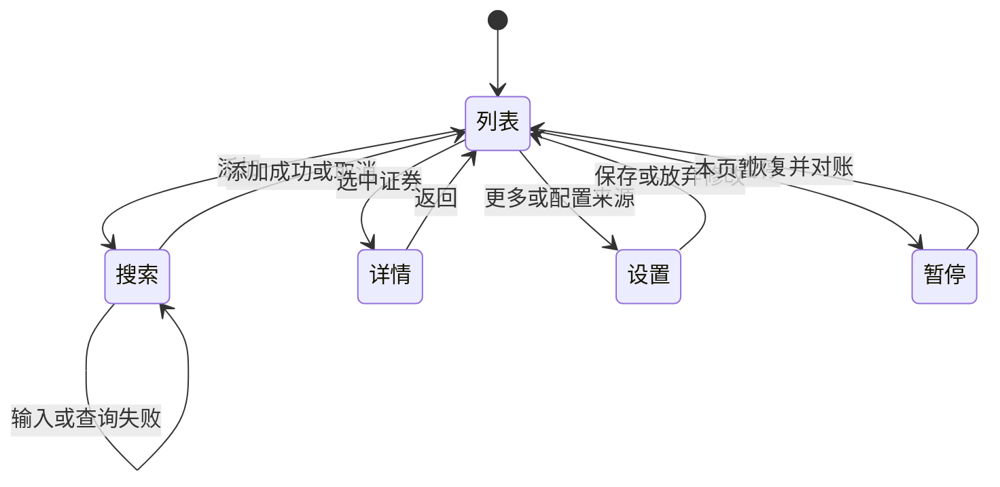
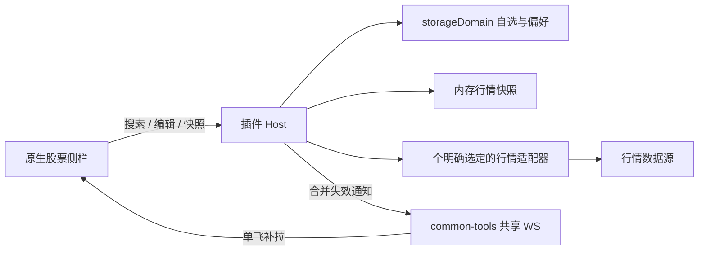

# 开源股票侧边栏插件调研与设计建议

调研日期：2026-10-28（Asia/Shanghai）。目标宿主：当前仓库对应的 DeepSeek Harness（DSH）；本机静态核查版本为 `0.2.1-rc.2`。状态：调研交付与设计提案，未实现插件、未安装或运行第三方插件。

开发交接入口：[股票单页面工具开发规格](./开发-股票侧边栏插件.md)。2026-10-29用户明确要求“单页面工具，不随不同会话销毁”，现方案为左侧导航入口+根作用域main工具页，页面运行时独立于Session。本文原生会话右栏、多pane与无会话受限的建议已被替代，仅保留作历史方案比较；不能据此实施。另一个新增要求“数据抽象、可替换与混合平台”已收敛为Provider合同、实例配置和能力路由。P0范围、挂载、生命周期与BDD以开发规格为唯一实施合同；本文保留竞品证据和可复用交互。

## 阅读导航

- 选参考项目：[DSH 比较](#dsh-开源竞品比较)、[VS Code 对标](#vs-code-开源对标)、[逐功能迁移表](#功能迁移矩阵)。
- 判断能否做到：[能力边界](#能力边界与规避方案)、[必须改宿主的情况](#必须改宿主时的最小请求)、[行情来源](#行情来源选型)。
- 画界面与写交互：[四类视图线框](#列表搜索详情设置线框)、[操作与失败路径](#完整操作流程与失败处理)、[键盘与焦点](#键盘焦点与鼠标规则)、[状态归属](#设置项和状态归属)。
- 排开发范围：[后续功能规格](#后续功能也需要提前明确交互边界)、[首期顺序](#首期范围与开发顺序)、[详细验收](#详细交互的补充验收)。
- 复核事实：[固定源码证据](#证据索引与复核边界)。外部来源的能力不等于本插件已经实现，表中迁移方案与数值默认值均为设计建议。

## 结论

建议做一个**桌面布局下与当前对话并排的原生股票侧栏**（窄屏遵循宿主全屏/收起行为）：默认显示自选名称、最新价、涨跌幅、数据状态，支持名称/代码搜索、固定顺序和局部详情。首期优先把“看一眼、加一只、查详情、回到工作”做顺，暂不加入持仓账本、资讯流、AI 研报和交易。

开源 DSH 插件已经覆盖了行情、搜索、图表、持仓、提醒。问题并不是缺功能，而是不同插件选择了浮窗、主区域页面、输入区行情条、全局皮肤等承载方式。这些方式各有用途，但与“窄侧栏长期可见、保留对话上下文”的目标有距离。**不能从这一点推导所有现有插件都不好用**；本报告把源码能证明的差异与待验证的体验假设分开。

推荐借鉴：

- **VS Code 韭菜盒子**：原生 TreeView、稳定的证券分组、少量行内操作与状态栏概览。
- **DSH stock-quotes**：自选排序、按证券映射报价、键盘展开、搜索建议、独立的图表刷新节奏。
- **DSH stock-mentions**：Host 数据归一、取消/超时/缓存的模块边界；其右侧外观实际是 overlay，不照搬成原生侧栏方案。
- **本仓库 common-tools 与宿主右侧页签**：统一事件连接、按需快照、原生布局和生命周期。

当前宿主原生右侧栏能够承载此方案，但属于会话布局：没有选中会话时不能假定可打开。左侧 `sidebar.panellist` 仅是导航图标；左侧页脚可以放紧凑入口，却没有已核实的独立全宽列表槽。**若“必须左侧常驻五行，且无会话也可看”是硬要求，应先补宿主扩展点，再实现插件。**不要通过覆盖工作区列表或修改宿主 DOM 来伪造支持。

## 范围与证据口径

用户明确要求：调研开源 DSH 插件与开源 VS Code 插件，不包含谷歌或其他浏览器扩展。

本报告使用 GitHub 开源索引发现候选，读取仓库 README、许可证和相关源码；VS Code 官方交互指南作为设计依据。公开源码不自动等于开源许可，行情接口可以请求也不自动等于有展示/分发授权。

| 标记 | 含义 | 能据此得出的结论 |
|---|---|---|
| 文档声明 | 作者 README、商店说明、数据服务官方文档 | 作者声明了什么；不能等同本次运行验证 |
| 源码核查 | 特定提交中的实际代码或本机宿主类型/实现 | 接入点、状态归属、调度、错误分支等静态事实 |
| 设计建议 | 本报告提出的取舍、默认值与验收目标 | 用于后续评审，不代表用户已经确认 |
| 未验证 | 没有安装实测、需要登录或需行情账号的部分 | 不能宣称性能、实时性、布局和兼容性已通过 |

本次打开现有 DSH GUI 后停在登录页，未进入侧栏；因此没有实际测量主题、宽度、折叠、网络请求量和使用流畅度。宿主结论基于安装源码，不能证明运行 profile 已启用所有服务。没有使用真实持仓、购买 API 或修改生产配置。

市场来源：[awesome-dsh-plugin 开源索引](https://github.com/awesome-dsh-plugin/awesome-dsh-plugin)、[dsh-market-own](https://github.com/zyf-maker/dsh-market-own)及其指向的 [dsh-catalog-merged](https://github.com/zyf-maker/dsh-catalog-merged)。前者正文核实收录了 stock-quotes、stock-view、stock-ticker、market-dock 等；另通过 GitHub 仓库搜索扩展样本。未对整个市场做穷举，也不使用安装量或星数代替体验评价。

## 从工作场景定义“舒服”

用户正在对话、读代码或写代码，看盘是短暂的附属任务。可优化的是四项成本：找到信息所需时间、切走工作所需步骤、判断数据是否可信的成本，以及界面持续占用的注意力。

| 任务 | 合适的默认行为 | 应避免的行为 |
|---|---|---|
| 看一眼自选 | 名称/价格/涨跌幅固定列；可用高度足够时至少 5 行同时可见 | 跑马灯、自动翻页、刷新重排、整行闪烁 |
| 加一只股票 | 搜名称或代码，明确市场后一次确认 | 先查代码规则、改配置文件、输错后静默消失 |
| 看一只详情 | 在侧栏内展开，返回保留焦点和滚动位置 | 默认切换主区域或弹出遮挡对话的大窗口 |
| 暂时不看 | 收起；停止无人观看的数据采集 | 隐藏了 UI 却继续重复请求 |
| 数据源出错 | 留住旧价并明确“更新失败/报价时间” | 用 0 填缺值、把请求时间当报价时间 |
| 切换 DSH 会话 | 同一份自选；页签开合遵循宿主会话布局 | 每个会话复制一份自选，或强制抢回股票页签 |

[VS Code Views 指南](https://code.visualstudio.com/api/ux-guidelines/views)建议数据使用 TreeView、少建视图、减少不必要 Webview、每项不超过三个操作；[Quick Picks 指南](https://code.visualstudio.com/api/ux-guidelines/quick-picks)强调简短的筛选与选择流程；[Status Bar 指南](https://code.visualstudio.com/api/ux-guidelines/status-bar)要求克制使用状态栏条目。这些是可迁移的交互原则，DSH 不需要仿造 VS Code 的全部 API。

## DSH 开源竞品比较

下表中的“差距”针对本报告的常驻窄侧栏目标，不是产品总体质量排名。具体源码基线见后文。

| 项目与许可证 | 承载方式与能力 | 值得借鉴 | 与目标的差距或核查限制 |
|---|---|---|---|
| [AhaCrazy/dsh-stock-quotes](https://github.com/AhaCrazy/dsh-stock-quotes)，MIT 已读 | `sidebar.panellist` 入口 + `main` 页面；自选、搜索建议、拖拽/菜单排序、分时小图、Agent 工具 | 稳定证券身份、手动顺序与排序视图分离、键盘展开；最接近列表交互目标 | 主要内容占主区域；自选在浏览器 localStorage，Agent 默认自选另在配置，存在两个真源；README 搜索支持章节与“不支持中文名称搜索”旧段落冲突，不能全盘照抄 |
| [Bob-Bo1/dsh-stock-watch](https://github.com/Bob-Bo1/dsh-stock-watch)，MIT 已读 | 左下角入口打开固定定位弹出面板；持仓/自选、Host 搜索与本地 JSON 保存 | 添加/编辑操作完整；页面不可见暂停报价请求；失败保留上一组数据 | 侧栏入口不等于常驻列表；报价由浏览器直接请求腾讯；持仓快照额外每 10 秒轮询，不符合本仓库空闲请求约束 |
| [Awu12277/dsh-stock-watch](https://github.com/Awu12277/dsh-stock-watch)，MIT 已读 | 可拖拽、折叠的胶囊/浮窗，行情与图表 | 快速展开、折叠及可保存位置 | 源码展开按 10 秒、折叠按 30 秒刷新，折叠并不停止；搜索有 200ms 防抖，但未见该路径请求序号/取消保护；浮窗遮挡程度需实测 |
| [AnacondaKC/dsh-stock-market](https://github.com/AnacondaKC/dsh-stock-market)，BSD-3-Clause 已读 | document.body 挂载 React 侧栏并用 CSS 压缩原布局；多项 Agent 工具 | 隐藏页面取消请求、失败退避；看盘与工具结合 | 没走原生侧栏插槽，布局耦合宿主页面；不直接迁移挂载方式 |
| [linhut/dsh-stock-terminal](https://github.com/linhut/dsh-stock-terminal)，自述 Apache-2.0，许可文本待澄清 | 全局交易终端皮肤、底面板、跑马灯、持仓 | 面板搜索的请求序号防竞态；跨市场信息组织 | 改全局视觉超出本需求；README 残留 MIT/旧版本/旧包名，LICENSE 又为删简 Apache 文本。归为源码可见候选，澄清前不纳入可直接复制的开源代码池 |
| [LisonEvf/dsh-stock-panel](https://github.com/LisonEvf/dsh-stock-panel)，MIT 已读 | `conversation.view` 股票工作台；复盘、选股、分析；源码默认启用 embedded 数据链路 | SWR 去重、隐藏页停轮询、研究模块组织 | 占满会话区；README“无内置端点、需自配”与默认连接源码不符。名称搜索发现完全同名被排除的静态分支，需修正验证 |
| [mingzeng21/dsh-stock-mentions](https://github.com/mingzeng21/dsh-stock-mentions)，MIT 已读 | 助手回答操作区股票按钮 + `shell.overlay` 右侧行情详情；分时/K线/资讯 | 唯一证券确认、数据归一、请求控制、只发送候选证券 | 没有自选列表；依赖回答中出现证券；右侧视觉不是原生 sidebarRight 页签 |
| [3930a/dsh-stock-watch](https://github.com/3930a/dsh-stock-watch)，MIT 已读 | `conversation.composer.dock` 常驻横向行情带；代码添加、删除、文件同步 | 常驻且紧凑，操作路径短 | 六位纯代码输入；主要操作悬停显示；浏览器默认 3 秒 setInterval；异步请求可能重叠，不能直接移植调度 |
| [xxxSnack/dsh-market-dock](https://github.com/xxxSnack/dsh-market-dock)，MIT 已读，衍生自 dsh-xueqiu | 输入区上方多页行情面板、overlay 徽标、指数条；持仓和提醒 | 明确“隐身”与恢复路径；显示功能与 Host 提醒分开 | 三处 UI 和持仓/资讯/工具扩大范围；README 的“零请求”必须限定为被卸载的 UI 轮询，Host 提醒仍可能取行情；节假日日历未覆盖 |

### 最有价值的源码发现

**侧栏按钮不等于侧栏内容。** Bob-Bo1 版本在 `sidebar.footer.action` 挂按钮，内容使用 `position: fixed`、292px 面板；stock-quotes 是主区域 `main`；stock-mentions 是 `shell.overlay`。它们分别解决快速弹出、完整数据页和回答联动，无法直接证明已经解决“与对话并排常驻”。

**刷新通常停留在组件级。** Bob-Bo1 的报价刷新检查 `document.visibilityState`，这是有用的节能处理，但另有持仓轮询；3930a 的报价更新是 `setInterval(load, ms)`，卸载会清理 timer，但已发请求依赖 alive 标记忽略结果，未见该段采用单飞调度。新插件应该从 Host 汇聚同一市场的请求，避免多个组件/页面按股票数量成倍增加上游访问。

**可以定位到影响体验的具体代码。** 以下为静态发现，未通过安装运行复现：

| 项目 | 固定提交源码 | 观察与影响 |
|---|---|---|
| Awu stock-watch | [刷新节奏](https://github.com/Awu12277/dsh-stock-watch/blob/ea922597583d339f4e0fba0facae95b5a127d004/client.js#L1198)、[搜索](https://github.com/Awu12277/dsh-stock-watch/blob/ea922597583d339f4e0fba0facae95b5a127d004/client.js#L1317) | 展开 10 秒、折叠 30 秒；搜索防抖没有取消已经发出的请求，旧词结果可能晚到覆盖新词 |
| stock-market | [body 挂载](https://github.com/AnacondaKC/dsh-stock-market/blob/02278af12330102c534c843a668d1c8407dbde1b/src/client/index.ts#L89)、[调度](https://github.com/AnacondaKC/dsh-stock-market/blob/02278af12330102c534c843a668d1c8407dbde1b/src/client/StockMarketView.tsx#L305) | 非原生侧栏；但链式 timeout、在途守卫、隐藏页 abort 是值得保留的机制 |
| stock-terminal | [面板搜索](https://github.com/linhut/dsh-stock-terminal/blob/a11b6b5d78edb2d1ad59da7cb598d25c94acae6a/lib/client.js#L1488)、[Host 缓存](https://github.com/linhut/dsh-stock-terminal/blob/a11b6b5d78edb2d1ad59da7cb598d25c94acae6a/lib/index.js#L50) | 面板以请求序号防乱序、Host Promise 缓存去重；其他设置入口不能据此一概认为有相同保护。许可澄清前只参考机制 |
| stock-panel | [搜索评分](https://github.com/LisonEvf/dsh-stock-panel/blob/c8bfc6e40d79841f37284abb1ec82bc262288d89/src/lib/market.ts#L283) | 名称包含先记 1，完全同名又设为 -1，最后只收非负项，完整名称被排除；这是需要修正的确定分支逻辑 |
| stock-panel | [默认 embedded](https://github.com/LisonEvf/dsh-stock-panel/blob/c8bfc6e40d79841f37284abb1ec82bc262288d89/src/lib/endpoints.ts#L78)、[连接](https://github.com/LisonEvf/dsh-stock-panel/blob/c8bfc6e40d79841f37284abb1ec82bc262288d89/src/host/tdx-data.ts#L157)、[内置端点](https://github.com/LisonEvf/dsh-stock-panel/blob/c8bfc6e40d79841f37284abb1ec82bc262288d89/src/host/vendor/opentdx.js#L2713) | 实际存在默认行情端点，选型时不能按 README“全部由用户配置”估算部署方式 |

**文档会比源码更乐观。** stock-quotes 的“名称搜索支持/不支持”两处冲突说明 README 不能替代功能验证；其[搜索实现](https://github.com/AhaCrazy/dsh-stock-quotes/blob/b400f6fbe8771e8baa18fe9fd6e4bb48733ff779/client.js#L1418)已核有名称索引、180ms 防抖与取消标记。market-dock 的隐藏仍保留提醒也说明“零请求”需要拆分 UI 与后台作业。这些不是否定项目，而是选型时必须验证的边界。

**复用还要检查包的副作用与第三方许可。** Awu 的 [Host 初始化](https://github.com/Awu12277/dsh-stock-watch/blob/ea922597583d339f4e0fba0facae95b5a127d004/index.js#L37)会向用户技能目录复制附带技能，未见卸载回收副本，不宜作为单纯 UI 组件整体安装。其根 MIT 不覆盖附带技能的全部许可；market-dock 的 [第三方声明](https://github.com/xxxSnack/dsh-market-dock/blob/0a3eb0958c63e3f7464ae5ef6cbc73e6def17a24/THIRD-PARTY-NOTICES.md)另涉及图表组件许可。market-dock 与上游 dsh-xueqiu 复用工具名，作者明确不建议同时启用；本轮未安装二者。

## VS Code 开源对标

| 项目与许可证 | 已核查行为 | 适合迁移的经验 | 不应照搬的部分 |
|---|---|---|---|
| [LeekHub/leek-fund（韭菜盒子）](https://github.com/LeekHub/leek-fund)，BSD-3-Clause 已读 | 原生 stock TreeView；按市场分组；排序配置；名称/代码搜索数据层；状态栏、详情等文档能力 | 在宿主列表范式内承载数据；证券身份稳定；涨跌排序与默认顺序明确 | 当前 README 把自定义分组/拖拽归 Pro，不可写作免费能力；多资产、资讯、AI、持仓不属于本次首期 |
| [Chef5/stock-bar（Stocks Bar）](https://github.com/Chef5/stock-bar)，MIT 已读 | 状态栏 + hover；QuickPick 接受选择；`showInputBox` 输入代码；默认 10 秒刷新；stop 清理 timer 和渲染 | 少量数据常驻、显式显示/隐藏、重复添加提示 | 商店的 Search Stock 并不证明中文名模糊搜索，所查源码入口要求代码；ticker catch 只记录日志，不能据此宣称用户看得到行情过期 |
| [roblourens/vscode-stocks](https://github.com/roblourens/vscode-stocks)，MIT 已读 | 状态栏按配置顺序展示；60 秒更新；可选涨跌颜色 | 简洁、固定顺序、低视觉负担 | 静态源码使用旧 IEX URL；定时器未登记清理，deactivate 为空；接口当前可用性未验证。仅作交互历史对照，不作新实现数据层基线 |

另查 [TDGarden/stock-watch](https://github.com/TDGarden/stock-watch)：公开仓库的根目录未找到独立 LICENSE，GitHub license API 返回 404。README 明确 10 秒刷新、代码配置和 `[9,15]` 显示时段，但没有足够证据将其作为许可证已确认的开源复用来源。因此只保留谱系背景：Stocks Bar 自述从该项目 fork，推荐复用仍以明确许可的仓库及实际文件归属为准。

对标重点不是“VS Code 所有股票插件都更好”。真正可迁移的是原生列表、键盘选择、信息密度、固定位置与克制的入口；其旧数据 API、粗糙时段判断、异常处理仍需重新设计。

## 新建还是基于现有插件修改

| 方向 | 优点 | 代价 | 建议 |
|---|---|---|---|
| 整体 fork stock-quotes | 自选、搜索、排序、图表交互较齐 | 需把主区域改原生侧栏，并统一浏览器/Agent 两份自选、数据请求及仓库规范 | 不作为默认方案；若未来明确必须首期具备完整分时图，可重新评估 |
| 整体 fork 浮窗/终端型插件 | 很快拥有完整行情功能 | 其布局、样式、状态和业务范围与窄侧栏目标不同 | 不推荐作为基础 |
| 新建一个小型 DSH 双半区插件，参考开源实现 | 直接满足原生侧栏和本仓库事件/主题约束，范围可控 | 需要实现自选与一个行情适配器 | **推荐**。可复用已验证算法/交互，但迁入代码时保留对应许可与署名 |

建议候选包名 `@mzzsfy/dsh-stock-sidebar`；这是命名提案，本轮不创建 package。优先复用宿主 React、已有 common-tools、storageDomain，不新增状态管理框架、专用数据库或共享 UI 包。图表进入第二阶段才选择维护良好的图表库。

## 逐功能参考清单：应该抄什么，如何迁移

这里的“抄”分三种：**借鉴交互**（保留用户动作与结果，重新实现）、**改写模块**（有明确许可且合同匹配时迁移局部逻辑）、**直接复用公共能力**（使用本仓库已经维护的依赖）。不建议复制整个插件。表中 P0 是第一版核心，P1 是核心稳定后的体验增强，P2 是有明确需求才进入的扩展；后三者是设计分期，不代表本轮实现承诺。

### 参考优先级与阅读顺序

| 优先级 | 参考项目 | 重点阅读 | 本项目应获得的结果 | 明确不带入 |
|---|---|---|---|---|
| 首选交互基线 | [DSH stock-quotes](https://github.com/AhaCrazy/dsh-stock-quotes/tree/b400f6fbe8771e8baa18fe9fd6e4bb48733ff779) | [列表、刷新、搜索所在 client](https://github.com/AhaCrazy/dsh-stock-quotes/blob/b400f6fbe8771e8baa18fe9fd6e4bb48733ff779/client.js) | 一张稳定、可键盘操作的自选列表，渐进显示详情 | main 页面挂载、UI/Agent 两份自选、浏览器直连行情、未归属的全局样式 |
| 原生体验基线 | [VS Code 韭菜盒子](https://github.com/LeekHub/leek-fund/tree/425bc79484218064e4ecdb1dea272733befabbd4) | [StockProvider](https://github.com/LeekHub/leek-fund/blob/425bc79484218064e4ecdb1dea272733befabbd4/src/explorer/stockProvider.ts)、[视图注册](https://github.com/LeekHub/leek-fund/blob/425bc79484218064e4ecdb1dea272733befabbd4/src/extension.ts#L87) | 原生布局、固定行、熟悉的菜单与折叠行为 | VS Code TreeView API 本身、Pro 能力假定、所有资产类别和资讯面板 |
| Host 数据边界参考 | [DSH stock-mentions](https://github.com/mingzeng21/dsh-stock-mentions/tree/5bee3468681cfc8a54bb8f117e889c4c6c790e0c) | [数据服务](https://github.com/mingzeng21/dsh-stock-mentions/blob/5bee3468681cfc8a54bb8f117e889c4c6c790e0c/src/stock-api/service.ts)、[请求控制](https://github.com/mingzeng21/dsh-stock-mentions/blob/5bee3468681cfc8a54bb8f117e889c4c6c790e0c/src/stock-api/request-control.ts) | UI 不感知供应商字段，错误与取消可解释 | overlay 挂载、只识别助手回答的产品入口、多源无声切换 |
| 生命周期参考 | [DSH stock-market](https://github.com/AnacondaKC/dsh-stock-market/tree/02278af12330102c534c843a668d1c8407dbde1b) | [可见性与调度](https://github.com/AnacondaKC/dsh-stock-market/blob/02278af12330102c534c843a668d1c8407dbde1b/src/client/StockMarketView.tsx#L305) | 取消、退避、停止与恢复有统一定义 | document.body 自建侧栏、修改宿主布局变量、总览业务与全部工具 |
| 稳定核心后的参考 | [DSH market-dock](https://github.com/xxxSnack/dsh-market-dock/tree/0a3eb0958c63e3f7464ae5ef6cbc73e6def17a24) | [订阅聚合](https://github.com/xxxSnack/dsh-market-dock/blob/0a3eb0958c63e3f7464ae5ef6cbc73e6def17a24/client/store/market.js)、[提醒](https://github.com/xxxSnack/dsh-market-dock/blob/0a3eb0958c63e3f7464ae5ef6cbc73e6def17a24/lib/alerts.js) | 多消费者合并、明确暂停语义、后续提醒去重 | 三处行情 UI、继承上游工具名/状态目录、Cookie 登录与账本整套流程 |
| 小而明确的交互参考 | [VS Code Stocks Bar](https://github.com/Chef5/stock-bar/tree/420ca61a4f9485452cfa55e2dd7704654eb98391) | [Controller](https://github.com/Chef5/stock-bar/blob/420ca61a4f9485452cfa55e2dd7704654eb98391/src/StockBarController.ts) | 重复添加提示、显式停止、选择确认 | 代码专用输入框、只记日志的失败反馈、timer 直接驱动 UI 请求 |

这些文件是阅读入口，不代表已经确认可以原样抽出所有模块。直接复制代码前，应逐文件检查其依赖、版权头、测试、来源字段与上游合同；保留原许可和必要署名，记录固定提交及改动。独立设计的交互可以借鉴，不能借此把未审过的整个仓库许可和第三方依赖都视为已通过。

### 功能迁移矩阵

| 功能/优先级 | 应参考谁、抄哪部分 | 本插件具体做法（均为提案） | 不照搬什么/限制 | 验收要点 |
|---|---|---|---|---|
| 原生看盘侧栏 / P0 | 韭菜盒子原生视图理念；DSH 宿主页签范例 | 左侧紧凑入口打开唯一股票 kind；默认不抢视图 | 不复制 TreeView API；不向 body 插自建侧栏 | 桌面并排、原生拖宽/关闭、无会话提示 |
| 自选行 / P0 | stock-quotes 证券身份映射、韭菜盒子紧凑列表 | `securityId` 作稳定 key；名称/价格/涨跌幅主列 | 不用数组下标绑定价格，不复制宽表全部列 | 更新后股票与价格不串位 |
| 添加搜索 / P0 | stock-quotes 建议列表与取消标记 | Host 统一搜索；本地索引先返回，远程补全；300ms 防抖 | 不沿用会等待远程完成才一起返回的路径 | 中文输入、旧查询迟到、无结果均可用 |
| 市场消歧 / P0 | stock-mentions 唯一确认原则 | 名称/代码候选显式标交易所与品种 | 不采用“先命中者胜出” | `000001` 不误添指数或股票 |
| 重复添加 / P0 | Stocks Bar 已存在提示 | 标准 id 去重；服务端幂等写入 | 不只按显示名称判断 | 两页面同时添加仍一条 |
| 自选持久化 / P0 | stock-panel 的 Host 域方向、Bob Host 写入流程 | 一份宿主自选；revision 冲突显式处理 | 不复制 localStorage 作为第二权威源 | 刷新、重启、换会话一致 |
| 单行编辑/删除 / P0 | Bob 的编辑流程，stock-quotes 行菜单 | 菜单删除 + 8 秒撤销；P0 只允许显示别名，不修改标准证券身份 | 不要求编辑持仓，不覆盖整份列表来撤销 | 删除错误可恢复；并发撤销不抹别人修改 |
| 手动顺序 / P0 | stock-quotes 上移/下移/置顶菜单 | 首期菜单移动、置顶区；稳定顺序保存 Host | 拖拽不作为唯一入口 | 纯键盘可完成，刷新不换位 |
| 涨跌排序 / P0 | 韭菜盒子排序切换、stock-quotes 视图排序 | 单击降序、再升序、再手动；仅排序视图不写手动顺序 | 不让编辑操作在滚动变化中打到别的行 | 菜单打开时冻结行序，关闭后重新计算；焦点始终跟随securityId，连续键盘导航期间延后重排，失焦后再应用 |
| 基础详情 / P0 | stock-mentions 详情分层 | 侧栏内替换正文；显示现价/昨收/高低/来源时间 | 不先堆 16 格指标、资金流与资讯 | 返回保留焦点/滚动，缺字段不伪造 |
| 请求取消/去重 / P0 | stock-market 调度、market-dock 订阅聚合 | Host 单飞批量采集；取消闲置任务；UI 只订阅失效 | 不用每行 timer，不复制页面各自抓行情 | 多窗口不成倍打同一源 |
| 更新失败 / P0 | Bob 保留旧价；stock-mentions 错误归一 | 行情、请求健康、市场状态分别记录 | 不用红色全屏报错替代可读旧值 | 一行失败不影响其他股票 |
| 主题与密度 / P0 | 韭菜盒子原生一致性 | 服从本仓库 token；数字等宽；无外链字体 | 不复制终端皮肤或硬编码涨跌红绿到所有控件 | 亮暗主题、焦点、字号通过 |
| 暂停看盘 / P0 | Stocks Bar stop、market-dock 卸载语义 | 关闭最后可见消费者停采集；显式暂停为本页面行为 | 不把折叠 30 秒继续抓取称停止 | 停采集时旧值标暂停，不标在线实时 |
| 拖拽排序 / P1 | stock-quotes 手柄及落点 | 只从手柄开始；保留菜单移动；完成才持久化 | 不拖整行，不能挤掉触屏滚动 | 取消拖拽无写入，失效 revision 不覆盖 |
| 自定义分组 / P1 | 韭菜盒子的分组行为描述、Awu 组配置思路 | 数据实体与组成员分开；组内独立顺序，支持同证券多组 | 不把 Pro 功能当可直接免费复制的模块 | 删组不删证券，不改变其他组 |
| 导入/导出 / P1 | stock-quotes 的 JSON 导入导出格式；预览是本方案新增 | JSON/逐行代码预览，去重，整批提交 | 不导入来源密钥、持仓、任意 URL；不复制浏览器单点存储 | 无效项可见，失败不半写 |
| 分时迷你图 / P1 | stock-quotes 独立刷新与完整交易轴 | 默认关；只对可见行按预算请求；报价与图不共用错误状态 | 不把剩余交易时间拉伸，不把断档补成直线 | 午休/缺点/当天未开盘可解释 |
| 个股大图 / P1 | stock-mentions 图表层、stock-quotes 十字线 | 详情内按需加载；读数放独立历史游标区 | 不让 hover 历史价冒充列表当前价 | 时间、币种、复权口径可见 |
| 后台提醒 / P2 | market-dock Host watcher | 独立任务、价格穿越触发、去重、明确运行前提 | 不承诺隐藏/关浏览器/退出 DSH 后都一样运行 | 旧价不触发；重启不重复补发 |
| Agent 查行情 / P2 | stock-quotes 工具、stock-mentions 证券确认 | 读同一自选与快照；输出来源与报价时间 | 不另放工具专属默认自选；不默认把会话原文发上游 | UI 与工具同标的同口径 |
| 对话股票快捷入口 / P2 | stock-mentions 完成回答操作区 | 只读候选确认后打开同一原生股票页签 | 不 DOM 改写 Markdown、不扫工具/思考/未完成流 | 无唯一匹配不生成误导按钮 |
| 持仓/盈亏 / P2 低优先 | Bob 简单成本模型 | 若做，单列“估算盈亏”口径与币种 | 不把简式收益称真实账户总收益 | 成本/股数/费用/复权缺项明示 |
| 常驻状态摘要 / P2 | Stocks Bar、韭菜盒子状态栏 | 只在宿主有合适槽位时允许最多一个标的摘要 | 不新增滚动行情带和多重入口；折叠隐藏以宿主为准 | 摘要隐藏不留下额外消费者 |

### 本轮明确不抄的设计

不整体引入全局股票皮肤、闪烁跑马灯、自动打开的大面板、鼠标悬停才出现的唯一添加入口、浏览器里的第二份自选、任何占位 `0.00` 行情、硬编码工作日当交易日、复制技能到用户目录、手工改生产 profile 的安装脚本。不要把“接口暂时可访问”包装为产品实时保证，也不要把 MIT/BSD 根许可当作图表、技能、字体等所有附带内容的许可。

## 能力边界与规避方案

### 先区分四种限制

- **当前宿主做不到**：在不改变宿主合同的前提下，没有相应扩展点或全局布局能力。
- **依赖条件才能做到**：数据授权、时序接口、交易日历、运行中的 Host 或额外服务就绪后才成立。
- **不能保证**：网络、上游服务、浏览器后台策略等使结果无法作绝对承诺，必须提供状态与恢复路径。
- **技术可做但本期不做**：分组、图表、提醒、持仓等是范围选择，不能伪称宿主禁止。

### 限制—影响—规避—剩余代价

| 想要的能力 | 限制类别与真实原因 | 推荐规避/替代 | 仍然不能保证什么 |
|---|---|---|---|
| 左侧全宽常驻五行，不影响会话列表 | 当前核查未见独立全宽内容槽；页脚默认横排 | 首版原生右侧；如果左侧是硬需求，先向宿主补独立 list 内容槽和高度/滚动合同 | 只改插件不能保证多页脚插件共存；不采用 CSS 劫持 |
| 没有会话也打开原生右侧股票栏 | sidebarRight 依附 Session | P0 明确提示进入已有会话；未来独立主页面可提供全局查看，但作为可选入口 | 全局页面与并排看盘不是同一体验；不悄悄创建会话 |
| 手机上同时保留完整聊天和行情 | 宿主窄屏转全屏；可用空间有限 | 原生全屏股票页 + 返回聊天；列表少列 | 不能同时保证两块完整内容可见 |
| 所有股票永久可见、一个侧栏放所有指标 | 视口与阅读密度有限 | 重要列常驻，详情按需；超过视口滚动、P1 分组 | 无限自选不滚动与可读字号不能同时成立 |
| 把 VS Code TreeView 直接搬进 DSH | 两宿主 API 和视图生命周期不同 | 借鉴行为，用 DSH React/slots 重写；单层自选无需仿制完整树框架 | 原生快捷键/右键菜单不会自动继承 |
| 自动恢复每个会话中的股票页签并一直抢先显示 | 宿主布局按会话管理，也可能有其他页签 | 只遵循宿主已有恢复；用户主动打开；全局自选独立于布局 | 切换新会话时不保证股票页签自动出现 |
| 免费、全市场、秒级、无限额行情 | 未找到同时支持这些条件的可核验来源 | 选一市场一来源，公开时效/额度；额度不足降低频率或升级授权 | 不能凭缓存/批处理突破计费权重和交易所权限 |
| 真实逐笔、完整盘口或委托深度 | 快照接口与专业实时权限不同 | 首期展示快照；有明确订阅权限再单独接逐笔/盘口 | 15 秒快照不能复原期间每笔成交 |
| 每次成功请求都得到最新成交 | 上游缓存/延迟、停牌、稀疏交易 | 同时展示 quoteAt/receivedAt/marketState；延迟未知时如实标记 | 不保证报价与交易所终端同一毫秒一致 |
| 历史分时图用实时快照自动补全 | 采集期间缺点、重启、午休与收盘会丢历史 | 采用独立历史分时接口；没有接口时关闭图表能力 | 不能把零散采样伪装为完整市场分时 |
| 所有源故障时无感自动切换 | 字段、延迟、复权、币种、证券映射口径不同 | P0 一个来源；未来显式切换整套报价并标来源，保留切换记录 | 不能拼主源价格和备用源昨收算可信涨跌 |
| 同时两个来源价格完全一致 | 成交所/聚合覆盖/时间不同 | 每组指标来自同一来源同一快照；详情允许比较但不合并 | 不能保证跨源点位/板块成分一致 |
| 只凭代码猜对每一只证券 | 多市场代码冲突，指数/股票同码 | 已持久化标准 id；新增时让用户选交易所/品种 | 无索引或唯一证据时不能可靠自动补市场 |
| 离线仍可新增所有证券并看最新行情 | 离线只剩已知索引与缓存 | 本地筛选已有自选；显示离线缓存；允许保存已验证候选 | 不能声称离线数据实时，也不能验证未知新股 |
| 开源发布后所有人共用一个个人 API Key | 数据许可与账号范围限制 | 每个使用者按条款配置；团队选相应合同；密钥只在 Host | BYOK 本身不解决团队展示权 |
| 从 localStorage 自动同步所有设备 | 浏览器存储不是 Host 持久化 | 单个 Host 的自选统一存储；不同设备连接同 Host 可同步 | 不同 Host、不同 profile 不自动跨端同步 |
| 同一共享 profile 下每个人私有持仓 | 当前提案是单人 profile，不具备用户级数据隔离 | 多人需求先定义宿主身份/存储作用域；个人用独立 profile | 不能把插件内自设 token 当宿主账户隔离替代 |
| 隐藏后完全零请求，同时后台到价提醒 | 两个目标矛盾，提醒需要继续取价 | P0 无提醒，隐藏最后消费者停采集；P2 把提醒采集独立展示和开关 | 启用提醒就不能声称全插件零行情请求 |
| 浏览器关闭后继续提醒 | 前端无运行环境，但 Host 可以仍运行 | P2 Host 提醒；通知通道另外验证 | DSH Host 退出后仍不工作；浏览器通知不保证离线送达 |
| DSH 退出或机器休眠后还秒级提醒 | 本地运行时停止/休眠 | 不承诺；需要常驻服务与授权数据，作为独立部署需求 | 插件本身不能绕过机器停机 |
| 上游挂了但界面始终显示“实时” | 无数据就无法制造新报价 | 留旧值，显示失败/未知/休市、提供恢复 | 重试只能恢复请求，不能承诺上游可用 |
| 无限扩展自选而资源保持不变 | 网络配额、渲染、图表订阅成本随数量增加 | P0 产品上限建议 100 只，来源额度更小则更低；分组不绕过总量限制 | 虚拟列表只降低渲染，不降低整份行情采集成本 |
| 一次解析兼容所有券商持仓/交易记录 | 文件与收益口径不同，敏感字段多 | P1 只导入自选；持仓独立定义显式模板 | 不能声称自动还原真实账户收益 |
| 未来所有 DSH 版本都兼容 | API 处于变化中 | 点分依赖门控、缺能力干净禁用；升级回归并声明核查版本 | 不承诺未经验证的旧/新宿主完整可用 |
| 所有第三方开源代码可以原样复制 | 许可、附带资源、依赖和打包产物不同 | 锁提交，逐文件审查归属与 NOTICE，必要时只借鉴行为 | terminal 许可冲突澄清前不纳入复制来源 |

### 必须改宿主时的最小请求

如果最终坚持左侧常驻，建议向宿主提出一个独立的侧栏内容扩展合同，而不是要求股票插件掌管整块左栏。建议合同包含：多插件列表式注册、优先级/标题、wide/compact 可用宽度、最大高度、滚动归属、折叠与当前可见性、卸载 disposer、键盘可达的入口，以及无 Session 时仍可呈现的声明。**这些是需要新增的能力，不是当前已有的槽位名称。**

宿主未提供前，左侧页脚只承担一个紧凑入口。不能采用更换 sidebar.workspaces、依赖内部 CSS 类名、改 body 宽度、注入透明悬浮层占位的办法；这些手段在主题、窄屏、其他插件或宿主升级时缺乏稳定合同。

## 交互设计提案

### 默认视图

在宿主允许并排的桌面布局下，右侧栏建议初始内容宽度约 320px，服从宿主实际可用宽度；280px 与 360px 作为后续布局验收点。当前宿主 viewport 小于 768px 时会转全屏，既有全屏布局也会保留；push 布局空间不足可能收起侧栏，依据[右侧栏布局实现](<C:/Users/yuanhao/AppData/Roaming/nvm/v24.14.1/node_modules/@deepseek-ai/dsh/node_modules/@deepseek-ai/dsh-client-ui-sidebar-right/lib/client.js#L1457>)。插件遵循宿主行为，窄屏不承诺对话与行情同时可见，提供原生返回路径。默认固定手动顺序，可置顶、上移/下移；涨跌排序由用户显式启用，开启后标明排序状态。列表行情刷新不自动改变手动顺序。

完整的列表、搜索、详情和设置线框见本节后文；所有线框数值均为演示数据。

正文/数字按本仓库字号与 token 规范，不引入独立字体和卡片配色。行高按 32px 量级，名称及市场信息按可用宽度压缩；窄于 280px 时优先收起辅助信息，不隐藏名称与涨跌幅、不出现整栏横向滚动。数字等宽并右对齐，正负号始终保留，不能只靠红绿。默认红涨绿跌，提供反转偏好；行情涨跌色与服务故障状态语义分开。

### 搜索、增删与排序

- 搜索入口保持可见，支持名称与代码；拼音只有证券索引确实提供时才宣传。远程搜索建议防抖 300ms；新查询取消旧请求或用请求代次丢弃迟到结果。
- 候选项显示“名称 + 标准代码 + 交易所 + 品种”。例如 `000001` 存在指数/股票歧义时必须选择，不用“第一个命中”静默替用户决策。
- Enter 确认、方向键选择、Esc 关闭并还焦点；已添加项显示“已在自选”且不重复写入。首期单一自选列表足够。
- 删除通过行菜单执行，完成后提供短时撤销；不把删除按钮永久铺满每行。键盘能进入菜单，不能仅悬停可达。
- 排序先做置顶、上移、下移和菜单操作；拖拽作为后续增强，不能成为唯一排序路径。显式行情排序启用时暂停手动拖拽，并告知先取消排序。
- 行详情默认在侧栏内显示基础行情与时间来源；Esc/返回恢复原列表位置。首期不依赖分时/K线接口。

### 空态与异常状态

| 状态 | 用户看见什么 | 操作 |
|---|---|---|
| 无自选 | “添加一只股票开始查看” | 一个主按钮打开搜索 |
| 未配置数据源 | “配置行情来源后开始查看” | 打开配置；不预装看似真实的演示行情 |
| 初次加载 | 固定行骨架或行内加载状态 | 不用整个面板反复重建 |
| 部分证券失败 | 失败行显示 `—` 或旧价 + 状态，其余正常更新 | 行内查看原因/重试 |
| 请求失败、有缓存 | 保留旧价，标“更新失败”与报价时间 | 手动刷新，受配额限制 |
| 已知延迟行情 | 常驻显示“延迟 N 分钟” | 不因刚请求成功而取消延迟标记 |
| 来源时效未知 | 显示“延迟未知/时间未知” | 不显示“实时” |
| 午休/休市/停牌 | 显示明确状态及最后交易时间 | 不因不变价判定故障；不以零代替缺值 |
| 未选 DSH 会话 | 左侧入口提示“进入会话后打开股票侧栏” | 不偷偷创建会话或切换主区域 |

### 信息架构与页面层级

只注册一个股票 kind，内部是“列表 / 搜索 / 详情 / 设置”四种页面状态。宿主默认仅在目标 pane 内去重，允许在不同 pane 或浮动面板中保留股票副本，因此不承诺整个会话严格单实例。P1 再加分组管理和导入预览；插件不主动为每只股票新建宿主页签。同一浏览器页面的多个副本共用自选、报价缓存和“暂停本页”状态；各自的搜索词、当前详情、滚动位置独立。关闭一个副本不撤销其他仍可见副本的行情需求。标题栏始终保留清晰的返回位置；列表、详情各自保存滚动位置。宿主自己的关闭、停靠、拖宽、全屏按钮由宿主管理，插件不重复画一套。

```text
宿主股票页签
├ 自选列表（默认）
│ ├ 添加搜索 → 候选 → 添加成功 → 自选列表
│ ├ 点击股票 → 基础详情 → 返回原行
│ ├ 行菜单 → 置顶 / 移动 / 别名 / 移除
│ └ 更多 → 排序 / 暂停本页 / 设置
├ 设置 → 来源状态 / 刷新偏好 / 显示偏好
└ P1：组管理、导入预览、图表设置
```

“搜索自选”和“添加股票”不能用一个无提示输入框混在一起：列表过滤只搜索已经添加的项目，零结果显示“自选中未找到”；添加页面搜索数据源证券库，零结果显示“未找到可添加的证券”。P0 只提供添加搜索，避免多一个筛选框占空间；P1 自选较多时再加清晰标注的“筛选自选”。

### 列表、搜索、详情、设置线框

以下是布局示意，所有证券与数字均为演示值，按钮文字也代表可访问名称。

```text
自选列表：320px 内容宽度
┌ 股票 · 自选 8        [添加] [刷新] [更多] ┐
│ 手动顺序                            [排序]│
├──────────────────────────────────────────┤
│ 名称与代码             现价        涨跌幅 │
│ 示例甲 SH 600001       12.34       +1.20%  │
│ 示例乙 SZ 000002        8.56       -0.80%  │
│ 示例丙 SH 600003          —        无数据 │
│ ……列表滚动，标题与底栏不滚动……             │
├──────────────────────────────────────────┤
│ 更新失败 · 保留上次报价         [查看原因] │
│ 来源 某源 · 延迟未知                       │
│ 当前快照获取于 14:30:10                    │
└──────────────────────────────────────────┘

添加股票
┌ [返回] 添加股票                          ┐
│ 名称或代码                               │
│ [茅台__________________________] [清空]   │
│ 当前范围：沪深股票                         │
├──────────────────────────────────────────┤
│ 贵州茅台                 600519 · 上交所  │
│ 示例同名证券             000099 · 深交所  │
│ ……候选最多显示前20项，继续输入缩小范围……    │
├──────────────────────────────────────────┤
│ [已选候选完整名称及代码]          [添加]   │
└──────────────────────────────────────────┘

基础详情
┌ [返回自选] 示例甲                 [更多] ┐
│ 600001 · 上交所 · CNY                    │
│ 12.34              +0.15       +1.20%   │
│ 交易中 · 来源 某源 · 延迟未知              │
│ 今开 12.10   昨收 12.19                  │
│ 最高 12.50   最低 12.00                  │
│ 报价时间 2026-10-28 14:30:05 +08:00      │
│ 获取时间 2026-10-28 14:30:10 +08:00      │
│ [复制代码]                      [刷新]   │
│ P1 才显示：分时 / 日K，以及明确口径        │
└──────────────────────────────────────────┘

设置（侧栏内表单）
┌ [返回] 股票设置                          ┐
│ 行情来源：某源               [检查连接]   │
│ 凭据：已配置（不回传原文）      [更换]      │
│ 请求周期：15秒 → 配额要求后实际30秒        │
│ 涨跌颜色：红涨绿跌 / 绿涨红跌              │
│ 数字显示：跟随证券精度                    │
│ 仅本页暂停：[开关]                        │
│                         [取消] [保存]    │
└──────────────────────────────────────────┘
```

搜索结果鼠标单击选中，双击不定义额外行为；选中后点击“添加”或按 Enter 才提交。键盘默认不自动选中第一个模糊结果，先按方向键选择；精确输入也必须经过候选确认，消除错误市场隐式选中。提交后回列表并短暂强调新行，不打开详情、不清空其他行。

### 布局、密度与尺寸规则

| 项目 | 默认建议 | 自适应行为与理由 |
|---|---|---|
| 内容宽度 | 320px；宿主拥有实际宽度 | 280/320/360px 为测试点；插件不设置全局 min-width 挤压聊天 |
| 行高 | 单行紧凑模式 32px 量级 | 多行名称或辅助状态需要时增至 40/48px，保留 4px 刻度；不靠 9px 字号硬塞 |
| 首屏可见行 | 内容高度足够时至少 5 行 | 验收前提：列表可用高度至少 `5 × 行高`；小窗/屏幕键盘遮挡时允许更少，不挤掉返回和错误提示 |
| 价格与涨跌 | 右对齐、tabular 数字、稳定列宽 | 根据证券最小价格精度格式化；不一律两位小数，不缩放到无法辨认 |
| 名称/代码 | 名称优先，市场代码是辅助识别 | 超长名称省略并提供 tooltip 和详情完整名称；代码不能唯一身份丢失 |
| 列隐藏顺序 | 辅助代码 → 涨跌额 → 小图 | P0 不含小图/涨跌额列；现价和涨跌幅保留。特别窄时行内折两行，不横向滚动 |
| 页头/状态栏 | 固定在面板内，列表单独滚动 | 弹层不得被固定栏遮住；短视口下状态展开区可滚动 |
| 图标 | 16px 量级 SVG，按钮提供中文名称 | 页头图标按钮约28px；触摸模式增大至44px点击范围，和宿主密度协调 |
| 行菜单 | hover 或 focus-within 显示；触摸常见 | 操作空间预留，显示菜单不挤动价格；不能只有 hover 才能触达 |
| 动效 | 仅150ms以内的状态/焦点过渡 | 不闪整行、不对每次价格更新滚动动画；reduced-motion 时取消装饰动画 |
| 空与错 | 原位置提示，保留可恢复数据 | 不用大插画、不跳主页面、不让 toast 成为唯一错误记录 |

默认涨跌颜色映射为独立的包内行情 token，数值上涨可引用宿主 error 色、下跌引用 success 色，但请求失败状态仍走 warn/danger 的语义，不因为红色上涨就将报价标为异常。选中行使用 accent-wash，涨跌符号和数字仍保持可辨。图表/文字对比度需在宿主亮暗主题实测；复制一个红绿色值不能替代测试。

### 完整操作流程与失败处理

| 流程 | 操作步骤 | 正常结果 | 失败/取消/边界 |
|---|---|---|---|
| 首次使用 | 打开入口 → 未配置提示 → 设置来源 → 检查连接 → 保存 → 添加股票 | 只在用户完成配置后开始采集 | 检查连接受配额限制；失败不覆盖已有配置；检查成功不是数据授权证明 |
| 日常打开 | 点击入口或已存在股票页签 | 先画当前内存快照，再按需请求；保留手动顺序 | 新进程没有报价缓存时先骨架，不从过期价格文件伪装新行情 |
| 添加证券 | 添加 → 输入 → 选择明确候选 → 确认 | 写入成功后回列表定位新行 | 搜索失败保留输入；添加失败停留候选页，可重试；上限/权限不足先说明 |
| 误加同一证券 | 已存在 id 再确认 | 提示“已在自选”，定位现有行 | 不重排现有手动顺序，不重复通知其他页面 |
| 编辑别名 | 行菜单 → 编辑显示名称 → 保存 | 只改变显示别名，详情仍有官方名称 | 空白表示恢复官方名；长度建议最多30个Unicode字符；证券 id 不能改 |
| 查看详情 | 点行或焦点行 Enter | 原位进入该股票详情，不创建另一个宿主页签 | 不先触发移除/拖拽；无数据仍展示身份与来源状态 |
| 返回列表 | 返回按钮或详情 Esc | 恢复同一证券焦点和列表位置 | 该证券已被别页删除时聚焦相邻行，并说明列表更新 |
| 删除证券 | 行菜单 → 移除 | Host 确认后移除，面板内8秒撤销提示 | 不用原生 confirm 挡每次单删；P1批量删除才显示明确数量确认 |
| 撤销删除 | 在本页提示内点击撤销 | 按当前 revision 重新插回原邻居附近；邻居已不存在则尾部 | 不是恢复旧快照；其他页已重加则定位现有项；过期撤销改为重新添加 |
| 置顶/移动 | 行菜单选择置顶/上移/下移 | 手动序持久化并广播；焦点跟随 id | 置顶区内独立排序；上下边界禁用；显式行情排序下需先取消排序 |
| 按涨跌排序 | 排序菜单选择字段/方向 | 保留手动顺序作为稳定 tie-breaker；缺值排最后 | 同值不随机换位；操作菜单/拖拽期间暂缓换位，只更新数字 |
| 暂停本页 | 更多 → 暂停本页 | 当前页撤销连续报价需求，行情快照静止并标“已暂停”；自选元数据仍接收变更 | 其他页面仍可采集；别宣称整个 Host 已停止；恢复请求不积压补发 |
| 切换会话 | 宿主选择另一个会话 | 自选数据不复制；按新会话布局显示 | 不自动打开股票抢焦点；恢复打开时读同一自选 |
| 更换来源 | 设置 → 新来源/凭据 → 检查 → 保存 | 原子切换并清空不匹配报价缓存，重新映射候选 | 不兼容证券列入“该来源不支持”而不删除自选；不混旧源昨收与新源现价 |
| 禁用插件 | 宿主禁用 | 清 UI/路由/事件/请求，持久化自选保留 | 禁用不等于清数据；清空必须单独显式动作，不删其他插件状态 |

“检查连接”只做一个低成本受限请求，并呈现三个独立结果：能否连接、当前账号能否访问请求的市场/端点、返回数据是否具备要求的字段。不能显示一个绿灯就声称已得到实时展示授权。来源设置保存失败时保留旧配置与旧采集；成功切换后给缓存使用来源代次，迟到的旧源响应不能回写。

### 键盘、焦点与鼠标规则

| 上下文 | 按键/动作 | 结果 |
|---|---|---|
| 面板外 | 普通输入或快捷键 | 不拦截聊天输入，不绑定全局单键；P0不新增默认全局快捷键 |
| 面板工具栏 | Tab / Shift+Tab | 按视觉顺序进入添加、刷新、更多、列表 |
| 自选列表导航 | 上/下，Home/End | 移动活动行焦点；不触发网络搜索、不自动打开详情 |
| 活动行 | Enter / Space | 打开基础详情；仅当焦点在行的导航控件时生效，不覆盖子按钮 |
| 行内菜单按钮 | Enter / Space | 打开菜单；菜单上/下选择、Enter执行、Esc关闭还焦点 |
| 搜索输入 | 上/下 | 在候选中移动；输入仍保留；键盘焦点与候选选择分开维护 |
| 搜索输入 | Enter | 未处于中文组合输入且有明确选中候选才添加；无候选不猜测 |
| 中文 IME | compositionstart/end | 组合过程中不提交、不每个拼音片段远程查；结束后才按防抖搜索 |
| 搜索/详情/设置 | Esc | 先关最内层菜单/弹层，再返回列表；未保存设置则提示放弃或继续编辑 |
| 列表默认状态 | Esc | 不抢宿主全局行为，不自动删除、不强制关闭宿主页签 |
| P1拖拽 | Esc 或拖出合法区域 | 取消移动，不写入；拖动过程中冻结视图排序 |
| 触屏 | 单击行、点菜单 | 与键盘等价；没有 hover 也能添加、排序和删除 |

列表可采用原生表格加行内按钮，或有完整键盘管理的 grid；不能仅写 `role=grid` 却不实现对应行为。推荐 P0 原生 table 语义，行内名称为按钮，使用一个活动行导航入口减少 Tab 次数；上下键只在列表导航控件内处理。只读报价变动不每次通过 aria-live 播报，添加/删除/连接失败才做礼貌播报。所有图标按钮有名称，tooltip 不能代替可访问名称。

### 页面状态与恢复规则



该图表示主页面导航，不表示网络状态。每个页面独立携带 `idle/loading/ready/error` 的局部请求状态；不要因一次错误把整个页面树切成错误屏。来源状态按以下维度组合显示：

| 维度 | 可出现的值 | 示例 |
|---|---|---|
| 连接/采集 | 未配置、连接中、正常、失败、限流、暂停 | “更新失败，保留14:30报价” |
| 市场状态 | 交易、竞价、午休、休市、停牌、未知 | “午休 · 最后交易11:30” |
| 报价时效 | 已知实时等级、已知延迟、延迟未知、时间未知 | “延迟15分钟”不能被“刚获取”覆盖 |
| 数值可用性 | 完整、部分缺字段、无报价、缓存旧值 | 高低缺值不影响最新价展示 |

P0 列表底栏摘要用“当前页/当前自选的采集状态”，不是把一只股票时间代表所有股票；混合结果写“7只正常，1只更新失败”。逐证券 quoteAt 放在详情及行提示。未来混合市场时底栏不写统一“已收盘”，应按行标市场状态或按市场汇总。

### 设置项和状态归属

| 设置或状态 | 默认值/存放位置 | 说明 |
|---|---|---|
| 自选、别名、手动顺序、置顶 | Host storageDomain | 全部会话和连接同 Host 的页面同源；revision保护 |
| 数据源、凭据、刷新预算 | Host 配置；凭据只Host可读 | 保存时校验，前端只得到是否配置/掩码，不把原文回传 |
| 涨跌配色、数字显示偏好 | Host 插件偏好 | 同 Host 一致；主题完全跟随宿主，不额外存一套明暗主题 |
| 原生页签开合/宽度/停靠 | 宿主会话布局 | 插件不复制localStorage镜像、不覆盖别的页签 |
| 列表滚动、当前详情、搜索词、临时排序 | 当前页面会话内存 | 换浏览器无需恢复；重新打开可恢复同页仍在内存的状态，不作为持久契约 |
| 暂停本页 | 当前页面内存 | 刷新页面恢复默认采集；页面上始终能看见暂停标志；非全局开关 |
| 行情快照 | Host内存 + 页面当前快照 | 默认不写磁盘；Host重启重新获取，不把历史缓存当最新数据 |
| P1分组和导入结果 | Host插件域 | 分组结构要和证券实体分离；偏好引用只作id不复制价格 |
| P2提醒规则/触发记录 | Host专用表 | 与可见UI消费者独立；启用状态和最近执行结果可见 |

## 后续功能也需要提前明确交互边界

“首期不做”不等于设计不说明。以下给出可采用的具体规则，作为后续阶段输入，不计入 P0 完成条件。

### P1 分组、批量管理与拖拽

默认“全部自选”是派生视图，不允许删除；用户组成员引用标准证券 id，同一证券可以出现在多个组。分组菜单支持新建/重命名/排序/删除；删除组提示“只删除分组，不移除自选”。从组内“移出本组”和“从全部自选删除”是两个不同动作，后者明确会影响所有组。

批量选择只有进入“管理”模式才显示，避免每行长期多一个控件。按本仓库规约，行选择使用具有可访问语义的 switch 视觉，不复制 stock-quotes 的裸 checkbox。顶部显示“已选 N 项”，允许移入组、移出组、置顶和删除；批量删除确认显示数量和示例证券名。新行情到达不清选择，删除项从选择集合自动移除。

拖拽只从专门手柄开始，拖动阈值建议 6px；触摸滚动不从整行起拖。显示插入线而非让价格表到处晃动；自动滚动只在列表边缘，松手一次提交 revision。跨组拖拽首版不做，使用“移动到组”菜单完成；显式行情排序下禁用拖拽并显示“先恢复手动顺序”。

### P1 导入与导出

导出只包含版本、标准证券 id、名称/别名、组和顺序，不带报价、API Key、Cookie、来源私密配置或持仓。建议命名 `stock-watchlist-YYYY-MM-DD.json`；用户下载到哪里由浏览器决定。

导入流程是“选择文件或粘贴 → 解析预览 → 显示新增/重复/无效/不支持 → 确认提交”。默认合并保留现有顺序，新项按导入顺序追加；“替换全部”必须第二次确认，并先提供旧列表导出。只接收数据 JSON 或逐行代码，不执行脚本，不抓用户提供的 URL。建议文件上限 1MiB、自选上限100只（受来源预算进一步限制），超出在预览中报错，不默默截断。

部分不合法不能静默跳过；允许明确选择“仅导入有效项”，确认页展示将跳过的条数。解析/证券验证阶段不写持久化，确认后同一 revision 事务一次提交；冲突则重拉并重新生成预览，不按旧快照覆盖。新旧版本不认识的字段忽略并列出警告，未知主版本拒绝，避免错误解释。

### P1 分时、迷你图与 K 线

**应抄 stock-quotes 的独立刷新和完整交易时间轴，不抄历史游标覆盖列表最新价。** 图表 hover 显示“历史 10:35 · 价格X”，列表现价保持最后报价；移动到空缺分钟显示“无数据”，不能沿用上一点造成有成交的错觉。

分时默认关闭以降低资源和密度；开启后只给屏幕可见行请求，报价按原节奏，小图按不快于60秒的预算单独更新，关闭不发分时请求。可见行超过来源额度时显示“仅展示前N只图表”，提供按需详情；不能偷偷挤占报价预算。滚入新行时批量合并，不每个Intersection事件立刻独立抓取。

时间轴使用交易所时区和交易日历，不硬编码美股北京时间开盘；午休可以压缩为空隙，但必须标明边界；停牌与缺点不连接为连续成交线。前一天的最后行情和今天空图分开，开盘前显示“上个交易日”而不假装今日走势。成交量单位由来源合同明确，“股/手”不统一猜成同一种。

大图位于详情内，优先分时和日K；均线/多周期/复权选择是后续增强。K线标题明确“不复权/前复权/后复权”；调整基准不同不叠在同一价格轴，报价不与复权历史直接算当日涨跌。来源只返回日线时不显示分时按钮；有字段却无权限时显示“当前数据权限不含分时”，避免空白图。图表错误不会清空基础详情。图表库引入前核查当前依赖、许可证及署名，采用打包资源，不运行时从公共 CDN 随意注入脚本。

### P2 提醒、Agent、持仓

提醒建议先实现简单上穿/下穿价格，一条规则对应一个标准证券、一种方向、一个阈值。首次建立只记录基准，不因当前已经高于阈值立刻弹出“刚突破”；之后只有有效新报价发生穿越才触发。缺 quoteAt、延迟未知或状态停牌时，根据规则显示“不能保证及时触发”，默认不触发以旧价驱动的通知。事件 id 使用规则id+市场时间/来源序列，持久化去重；不要对同一报价每轮通知。Host重启或监控中断后，以第一份有效新报价重新建立基准，不拿停机前后两个点补推穿越，不补发无法确定发生时间的事件；界面保留“监控中断”记录。

明确显示“监控运行于本机 DSH”；规则启用后可隐藏 UI 继续监控，但 Host 退出/休眠不工作。通知默认是面板内记录，桌面通知需明确用户启用且权限存在；点击通知定位证券，不能自动买卖。相邻规则可以共享 Host 采集预算，规则数量越多越可能提高需求，达到额度时拒绝继续启用而不是悄悄漏监控。

Agent 功能先只读：查当前自选和指定证券报价，结果必须附来源、quoteAt、receivedAt、时效与缺值。工具与 UI 使用同一 Host 服务，不为 Agent 另设股票列表或抓取通道。自然语言“把某股票加自选”属于写操作，未来启用时先解析唯一证券，再以可见结果确认写入；不因对话出现股票名字自动更改列表。分析能力不能代替原始数据，模型判断与事实报价分开显示。

持仓若做，只接受用户明确输入的数量/成本/币种，区分当日变动、累计估算盈亏、已实现盈亏；不把 `(现价-成本)×数量` 称含费用和分红的真实收益。首个持仓版本不接券商账户、不保存交易密码、不自动解析Cookie、不下单。相关成本与收益精度按证券/币种定义，前端格式化不能作为财务计算真源。

## 宿主接入的真实边界

以下文件位于本机已安装 DSH，路径只用于当前调研复核，升级后应重新核查。不能把本机包版本当作 API 最低引入版本。

| 能力 | 已核查依据 | 方案约束 |
|---|---|---|
| 左侧导航 | [sidebar 槽位声明](<C:/Users/yuanhao/AppData/Roaming/nvm/v24.14.1/node_modules/@deepseek-ai/dsh/node_modules/@deepseek-ai/dsh-client-ui-sidebar/lib/types/client/contract/slots.d.ts#L42>) | panellist 是图标入口，不放股票列表；不替换 single workspaces 槽 |
| 左侧页脚 | [sidebar 实现](<C:/Users/yuanhao/AppData/Roaming/nvm/v24.14.1/node_modules/@deepseek-ai/dsh/node_modules/@deepseek-ai/dsh-client-ui-sidebar/lib/client.js#L399>) | footer.action 传 wide；容器默认横排。仅放紧凑入口。Windows 标题栏折叠状态可能隐藏整个页脚，不承诺折叠仍可见 |
| 原生右侧页签 | [TabDefinition](<C:/Users/yuanhao/AppData/Roaming/nvm/v24.14.1/node_modules/@deepseek-ai/dsh/node_modules/@deepseek-ai/dsh-client-ui-sidebar-right/lib/types/client/tab-registry.d.ts#L75>)、[ISidebarRight](<C:/Users/yuanhao/AppData/Roaming/nvm/v24.14.1/node_modules/@deepseek-ai/dsh/node_modules/@deepseek-ai/dsh-client-ui-sidebar-right/lib/types/client/service.d.ts#L140>) | 注册独有 kind；definition.id 用完整包名；body/title 的 key 等于 definition.id，openTab 参数使用 kind；由用户点击打开，不激活即抢焦点 |
| 页签去重范围 | [placement 合同](<C:/Users/yuanhao/AppData/Roaming/nvm/v24.14.1/node_modules/@deepseek-ai/dsh/node_modules/@deepseek-ai/dsh-client-ui-sidebar-right/lib/types/client/service.d.ts#L117>) | 默认只在目标pane去重。入口可对本页管理器已知的当前会话股票实例调用 focus(tabId)，包括浮动实例；没有可确认实例再openTab(kind)。宿主创建/恢复的多pane副本全部正常接纳，不强制关闭；不依赖未核实的全会话枚举API承诺严格单实例 |
| 右侧生命周期 | [宿主 browser 接入范例](<C:/Users/yuanhao/AppData/Roaming/nvm/v24.14.1/node_modules/@deepseek-ai/dsh/node_modules/@deepseek-ai/dsh-client-ui-sidebar-browser/lib/client.js#L1603>) | ctx.effect 持有注册 disposer；默认 keepMounted=false；换会话或关闭按宿主行为卸载 |
| 数据持久化 | [storageDomain API](<C:/Users/yuanhao/AppData/Roaming/nvm/v24.14.1/node_modules/@deepseek-ai/dsh/node_modules/@deepseek-ai/dsh-storage-domain/lib/types/index.d.ts#L64>) | ctx.storageDomain.open(spec)；须声明实际 backend 依赖并处理打开失败；domain.close 跟插件生命周期，不能假设 ctx.storage.get/set 存在 |
| 共享消息及快照 | [common-tools](<../packages/dsh-common-tools/README.md#L63>) | setupCommonTools(ctx) 两端初始化；WS 只通知失效，onReset 拉快照，createChangeNotifier/createSnapshotRefresh 合并与单飞 |

自选列表与用户偏好按宿主 profile 的插件域持久化，跨 DSH 会话共享；**当前提案按单人 profile 使用**，不是多用户私有股票账户。右侧页签位置和开合由各会话的原生布局维护，两种状态不要混为一谈。需要团队/多用户隔离时由下一轮产品范围明确，不能把宿主可达当作个人账户隔离。

本仓库强制约束：[API 对齐](<../DEVELOPMENT/dsh-api-alignment.md>)、[client 规约](<../DEVELOPMENT/plugin-client-conventions.md>)、[UI 设计](<../DEVELOPMENT/plugin-ui-design.md>)、[共享依赖](<../DEVELOPMENT/client-dependency.md>)、[开发与网络请求约束](<../DEVELOPMENT/dev-loop.md>)。数据源密钥仅 Host 使用，不放前端、日志或自选导出；这与插件不自建 Host/Origin 认证层的仓库规则不冲突。

## 最小架构与数据语义



只划分四个职责：证券解析、行情适配与采集、自选持久化、侧栏呈现。来源字段不能穿透到 UI；例如腾讯 `sh600519`、其他源的 `600519.SH` 应归一成同一个交易所与证券标识。代码作为字符串保留前导零，不使用裸数字作为身份。

| 数据 | 必要字段及规则 |
|---|---|
| Security | `id`、交易所、代码、名称、品种、币种、交易所时区；id 必须含市场/品种身份 |
| Quote | `securityId`、`last`、`previousClose`、`change`、`changePct`、`source`、`quoteAt`、`receivedAt`、`delayKind`、`delaySeconds`、`marketState` |
| 缺值 | 不可用数值为 null；UI 显示 `—`。previousClose 缺失或不大于 0 时不计算涨跌幅；零变动是合法值 |
| 时间 | quoteAt 为来源报价时间，可为空；receivedAt 为 Host 成功接收时间。两者不得互相替代；内部时间带时区或 UTC |
| 数据新鲜度 | 请求健康与报价时效分开；已知延迟由源配置/返回值标明。仅旧报价时间不能直接判定断流，低流动性证券也可能没有新成交 |
| Watchlist | 标准证券 id 有序数组、按 id 保存的别名/置顶元数据、版本 revision；编辑带预期 revision，冲突返回当前版本，不覆盖另一页面刚完成的修改；P1另加组与成员引用 |
| QuoteSnapshot | 成功行情与逐证券错误同时返回；部分失败不丢失其他成功项；快照不携带密钥 |

不把昨收冒充今天收盘。收到现价 0/空值时先按来源语义判断无成交/字段缺失；可以显示“昨收 X”，但不能替换 last 并标成“收盘 X”。首期不做持仓盈亏，避免成本、手续费、币种换算、复权和分红口径混入简单看盘。

### 建议的应用接口与错误语义

这些是待实现的插件接口合同，不是当前宿主已提供的股票 API。统一命名空间建议 `/api/stock-sidebar`，只通过 Host 调用上游，避免浏览器 CORS、供应商凭据暴露与多页面请求放大。

| 能力 | 建议接口与输入 | 返回及错误处理 |
|---|---|---|
| 读取当前视图 | `GET /api/stock-sidebar/snapshot` | 自选revision、偏好、来源代次、当前报价和逐证券错误；不顺便强制每次请求都抓上游 |
| 证券检索 | `GET /api/stock-sidebar/search?q=...&phase=local`，必要时再请求 `phase=remote` | 标准候选与匹配方式；每次最多20条；搜索词最长100字符；local只查已有索引，remote是独立请求，结果按标准id合并且保持当前选中项；没有本地索引时明确显示正在远程检索 |
| 自选编辑 | `POST /api/stock-sidebar/watchlist`，action/id/expectedRevision/operationId | add/remove/move/alias/pin；成功新revision；409携带当前revision；400校验错误；写失败不推进内存版本 |
| 请求新行情 | `POST /api/stock-sidebar/refresh` | 合并在途请求并等待该批次完成，成功响应直接返回新快照（报价相同也完成且带最新receivedAt）；上游失败返回逐证券错误和可用旧值；额度限制立即429+retryAfter；等待上限建议10秒，超时504。客户端按响应结束加载，不靠下一条广播、不轮询等待；离开页面取消本客户端等待，不取消其他消费者共有任务 |
| 来源配置 | `POST /api/stock-sidebar/source` | 检查字段与凭据后原子更新；不在响应返回密钥；409配置代次冲突、422权限/字段不满足 |
| 查询来源状态 | `GET /api/stock-sidebar/source-status` | 已配置与否、支持市场/能力、有效周期、最近采集结果；不返回任意上游错误原文中的密钥 |
| P1导入 | `POST /api/stock-sidebar/watchlist/import`，已确认预览与expectedRevision | 整批校验和提交，任何持久化错误均不部分写入；不能借导入绕过总数/市场限制 |

operationId 用于一次用户写操作的幂等重试。遇到响应丢失，客户端先读取最新快照核对操作结果，再用同一 operationId 重试；Host 在有界时间窗口内记住已执行结果。不能每次点重试都生成新的删除/移动操作。不同操作仍用不同 id；读接口与手动刷新不需要伪造写入幂等记录。

错误文案按层归一：“证券不存在/不支持”“当前来源权限不足”“额度限制，稍后重试”“来源响应格式变化”“本地保存失败”“列表已在另一页面修改”。错误同时携带可恢复类别；UI不展示堆栈、上游 URL 中的密钥或所有原始返回。身份/可达性沿用宿主，不自建认证层；这不妨碍对证券代码、搜索长度、枚举和文件结构做输入校验。

### 可见性、暂停和快照新鲜度的精确合同

采集需求不能只取 `onPresence > 0`：同一页面进入设置/搜索后仍可能保留客户端订阅，暂停页面也需要知道自选被其他页面改动。推荐页面内一个管理器持有 common-tools 接收订阅，按消费者统计两种需求：**数据变更通知**与**需要连续报价**。后者由当前页签是否显示、document可见、页面是列表/详情、用户未暂停共同决定。

可见页面通过总线发布 `watch-demand` 业务消息，只报告本页面是否需要报价；这不是已有总线方法，不修改 common-tools 内部协议。每个页面带随机pageId和递增generation；Host按当前pageId集合合并采集需求。同一浏览器页面的多个股票页签副本共用一个pageId和管理器，管理器取任一可见且未暂停的列表/详情副本的需求并集，不各建 timer；暂停本页对这些副本一起生效，其他浏览器页面不受影响。失去需求时立即发布停止；异常断线用有期限的租约回收：建议可见需求每30秒经共享WS续租、90秒到期，过期停止该页面的需求。租约消息不触发行情HTTP、不广播快照；正常隐藏立即停止，浏览器崩溃/断网最迟租约到期回收，不承诺物理断网瞬间可见。

P0这项租约是为精确定义“谁在看”，并非另外造一条连接或永久后台服务。实现时若宿主已经提供可复用、带连接归属的需求租约，优先替代这一层；不能从现有仅报连接数的presence推断pageId生命周期。请求合并仍使用现有common-tools能力。

暂停页面仍接收自选/配置失效并更新列表元数据，通常保留暂停时的行情快照并标暂停；若来源代次改变，立即清除不匹配的旧报价，显示“来源已更换，恢复后更新”，不自动恢复连续采集，不给旧价套用新来源标签。恢复时对账后重新租约。设置/搜索页不维持连续行情需求；用户显式检查来源或查询证券是按需请求，受同一来源总预算。零消费者没有周期采集，但仍允许明确的一次手动请求/检查；P2提醒上线后才引入独立后台需求。

`receivedAt` 每次成功采集都会改变，如果因此广播，就会把“无价格变化”变成周期快照拉取。推荐把它定义为**当前快照最后一次成功取得该份报价的时间**：Host可另记内部`lastPollSuccessAt`健康记录；完全相同的报价/quoteAt/状态只更新内部健康记录，不广播。下一次业务快照变化、首次/重连或用户手动刷新时才携带最新receivedAt。UI写“当前快照获取于…”，不能把它展示成“最近心跳/最后一次请求”。健康从正常变失败、限流变正常、报价时间推进、市场状态变化都立即合并通知；失败后恢复但价格不变也必须解除错误状态。

### 刷新与资源约束

默认目标为可见、交易时段每 15 秒一次 Host 批量快照采集；这只是产品目标，实际周期必须取数据源套餐允许值与用户配置的较大者。没有明确额度的来源不宣称该周期可长期运行。

- 每个 Host 进程/插件域统一采集，多个页面共享同一证券快照；请求进行中不启动同一批次的第二个请求。
- 页面打开股票功能期间持有变更接收订阅；连续行情需求以本节前文的可见性/暂停合同单独申报。common-tools presence 只统计接收订阅连接数，不能直接作为行情采集开关。
- 最后报价消费者正常退出后停采集并取消请求；异常断线按租约超时回收。首期没有后台提醒，因此不保留无人观看的周期采集。
- 无报价/状态变化，不重复广播；报价时间或错误状态变化也算快照变化。前端显示“多久以前”可以本地更新文字，不发 HTTP。
- 限流遵守 Retry-After；网络错误以 15/30/60/120 秒上限退避并加抖动；手动刷新也不能绕过配额或单飞。上游读请求超时建议 8 秒，最终以适配器合同确定。
- 空闲浏览器不做周期 HTTP 快照；共享 WS 首连/重连对账，刷新合并使用现有工具，避免独立重试循环。
- 交易日历来自可核验来源；午休、节假日、盘前/盘后独立。无法确认时显示“交易状态未知”，仍按受限可见采集策略，不能仅凭工作日/本机时区宣称休市。美股扩展必须覆盖夏令时。

额度估算必须分清 HTTP 请求次数和计费权重。若 20 只股票、每 15 秒一次、每只计 1 credit，则每分钟 `20 × 60 / 15 = 80 credits`，A 股 4 小时为 `19,200 credits`；即使一个批量 HTTP 就能返回，也未必只计一次。对比接口套餐后才能选刷新周期。

## 行情来源选型

这部分服务于“能否持续看盘”，不作为泛泛的数据接口目录。开源许可与行情展示授权是两件事。

| 来源 | 本次已核查事实 | 对本插件的判断 |
|---|---|---|
| 腾讯/新浪/东方财富/雪球公开 Web 接口 | 多个开源样本实际调用；stock-quotes 自述非官方、未授权、无 SLA。未取得服务方长期接口与展示授权承诺 | 适合研究适配机制，不能以“无需 Key”推出长期可维护、低延迟或可公开分发；不做无声换源拼接 |
| Tushare | [积分与权限表](https://tushare.pro/document/1?doc_id=290)：免费 120 积分只覆盖非复权日线；实时日线、指数、ETF、分钟分别独立权限。股票实时日线列为 200 元/月、50 次/分钟；该报价不等于分钟图权限 | A 股个人使用的优先评估候选；先验证需要的时间戳、证券搜索、实际更新频率及对应权限，不将“实时日线”当逐笔实时 |
| Tushare 许可 | [服务协议](https://tushare.pro/document/1?doc_id=405)限定个人、不可转让、非商业、个人查看 | 个人自用与团队部署分开评估；用户自带 Token 不自动获得团队展示/数据分发权 |
| Twelve Data | [官方 pricing.md](https://twelvedata.com/pricing.md)：Basic 8 credits/min、800/day，WS 8 credits 仅 trial；[上交所页面](https://twelvedata.com/exchanges/xshg)明确 Delay=EOD | 不适合作为 A 股盘中实时源。美股可进一步评估；Basic 的 feature highlights 写 internal non-display，不能直接承诺免费版可用于本看盘 UI；Grow 明确 internal display，企业按 Business 权限 |
| Finnhub | [条款](https://finnhub.io/terms-of-service)：网站计划默认个人；企业内部使用、分享数据/派生结果需书面批准；所有计划额外有 30 calls/sec 上限 | 美股扩展候选；本次没拿到可核验的免费套餐每分钟配额，不写常见“60/min”传闻，不把按秒上限当免费配额 |
| Alpha Vantage | [官方支持页](https://www.alphavantage.co/support/#api-key)：通常免费 25 次/日，认证开源/教育项目另有例外；美股实时与 15 分钟延迟为 premium-only | 常规免费额度不适合持续轮询侧栏；不能因为插件开源就自动认为符合豁免 |

**推荐决策**：首期以“沪深 A 股、单人自用、一个来源”为边界评估，优先验证 Tushare 的相应个人权限能否提供足够清晰的盘中报价与时间信息；若零成本是硬要求，公开接口适配属于另一项明确取舍，应接受来源不稳定与延迟未知，且先核查使用条件。发布给团队或多人使用前独立确认所需展示权限。此处不强行选出一个“免费、全市场、实时、无限额”的不存在证据支持的方案。

首个适配器选定前可完成假数据交互样例与纯逻辑测试，但不能宣布实时看盘功能完成。市场范围、预算和是否多人使用由开发启动时确认；本轮调研不依赖这些答案。

## 首期范围与开发顺序

| 阶段 | 交付 | 通过条件 |
|---|---|---|
| 接入验证 | 隔离环境中左侧入口 + 原生右侧股票页签，固定假数据 | 桌面具备并排空间且非全屏时与对话并排、不遮挡输入；窄屏遵循宿主全屏/收起；开合/换会话/禁用清理正确；没有会话时明确提示 |
| 一个完整数据闭环 | 一个已确认来源、标准证券身份、自选增删与持久化、快照与状态 | 重启自选不丢失；名称/代码可选准；错误保留旧价并标记；来源时间可追溯 |
| 体验与负载验收 | 键盘、排序、局部详情、亮暗主题、共享请求 | BDD 通过；稳定顺序；隐藏停止；同页多组件/多页面不放大上游请求 |
| P1 体验增强候选 | 分时图、分组、导入导出、拖拽 | 核心自选体验稳定且对应数据权限/预算已具备；按各自验收执行 |
| P2 按需扩展候选 | 港美股、价格提醒、Agent、估算持仓 | 由实际使用反馈决定；分别确认市场许可、运行条件及口径，不并入P0/P1完成要求 |

首期明确不做：交易下单、荐股、自动新闻、AI 研报、全局主题替换、持仓账本、云端账号、后台提醒、复杂 K 线指标。重点是先达到常驻自选体验，再增加数据维度。

### BDD 验收场景

以下为后续实现验收规格，不是本轮测试通过记录。

| 场景 | Given | When | Then |
|---|---|---|---|
| 并排查看 | 已有 DSH 会话、股票插件可用，宿主具备足够并排空间且非全屏模式 | 点击股票入口 | 原生右侧页签打开，当前对话保持；列表不在插件 overlay 遮挡内容 |
| 窄屏/全屏 | viewport 小于 768px 或宿主已有全屏布局 | 打开股票页签 | 遵循宿主原生全屏，可返回对话；push 布局空间不足时允许宿主收起，不强改布局 |
| 无会话 | 当前全局设置页或未选会话 | 点击入口 | 明确提示进入会话；不报异常、不自动创建会话 |
| 名称搜索 | 已接入证券查询 | 搜索“茅台”并确认结果 | 展示明确交易所与代码，加入一次；重复确认不重复 |
| 代码歧义 | 相同代码存在不同证券 | 输入 `000001` | 展示候选，不静默猜市场 |
| 请求乱序 | A 查询慢、B 查询快 | 连续输入 A 再 B | 只呈现 B 的结果，A 不覆盖 |
| 稳定刷新 | 手动顺序已调整、选中第 3 行 | 报价更新 | 顺序、焦点、滚动位置不变，数值局部更新 |
| 部分失败 | 三只股票两只有有效返回 | 第三只失败 | 成功行更新，失败行保留旧值/缺值并显示状态 |
| 时间准确 | 来源报价延迟 15 分钟 | 请求刚成功 | 仍显示延迟；receivedAt 不伪装 quoteAt |
| 午休/停牌 | 来源明确午休或停牌 | 价格没有变化 | 显示正常市场状态，不把不变价当断流 |
| 缺值 | 来源 last 缺失或占位 0 | 渲染报价 | 显示缺值或明确昨收，不生成虚假收盘价/跌幅 |
| 隐藏与恢复 | 只有一个可见股票消费者 | 隐藏页签或文档，再恢复 | 最后消费者离开停止采集；恢复立即对账；不补发一串旧请求 |
| 多页面 | 两页面观察同一自选 | 同时打开与刷新 | Host 共用一次采集；写 revision 冲突显式处理 |
| 限流 | 上游返回 429 | 自动或手动刷新 | 遵守 Retry-After；旧值标记；不形成高频重试 |
| 清理 | 插件有路由、timer、订阅及在途请求 | 禁用/重载插件 | 全部释放；迟到响应不更新已卸载 UI；其他插件总线仍正常 |
| 键盘与主题 | 亮/暗主题，鼠标不可用 | Tab、方向键、Enter、Esc 操作 | 能搜索、选行、开详情、关详情、菜单排序；焦点清晰、无键盘陷阱 |

### 详细交互的补充验收

| 阶段/场景 | Given | When | Then |
|---|---|---|---|
| P0 中文输入 | 输入法正在组合“茅台” | 按Enter选字 | 只完成输入法选字，不提交添加；组合结束后防抖搜索 |
| P0 默认候选 | 模糊词有多个结果 | 未选中候选直接Enter | 不自动添加第一条，提示先选证券 |
| P0 本地/远程合并 | 本地候选已选择 | 远程结果补到 | 按id去重，不改当前选中身份，不覆盖更新查询 |
| P0 重复/幂等 | 两页面添加同一id或一次请求响应丢失 | 并发提交或同operationId重试 | 最终只有一条；不重排/重复执行副作用 |
| P0 撤销并发 | A删证券后B调整其他证券顺序 | A撤销 | 在当前revision上恢复目标，不回滚B的其他修改 |
| P0 排序焦点 | 涨跌排序中某行菜单已打开 | 涨幅变化或其他页移除该证券 | 刷新数字但冻结当前行序；目标被删除则关菜单提示，不对替换位置的行执行 |
| P0 暂停多页 | A暂停，B仍在看 | 新行情和自选变更发生 | A只更新元数据并保留暂停行情，B继续正常采集；不误停全部需求 |
| P0 异常断线 | 最后一个页面未发送停止即断网 | 租约未续 | 最迟90秒建议租期到期回收需求；正常隐藏不等待租期 |
| P0 来源切换 | 旧源请求在途 | 保存新源后旧响应返回 | 代次校验拒绝旧响应，不能混源算涨跌 |
| P0 手动刷新完成 | 当前快照存在，下一批报价完全相同 | 点击刷新 | POST等待合并批次完成并直接返回最新快照；receivedAt更新且停止加载；无需等广播，不启动轮询；失败/429/504也结束加载并明确提示 |
| P0 多pane副本 | 同浏览器页两个股票副本均可见 | 关闭一个、再暂停本页 | 关闭一个仍保留另一副本需求；暂停本页撤销该页面合并需求；其他浏览器页面不受影响 |
| P0 暂停后换源 | A暂停且保留旧源报价 | B保存另一来源 | A更新配置并清除代次不匹配报价，保持暂停，不混用来源标签 |
| P0 相同快照 | 连续采集得到相同数值/报价时间/状态 | receivedAt变化 | 不单因内部采集成功广播周期快照；显式刷新能取得最新获取时间 |
| P0 错误恢复 | 旧价存在且之前失败 | 下一次成功返回相同价格 | 解除失败状态并合并通知，不能因价格相同一直显示失败 |
| P0 小视口 | 高度不足五行 | 打开面板/弹出软键盘 | 可滚动且保留导航，不卡死于“必须五行”验收 |
| P1 分组 | 证券同时在两组 | 删除一组 | 另一组与全部自选不丢证券 |
| P1 导入 | 部分无效/重复/超额 | 预览、确认或取消 | 预览不写；提交只应用明确确认范围；失败不半写 |
| P1 图表 | 当前价12，历史10:35为11 | hover历史点 | 独立标历史读数11，列表当前价仍12 |
| P1 图表口径 | 数据有午休/断点/复权 | 展示分时/K线 | 不伪连缺点，不跨复权口径算当日涨跌，单位清楚 |
| P2 提醒 | UI隐藏但有启用规则 | 新报价穿越阈值 | Host继续按预算采集并去重记录；界面明确这时不是零请求 |
| P2 提醒无环境 | Host退出/休眠或只有旧报价 | 到达预期时间 | 不声称提醒已送达；恢复后显示监控中断，不伪造实时事件 |

### 验证方法与可接受证据

实现时先用可控行情夹具覆盖正常、延迟、停牌、缺值、乱序、429、断网、写入失败及来源切换，避免用“今天碰巧没报错”代替测试。UI 使用有头浏览器，在隔离 profile 中验证宿主桌面并排和窄屏全屏两种路径；亮暗主题各检查键盘焦点、选中态、涨跌符号和错误状态。

测试层建议：证券解析/涨跌/排序用纯函数测试；Host 调度用可控时钟与模拟上游验证单飞、配额和取消；持久化验证revision冲突、幂等与失败不半写；UI测可观察行为而非内部state；最后用网络面板检查多个消费者与最后消费者退出。P1/P2只在各自阶段加入对应验收，不能因为文档提前设计就要求P0全部实现。价格“正确”应与同一来源同一时点对账，不与另一个不同延迟终端机械比较。

建议体验目标：有本地快照时打开面板到可读列表 P95 不超过 200ms；10 只股票且列表高度足够 `5 × 行高` 时可见至少 5 行；从已打开列表开始，添加流程最多“打开搜索—输入—选候选—确认”四步，详情一击打开、一击返回。以明确设备/浏览器、至少 30 次操作记录验证，不把设计目标当已有基准；外部行情响应时间单独记录。网络验收在隔离环境观察 5 分钟空闲期：无周期 HTTP 快照，仅共享连接心跳和存在可见需求时的WS租约续租，不因此拉取HTTP快照；活动期检查单飞、退避、多个消费者及卸载。

## 证据索引与复核边界

### 已固定的外部源码基线

GitHub 默认分支会继续变化，下列提交用于复核本次读到的代码。

| 项目 | 提交及重点文件 |
|---|---|
| Bob-Bo1/stock-watch | `8b74366224b59cc8eed547d431e4f1da2029bc74`；[client：轮询/搜索/浮窗/槽位](https://github.com/Bob-Bo1/dsh-stock-watch/blob/8b74366224b59cc8eed547d431e4f1da2029bc74/lib/client.js)、[LICENSE](https://github.com/Bob-Bo1/dsh-stock-watch/blob/8b74366224b59cc8eed547d431e4f1da2029bc74/LICENSE) |
| stock-mentions | `5bee3468681cfc8a54bb8f117e889c4c6c790e0c`；[client 接入](https://github.com/mingzeng21/dsh-stock-mentions/blob/5bee3468681cfc8a54bb8f117e889c4c6c790e0c/src/client/index.ts)、[README](https://github.com/mingzeng21/dsh-stock-mentions/blob/5bee3468681cfc8a54bb8f117e889c4c6c790e0c/README.md) |
| 3930a/stock-watch | `99a2c6f025997baadb95723a1b79c321e04b09bd`；[client](https://github.com/3930a/dsh-stock-watch/blob/99a2c6f025997baadb95723a1b79c321e04b09bd/lib/client.js#L91)、[README](https://github.com/3930a/dsh-stock-watch/blob/99a2c6f025997baadb95723a1b79c321e04b09bd/README.md) |
| 韭菜盒子 | `425bc79484218064e4ecdb1dea272733befabbd4`；[TreeView 注册](https://github.com/LeekHub/leek-fund/blob/425bc79484218064e4ecdb1dea272733befabbd4/src/extension.ts#L87)、[StockProvider](https://github.com/LeekHub/leek-fund/blob/425bc79484218064e4ecdb1dea272733befabbd4/src/explorer/stockProvider.ts)、[搜索数据层](https://github.com/LeekHub/leek-fund/blob/425bc79484218064e4ecdb1dea272733befabbd4/src/explorer/stockService.ts#L710)、[LICENSE](https://github.com/LeekHub/leek-fund/blob/425bc79484218064e4ecdb1dea272733befabbd4/LICENSE) |
| Stocks Bar | `420ca61a4f9485452cfa55e2dd7704654eb98391`；[Controller](https://github.com/Chef5/stock-bar/blob/420ca61a4f9485452cfa55e2dd7704654eb98391/src/StockBarController.ts)、[商店说明](https://marketplace.visualstudio.com/items?itemName=gvim.stocksbar-vscode) |
| VS Code Stocks | `d3f14dc0421cd2b386be1628d3419ad73f17ee5d`；[完整实现](https://github.com/roblourens/vscode-stocks/blob/d3f14dc0421cd2b386be1628d3419ad73f17ee5d/src/extension.ts)、[LICENSE](https://github.com/roblourens/vscode-stocks/blob/d3f14dc0421cd2b386be1628d3419ad73f17ee5d/LICENSE) |
| stock-quotes | `b400f6fbe8771e8baa18fe9fd6e4bb48733ff779`；[main 与导航注册](https://github.com/AhaCrazy/dsh-stock-quotes/blob/b400f6fbe8771e8baa18fe9fd6e4bb48733ff779/client.js#L2473)、[README](https://github.com/AhaCrazy/dsh-stock-quotes/blob/b400f6fbe8771e8baa18fe9fd6e4bb48733ff779/README.md)、[LICENSE](https://github.com/AhaCrazy/dsh-stock-quotes/blob/b400f6fbe8771e8baa18fe9fd6e4bb48733ff779/LICENSE) |
| market-dock | `0a3eb0958c63e3f7464ae5ef6cbc73e6def17a24`；[官方槽位](https://github.com/xxxSnack/dsh-market-dock/blob/0a3eb0958c63e3f7464ae5ef6cbc73e6def17a24/client/slots.js#L15)、[UI 轮询清理](https://github.com/xxxSnack/dsh-market-dock/blob/0a3eb0958c63e3f7464ae5ef6cbc73e6def17a24/client/store/market.js#L345)、[Host 提醒取行情](https://github.com/xxxSnack/dsh-market-dock/blob/0a3eb0958c63e3f7464ae5ef6cbc73e6def17a24/lib/alerts.js#L256)、[LICENSE](https://github.com/xxxSnack/dsh-market-dock/blob/0a3eb0958c63e3f7464ae5ef6cbc73e6def17a24/LICENSE) |
| Awu12277/stock-watch | `ea922597583d339f4e0fba0facae95b5a127d004`；[README](https://github.com/Awu12277/dsh-stock-watch/blob/ea922597583d339f4e0fba0facae95b5a127d004/README.md)、[LICENSE](https://github.com/Awu12277/dsh-stock-watch/blob/ea922597583d339f4e0fba0facae95b5a127d004/LICENSE) |
| stock-market | `02278af12330102c534c843a668d1c8407dbde1b`；[README](https://github.com/AnacondaKC/dsh-stock-market/blob/02278af12330102c534c843a668d1c8407dbde1b/README.md)、[LICENSE](https://github.com/AnacondaKC/dsh-stock-market/blob/02278af12330102c534c843a668d1c8407dbde1b/LICENSE) |
| stock-terminal | `a11b6b5d78edb2d1ad59da7cb598d25c94acae6a`；[README](https://github.com/linhut/dsh-stock-terminal/blob/a11b6b5d78edb2d1ad59da7cb598d25c94acae6a/README.md)、[LICENSE](https://github.com/linhut/dsh-stock-terminal/blob/a11b6b5d78edb2d1ad59da7cb598d25c94acae6a/LICENSE) |
| stock-panel | `c8bfc6e40d79841f37284abb1ec82bc262288d89`；[README](https://github.com/LisonEvf/dsh-stock-panel/blob/c8bfc6e40d79841f37284abb1ec82bc262288d89/README.md)、[LICENSE](https://github.com/LisonEvf/dsh-stock-panel/blob/c8bfc6e40d79841f37284abb1ec82bc262288d89/LICENSE) |

本仓库读取时 HEAD 为 `b26500c591207bbe8e770a74c196dc4b480e7d9f`，已有其他任务未提交修改；文中本地引用指向本次工作树，特别是公共能力与宿主升级后需重新对齐。外部源码按上述提交静态读取，不保证仓库提交与插件市场发布包完全一致。

### 开发前仍需解决的决策

| 问题 | 当前建议 | 为什么会改变方案 |
|---|---|---|
| 左侧还是右侧 | 先选原生右侧；左侧放入口 | 左侧全宽常驻需要新的宿主槽位；无会话使用需要额外承载方案 |
| 第一市场 | 沪深 A 股普通股票 | 港美股/ETF/指数增加标识、权限、时间和交易日历差异 |
| 费用与使用者 | 单人 profile、自带来源权限 | 团队/公开展示会改变数据许可和存储边界 |
| 是否首期必须有分时图 | 先不做 | 若必须，需额外时序接口、断点/午休/复权语义与图表预算 |

这些是开发启动输入，不是本轮文档的缺失占位。已授权的调研与提案可独立交付，后续实现以明确选定的范围为准。
