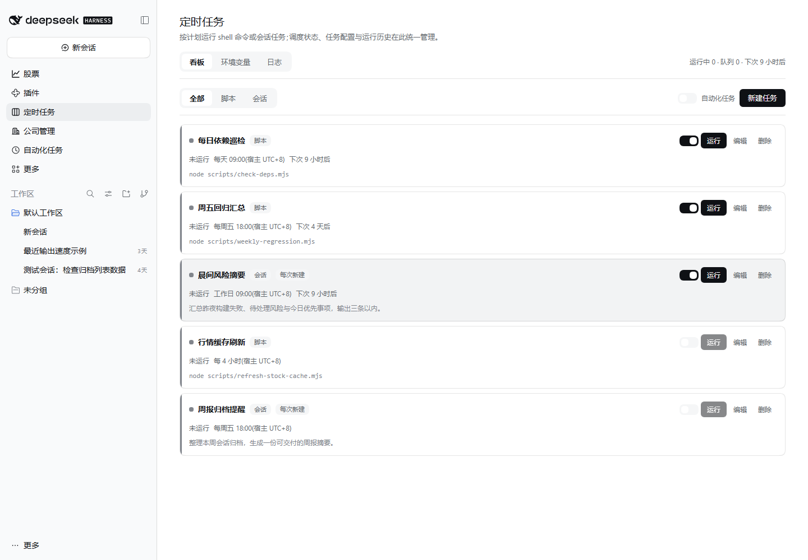
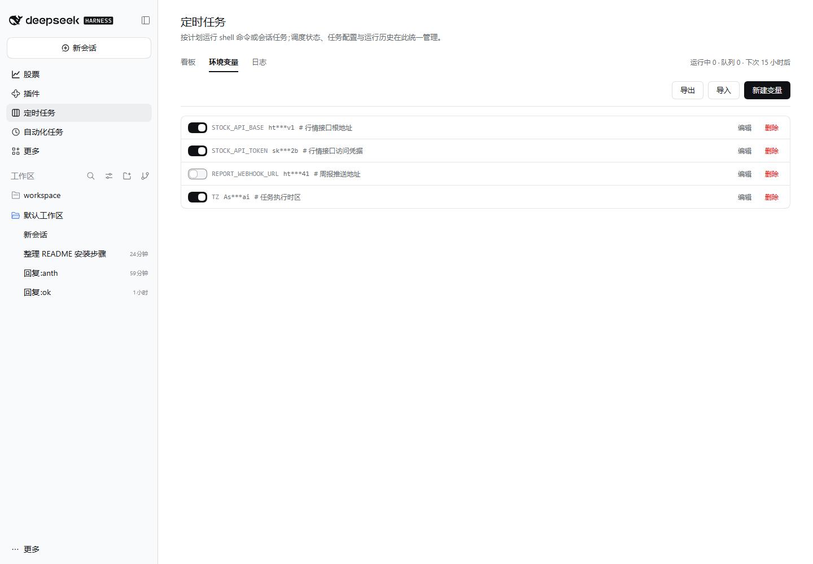

# @mzzsfy/dsh-cron-board

轻量级定时任务看板 dsh 插件:环境变量集中管理 + 定时任务(cron)调度,执行体支持两类——本地脚本(dsh 宿主进程内 spawn)与 dsh 会话任务(定时向 dsh 会话投递任务,投递即终态,支持「每次新建会话」或「固定同一会话」)。一条任务可挂多条 cron 表达式(按行书写,crontab 多行同构),触发点取各表达式最早一次;同刻命中多条表达式合并为一次运行。

## 预览




## 功能

- **看板**:任务卡片列表(状态色/下次触发相对时间/启停开关/立即运行/编辑/删除),新建编辑模态为调度构建器布局:类型/会话模式/调度频率统一分段组件,结构化频率(每天/每周/工作日/固定间隔)自动生成表达式(反解不出即自定义手输),即将执行时刻 chips 为服务端实时预览;**调度计划可挂多条表达式**——计划行列表逐条显示摘要与表达式,「+ 添加时间」追加一条、行尾删除(至少保留一条),选中行在下方构建器编辑;编辑保存只提交改动字段并带回打开时的 `updatedAt` 作乐观锁,期间任务被别处改动(自动禁用/开关/会话绑定)则以 409 拒绝重保存而非静默回滚
- **自动化任务同屏(可选)**:开启 `showAutomationTasks` 后,看板下方以只读分组展示宿主「自动化任务」的标题/状态/频率/下次运行/目标,同时隐藏宿主侧栏中重复的「自动化任务」入口;点击任务卡跳转宿主自动化任务页管理。cron-board 不复制宿主编译器、不改宿主任务数据。宿主未提供 `remote.schedule` 时仅该分组不可用,看板其余能力照常
- **环境变量**:集中管理,值打码展示,多值(同名展开笛卡尔积,组合数超出 20 截断并告警),dotenv 文本导入(预览/追加/覆盖)与导出;导出对含换行、首尾空白、` #` 或首引号的值/备注做双引号转义,导入按引号还原,多值与值内 ` #` 不再被拆分或丢弃;多值行在引号值之后带 `[multi]` 标志(单行多值在文本上无法与普通单行值区分),导入据此还原多值语义,无标志的旧导出文本仍按值里是否含换行推断
- **会话任务**:投递即终态(crontab 语义,执行状态归会话本身);fresh 每次新建会话;pinned 固定会话(忙时跳过,会话被删除或归档自动重建并回写,首跑自动绑定;同宿主控制器下同任务或同固定会话在准入期间互斥,跨热重载实例共享;排队任务出队使用最新固定会话绑定);按 workdir 自动挂载宿主分组,界面分组内可见;执行预设可选(Agent Preset,缺省跟随宿主默认,dsh-im 同构);模型可选(provider/model/推理强度,缺省跟随宿主默认,仅作用于本任务运行——经宿主会话级模型选择安装,不改全局默认;投递前校验目录可用性,不可用即失败并记录原因,运行记录展示实际模型。宿主边界:模型选择是会话持久状态,任务成功投递后由该轮消费;pinned 会话任务投递被拒的边缘路径下已装选择会保留到该会话下一次请求,宿主无选择卸载面)
- **调度**:croner 解析,一条任务可挂多条表达式(换行分隔,去空行/重复行),`nextRunAt` 恒为各表达式下一次触发中的最早值,同刻命中多条表达式合并为一次运行,运行记录带命中的表达式行(`schedules`,API 派生 `scheduleSummary`);停机期间错过不补跑(misfire 即跳过),孤儿运行恢复,全局与任务级并发闸门;重启恢复只重算不属于任一表达式触发点的残留值,DST 春跳当天不存在的墙钟时刻(如 02:30)按 croner 顺延到真实时刻(03:30)视为合法触发点保留,不静默改到次日;卸载时先等在飞 tick 收尾再停执行链,停止返回后不再推进触发点或补写调度失败记录;shell 任务超时收尾(Windows 强杀进程树;POSIX 先终止进程组,宽限后整组强杀,即使父 shell 已退出;会话任务无超时语义);单次运行开关(runOnce,任意一次真实运行入队后自动停用任务);停止/删除落在运行记录落库的等待窗口内时,不再启动 runner,已预占记录按停止原因收敛为 cancelled(不存在停止返回后才出现的进程)
- **时区**:cron 表达式支持内联时区后缀 `T±N`(整数小时,如 `0 9 * * *T+8` 表示东八区 9 点,范围 -12 至 +14,`T+0` 即 UTC),每条计划行独立携带自己的后缀;构建器提供时区行写入后缀,新建任务默认固化设备时区偏移;无后缀表达式按宿主进程系统时区调度(crontab 惯例),摘要按各表达式自己的时区分别尾注;日志 Tab 展示时区在全部计划行时区一致时取该偏移,混合时区回退宿主默认(不冒充某一行的时区);固定偏移不随夏令时变化;后缀只表达整小时,非整点设备时区(如 +5:30/+5:45)不取整成相邻整点(会整体错半小时),新建任务回退宿主默认,偏移按 `±H:MM` 展示且时区下拉不出现空白项
- **模型工具（默认关闭）**:`toolsAppend` 向模型追加 `cron_board_list/view/create/edit`,可按页读取看板任务的全部集合,并管理当前主会话通过工具创建的会话任务。列表返回 `items/shown/total/limit/offset`,`limit` 默认 100、上限 500,模型按 `offset += shown` 翻页至 `offset >= total`(翻页期间集合或顺序变化回 `offset = 0` 重读)。`toolsOverlay` 包装当前预设可用的官方 `schedule_*` 执行入口,官方参数、权限、结果与展示不变,模型成功写入后通知看板刷新;官方自动化任务页面、历史与编辑页仍由官方插件提供。两个开关独立生效。[模型工具支持-BDD.md](模型工具支持-BDD.md)

  追加的四个工具是宿主新名字:按名字收紧的预设 permit-list 天然安全,用 deny-list 收紧的预设需显式 deny 这四个名字,否则模型可从该预设获得自调度写入能力。追加模式目前不限制任务条数与创建频率,也不对创建做宿主审批,部署方需按会话的可信度评估该风险。看板的自动化任务分组本身经宿主 `schedule/changed` 事件刷新,覆盖模式的通知是在此之上的补充。
- **日志**:每任务每运行独立日志文件,面板查看(默认只载尾部窗口,超长时提示并给「导出」取全文)与清空,按任务保留条数裁剪(按文件修改时间);尾部窗口按字节上限读取,单行超过上限时优先丢弃半行保留后续完整行,窗口内没有完整行则保留部分行并标记截断,不显示空日志

## 路由

前缀 `/api/cron-board`(envs / jobs / runs / status / cron/preview / agent-presets / model-catalog / ui-settings),REST 风格,中文业务错误透传。写方法要求宿主闸门通过、同源(Origin↔Host)与 `application/json`(精确媒体类型);写请求体超过 64KB 回 413 + JSON 且连接不被撕(响应后服务端读空丢弃剩余体,keep-alive 可继续复用);请求体读到一半客户端断开时以 400「请求体读取中断」收敛(aborted/close 兜底,不留悬挂处理链);任务的 `schedule` 为多行计划文本(行内首尾空白归一、空行与重复行丢弃,上限 10 条),`POST/PATCH jobs` 逐条校验表达式且每条都必须有未来触发点(400),`nextRunAt` 按全部表达式取最早一次;`cron/preview` 返回逐条摘要/触发点(`items`,重复表达式去重)与合并摘要/触发点,表单按规范化表达式匹配行;`PATCH jobs/:id` 携带 `updatedAt` 时按乐观锁 CAS 校验,冲突回 409;`updatedAt` 是配置版本,仅配置写推进,调度/执行回填(nextRunAt/lastStatus/会话绑定)不参与,活跃任务不会因运行态变化无法编辑;删除任务在在途运行未终止时回 409 并保留任务,删除窗口内的运行请求同样 409 且不落运行记录(无孤儿 run),删除持久化失败会释放「删除中」拒绝态;集合损坏时只读列表带 `broken`/`warning`;`GET runs` 返回每条记录的 `schedules`(该次 cron 命中的表达式原文,手动触发无)与派生 `scheduleSummary`(逐条摘要 ` · `),旧记录无该字段即为空;`GET runs/:runId/log` 默认只回尾部 1000 行(`tail=<行数>` 覆盖,`tail=all` 取全文)。

## 界面挂载

挂载走宿主官方契约(main 全局面板插槽 / sidebar.panellist 侧栏面板行 / better-sidebar 服务),不读取或改写宿主任务数据;`showAutomationTasks` 的侧栏入口合并是可选显示层,按宿主 `sidebar.panellist` 的 aria/icon 标记隐藏重复行,宿主 UI 大改时可能失效:

- **默认:全局面板**。看板以同 id 注册 main keyed 条目(中央面板)+ sidebar.panellist 条目(侧栏「新会话」下方面板行);点击面板行由宿主 `layout.selectPanel` 切换中央区,会话保持不动;点击会话行或新会话即切回会话(官方路径)
- **手动移入**:插件管理页本包详情配置卡(官方 PluginCard 形制:折叠卡壳,cb-pc 镜像;旧宿主落设置>插件页)提供「看板移入 better-sidebar 侧边栏」开关;开启即注册扩展槽 tab 并卸载全局面板
- **不自动回退**:移入后页签关闭/类型禁用均不再自动返回;把开关关掉即回到全局面板形态(经公共 WS 总线 `@mzzsfy/dsh-cron-board` 插件通道感知,变更即时生效;host/client 在 `apply(ctx)` 调用 `setupCommonTools(ctx)`,通道身份取 `ctx.fiber.entry.options.name` 的完整 npm 包名,组件捕获所属 ctx 的 bus，卸载可提前退订；ctx 卸载释放连接持有与全部订阅)
- **开关可用性**:已装载 better-sidebar 时可切换;未装载时开关呈禁用态仅展示(保持全局面板,无副作用)

## 配置

在「插件 → 定时任务」详情卡切换 `sidebarTab`、`showAutomationTasks`、`toolsAppend` 和 `toolsOverlay`。前两项对应开关「看板移入 better-sidebar 侧边栏」「看板显示自动化任务」,后两项对应「追加定时任务工具」「替换官方自动化任务工具」。开关即时生效,其余设置通过配置文件或设置接口修改。

| 配置项 | 说明 | 默认值 |
|---|---|---|
| `tickSeconds` | 调度轮询周期(秒,最小 5),变更后自动按新周期重建定时器 | 30 |
| `maxConcurrent` | 全局同时运行的执行单元上限 | 2 |
| `logKeepPerJob` | 每任务保留的运行日志份数(超出按文件修改时间裁剪) | 200 |
| `maskEnvInPrompt` | 会话任务投递文本中环境变量值打码 | 关 |
| `sidebarTab` | 看板移入 better-sidebar 侧边栏(需已装载;关闭时以侧栏面板行 + 全局面板呈现) | 关 |
| `showAutomationTasks` | 看板显示宿主自动化任务(只读聚合)并隐藏侧栏重复入口;需宿主提供自动化任务服务 | 关 |
| `toolsAppend` | 追加看板工具 `cron_board_*`；脚本任务、子会话与其他会话创建的任务只读，仅当前顶层会话经工具创建的会话任务可写 | 关 |
| `appendMaxJobs` | 追加模式下单个会话可通过工具创建的任务上限(达到上限返回 `quota_exceeded`)；0 表示不限制 | 0 |
| `toolsOverlay` | 替换当前预设提供的官方自动化任务工具执行入口 | 关 |

## 与宿主自动化任务的边界

宿主 Web 版自带「自动化任务」(`dsh-schedule` + `dsh-client-ui-schedule`),负责提醒/一次性/间隔/RRULE 任务向会话投递指令。cron-board 与它的重叠只有「定时向会话投递一条提示」:cron-board 额外提供 shell 执行、环境变量、日志、并发闸门、模型/预设选择和固定会话模式;宿主自动化任务不执行 shell。

本插件的 `showAutomationTasks` 是 UI 聚合开关,不是功能合并:开启后只读列出宿主任务,并隐藏宿主侧栏中重复的「自动化任务」入口;编辑、暂停、删除、立即运行仍在宿主自动化任务页(分组头「打开自动化任务页」仍可进入);宿主页面不反向嵌入 cron-board。默认关闭,避免不需要该视图的用户看到重复内容。侧栏入口隐藏依赖宿主 `sidebar.panellist` 的 aria/icon 标记,宿主 UI 大改时可能失效,但不会影响看板与宿主任务本身。

**工具面覆盖（`toolsOverlay`）**包装当前会话已可用的官方执行入口，沿用宿主调度服务及结果展示；关闭开关即恢复原执行入口。官方自动化任务页面、历史与编辑页不在此覆盖范围内。

多 cron 计划的调度语义见 [多cron支持-BDD.md](多cron支持-BDD.md)。模型工具两种模式见 [模型工具支持-BDD.md](模型工具支持-BDD.md)。

## 依赖

- `croner`:cron 表达式解析与触发点计算
- `@mzzsfy/dsh-common-tools`:client 半区总线订阅硬依赖(数据刷新唯一通道,host 半区经 `setupCommonTools` 门面消费),普通 npm 依赖而非插件,不进 profile 依赖清单、不单独成插件卡,只在所属插件详情页作为只读部件行出现。client 装载行由本包 cordis.patch.yml 自带,装本包即可独立运行,无需安装 session-manager 或手工加行:

  ```yaml
  - insert:
      - id: cron-board-dsh-common-tools
        name: '@mzzsfy/dsh-common-tools'
  ```

  宿主按包名把各消费插件的多行装载行合并成一份 client 模块(bundle 只拼一次,多行在宿主侧是多个空 `apply()` 条目);条目 id 带本包前缀防树内冲突。条目缺失时 client factory 抛错、由装载层在控制台报出缺失模块(0.7.2 起;此前静默禁用为已知缺陷)。依赖范围 `^0.5.0`;兼容窗口(0.5.x 只准 patch、0.6.0 须与九个消费方范围抬升同批)与 hello 版本协商见 [DEVELOPMENT/client-dependency.md](../../DEVELOPMENT/client-dependency.md)
- `@deepseek-ai/dsh-tools`（宿主 peer 依赖）用于声明及注册模型工具。追加模式的会话任务还需要 `sessionController`；覆盖模式只包装当前会话可见的官方 `schedule_*` 定义，不依赖会话服务。
- 宿主服务:settings / timer(软依赖)、webServer;sessionController 不进 `inject`(0.1.1-rc.2 及更早宿主无此服务,声明会永久 pending 拖死 boot),改使用点实时解析:服务缺失时看板与脚本任务照常,建会话任务(或把脚本任务改成会话任务)回 400 并一次性告警,既有会话任务的停用/改名/改期不受影响;服务晚到挂载后无需重建插件即恢复(慢启动宿主不会永久误判)

## 开发

```sh
node scripts/dev-link.mjs dsh-cron-board   # 挂载工作副本到 profile
cd packages/dsh-cron-board
npm test                                   # 测试(经 _mocks.common-tools.mjs 预载公共依赖桩)
```

注意:插件新增进入 profile bundles(`dsh plugin add`)后需 dsh 重启一次完成首装载;此后工作副本改动经 dev-link HMR 热重载。

## dsh 版本兼容

按仓库动态窗口验证(scripts/compat/window.mjs),不预置任何固定版本槽:主测 = 渠道 dist-tag 最新 rc,完全适配口径;基线 = npm latest,不崩溃底线口径;主测与基线同版时收敛单槽。兼容面以窗口实测为准,不逐版本承诺。逐轮实测结论见 `docs/兼容性测试/逐包测试进度.md`(本地维护,不入库)与本包 `兼容性测试.md`。
