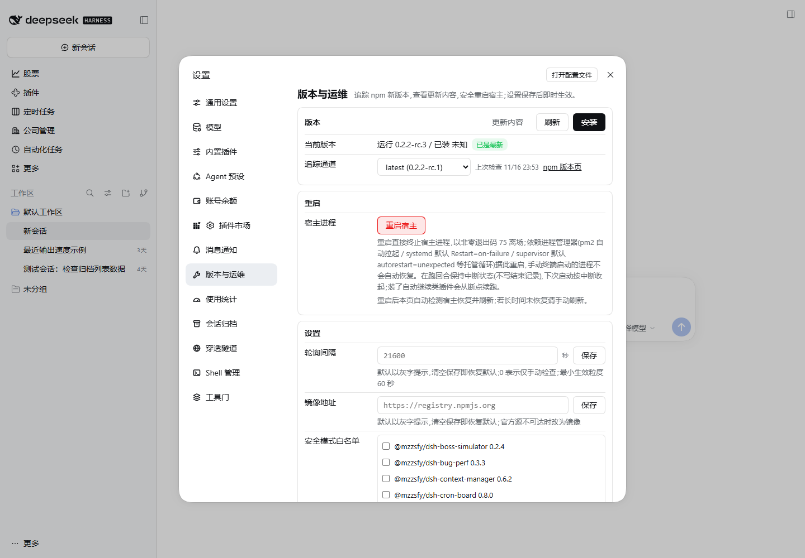

# @mzzsfy/dsh-maintain

DeepSeek Harness 设置页插件:版本监测、更新内容、升级前检查、宿主 A/B 升级、安全重启。

## 预览




## 功能

- 版本监测:host 启动即检查一次,按轮询间隔重复检查(内存快照,不持久化);当前版本与追踪通道最新版对比,落后即提示。运行版本(宿主启动时缓存)与已装版本(受管链接 `dsh_link` 当前指向安装槽的清单版本)分开统计与展示,落后判定以运行版本为准,已装版本领先运行版本时提示"重启后生效"。定时轮询为软依赖:宿主 timer 服务不可用时仅停用自动轮询,面板显示降级提示,手动刷新仍可使用。通道最新版不是合法精确 semver 时安装入口禁用(宿主入口必以 400 拒绝)。
- 版本更新内容:面板"更新内容"按钮按追踪通道最新版本拉取 GitHub Releases 发布说明(deepseek-ai/deepseek-harness,标签 `dsh-v<版本>`,npm 清单无 readme 字段故以官方 releases 为事实源;通道最新版就绪前按钮禁用)。数据源为 releases 页面而非 api.github.com(未认证 API 限流 60 次/小时/IP 且按 IP 共享,页面限流实际宽松),从 markdown-body 正文容器深度配对提取,渲染后 HTML 映射回行文本(标题→# 前缀、列表→- 前缀、块级闭合→换行、实体解码;标签剥离先于实体解码,产物只经 React 文本节点输出无 XSS 面),页面响应体上限 512KB 流式截断;页面 URL 自建,无需远端 URL 白名单。弹窗展示版本、发布时间与正文,附"在 GitHub 查看"源站链接,无发布说明时明确提示;host 进程内缓存(仅成功结果,上限 20 个版本,超限淘汰最早缓存的版本,GitHub Releases 视为不可变故不设过期),同一版本重复查看不重复请求。GitHub 不可达或该版本未发布 Release 时窗内提示错误并可重试,附 releases 页兜底链接;路由 `GET /api/maintain/release-notes` 取追踪通道最新版。
- 救援说明:每次打开安装确认弹窗都显示独立救援 profile 的启动命令与可展开说明;点击「开始安装」并通过服务端检查后，插件在启动安装前创建或更新 DSH 用户目录的 `rescue.txt`，记录离线诊断和修复原 profile 的步骤。打开确认弹窗和预检不会写入文件。救援命令会重建同名救援 profile，已有数据须先备份。文件写入失败时页面会提示。
- 追踪通道:在 npm dist-tags 间切换(latest / next / alpha 等,选项由检查结果动态生成),切换后按新通道判定。
- 一键受管安装(A/B 双目录编排):安装前候选验证 fail-closed——依赖树完整性检查(npm ls)+ 候选 CLI 真实执行冒烟(`node <候选bin> --version`,隔离候选环境,自然退出,不启动宿主服务),验证通过才切换链接。激活前的确定性失败会保留原安装链接和命令入口，旧宿主继续运行。确认弹窗带"安装后自动重启宿主"勾选(单次意图,默认开):勾选时切换成功即调度宿主退出,由托管方式拉起新版本;取消勾选则宿主继续运行当前版本并立即恢复正常服务(维护暂停随之解除,新回合照常受理),需手动点"重启宿主"加载新版本;切换已发生而宿主仍是旧版本,运行路径一致性会拒绝再次发起升级直至重启。安装或验证超时、切换状态不确定时，保留升级锁并安排保护性退出。进入安装激活前，若门控拒绝且失败结果无法落盘，保留升级锁并让当前宿主继续服务。后续升级和面板重启须等人工核验。进入激活后，若失败结果无法落盘，仍安排保护性退出。
- 升级前检查:确认弹窗打开即调用 `POST /api/maintain/preflight`,逐项检查安装布局、目录写权限、磁盘空间、残留 `upgrade.lock`、`state.json` 阶段、npm CLI、目标 Node engines 与插件兼容性;服务端在受理时重新检查。预检报告列出环境硬失败或插件硬不兼容;若仍提交升级,`POST /api/maintain/upgrade` 返回 `409`,插件硬不兼容时列出相关插件。插件扫描不可用或兼容性未验证只提示警告,不等同于已确认兼容。候选安装后，升级流程与运行宿主的官方包管理操作共用该 profile 的 `package.json` 写锁。持锁期间重新读取插件选择、复查兼容性并提交安装链接和命令入口。无法加载或获取写锁时中止本次升级。持锁后若发现 `.plugin-manager/run.json` 遗留记录或无法核验，先停止本次升级，由运维核验遗留包管理任务后再重试。维护流程保留记录供排查。rc.5 在启动 pnpm 后才写入运行记录。包管理进程异常退出后，即使未发现记录，也应先核验相关子进程已退出再升级。准备期间出现明确的硬不兼容时，本次升级记录失败，当前宿主继续运行。若复扫不可用，宿主记录 `plugin-rescan-unavailable`，其余门控通过后仍可切槽。单个插件无法评估时保留同批其他插件的明确结论。复扫调用受信任的候选宿主兼容评估器，Worker 隔离模块缓存，文件系统权限与宿主相同。目标版本清单按版本与镜像源缓存 10 分钟,体积取 npm `dist.unpackedSize` 加固定安装余量。
- 同一 npm 安装目录只支持单生产宿主执行受管升级。A/B 槽由该目录下的所有 profile 共享。执行升级前，先停掉其他使用这份安装的宿主。
- 受管升级仅升宿主:不在线同步更新插件,也不通过安全模式自动禁用或恢复插件,不改活动 profile 的插件清单、锁文件或包树。确认弹窗不再提供「先升级插件再切换槽位」与「安全模式」开关,仍可选择是否自动重启。向 `POST /api/maintain/upgrade` 提交 `upgradePlugins: true` 或 `safeMode: true` 会在创建升级任务或改盘前直接返回 `409`,不会改为宿主单升来执行。插件事务保持关闭;M1 的隔离验证未通过前不开放事务,也不回退到在线改包。
- 旧安全模式记录：`<prefix>/.dsh-maintain/safe-mode.json` 有可验证的 profile 归属时，仅该 profile 可在恢复卡显式恢复，失败项继续留档。更早的记录缺少归属，须由运维核对原 profile 与插件名单，在原 profile 的插件管理页逐项启用。恢复完成后重启宿主。
- 升级进度:状态接口与面板展示宿主升级阶段(准备/安装/验证/提交前检查/切换/等待重启)、阶段耗时与升级输出尾部(16KB,ANSI 清理);浮条显示真实阶段与时长,不伪造百分比。进程内本次升级与 `state.json` 历史记录分开展示。旧插件结果有逐项数据时,可展开「插件明细」查看结果和原因。旧重启后待执行意图只读显示为「未执行」,不重放;没有逐项数据时仅提示整笔未执行。如还需更新插件,须另行安排,不能从此回执重试。
- 升级落地回执:新宿主 `appReady` 后核对目标版本/路径与运行版本,用 `pluginInventory` 和 `pluginManager.listBundles` 检查装载健康。已禁用插件的兼容告警与 `not-bundle`、`unsupported-platform` 不计作运行失败。已知宿主升级失败或历史插件失败优先判定为 `ok=false`,即使当前健康也不显示绿色完成。没有已知失败时,切槽后待重启或重启后就绪检查不可用为 `ok=null`,也不显示绿色完成,面板不会确认这两类未落定结果。只有确认成功的回执才可能自动确认;历史失败（含旧插件未执行）可点「知道了」。如需排查,先展开并查看明细;确认后只隐藏当前结果。回执归发起升级的 profile 所有。`POST /api/maintain/upgrade/receipt-ack` 按 `operationId` 和 `result`（`succeeded` / `failed`）写入对应的已读标记。无归属的旧记录和仅在内存中的失败支持浏览器本地确认。成功必须有发起 profile 本次启动的健康样本。页面刷新后，若初次状态携带正在检查健康的升级 `operationId`，观察器也会跟踪该操作。之后宿主再次重启时沿用本页开始观察时的截止时间。状态写入共用 `<prefix>/.dsh-maintain/state.json.lock`。锁在进程异常退出后残留时，核验持有者与状态记录后再处理。
- 活跃工作门控(fail-closed):升级受理与提交切换前检测运行中的 agent 会话与后台 job(jobs 按官方 `list(caller)` 字符串语义逐 agent 查询)。检测面不可用即拒绝升级(不冒充弱一致窗口放行);存在活跃工作拒绝且不可越过;重启仍按原语义带 force 可越。概要随 status 提供给面板。terminals 服务面 0.2.0 对插件 ctx 不可探属宿主常态,不因面缺失降级:agents 计数覆盖 running 期间的终端活动;agent 转 idle 后仍存活的终端不可计数,升级会中断它们,属已知盲区。
- 审计日志:升级、重启和旧安全模式人工恢复的触发、结果或拒绝记录为结构化日志(`audit endpoint=… outcome=…`),便于事后排查。
- 面板设置编辑:轮询间隔、镜像地址可在面板底部编辑保存(轮询间隔保存即重排,镜像地址保存即重查);镜像地址仅接受无查询串或锚点的 HTTP(S) URL。旧安全模式白名单设置仍可编辑,但不会启用在线安全模式或绕过硬不兼容阻断。
- 操作反馈:检查更新、通道切换、面板保存与升级触发的失败经全站浮出通知(@mzzsfy/dsh-common-tools,由本包 `cordis.patch.yml` 自带的装载行引入)提示;页面加载失败与重启超时等状态提示仍在面板内展示。
- 安全重启:两段式确认后延迟数秒直接终止宿主进程(不经宿主 `appExit` 优雅停机,理由见「重启须知」);重启指令在响应发出后延迟执行,退出调度与响应冲刷解耦,客户端断连不影响宿主退出,浏览器先收到回执进入重启等待态;确认后面板立即提示重启进行中,轮询探测宿主恢复,且主文档连续多次探测可加载(宿主页面服务 fallback 已就绪并稳定)后再稍候片刻才刷新页面,避免启动窗口内刷新拿到 404,总时长最多 1 分钟,超时提示转人工检查。进程以专用非零退出码 75 离场(见「重启须知」的托管默认策略),托管方式据此拉起。动作路由带宿主闸门、跨源守卫(Origin 与 Host 不符即 403)与精确 `application/json` content-type 校验,与外层鉴权插件(如 dsh-web-startup-auth)互补;未部署鉴权插件时同源请求仍匿名可达。

## 安装

```sh
dsh plugin --profile web add @mzzsfy/dsh-maintain
```

标准插件安装:包进入 profile node_modules(pnpm hoisted 布局),bundle patch 随下次 dsh 重启自动生效,无需手动编辑 cordis.patch.yml;宿主 peer(`@deepseek-ai/*`)不落盘,经目录逐级兜底解析到 dsh 本体全局安装目录。

开发安装(仓库工作副本直挂,不经 npm 发布):

```sh
node scripts/dev-link.mjs dsh-maintain   # 仓库根执行:归一 profile 依赖行 + 挂 junction
```

工作副本以 junction 挂进 profile,host 半区改动保存约 5 秒防抖窗口热重载,client 半区改动刷新页面即生效,无需发版;规约与全仓归一见 `node scripts/dev-link.mjs all`。勿用 `link:` 或裸相对路径手工挂载——realpath 后 peer 从仓库目录解析会失败(早期"必须手工拷贝部署"结论的成因,对 dev-link junction 不成立,junction 内 peer 沿 profile 解析)。

## 设置(配置节,热加载)

```yaml
maintain:
  channel: latest                                # 追踪通道,选项以检查返回的 dist-tags 为准
  pollIntervalSec: 21600                         # 轮询间隔秒,仅正数启用周期检查,0/负数禁用,上限 30 天
  registryBase: https://registry.npmjs.org       # 官方源不可达时可改为镜像地址
  safeModeWhitelist: []                         # 保留的旧安全模式白名单,不启用在线改包
```

配置落在 profile 条目 `maintain` 的 config 节(即上例 settings.yaml 的 `maintain:` 块,经 dsh 配置迁移后为 profile patch 内该条目的 config 键):宿主以插件静态 `Config` 导出生成节表单,字段均为 volatile,面板保存经 configEditor 写回、仅 volatile 变化时 loader 原地热更(不重启插件)。轮询间隔与镜像地址亦可在设置面板「版本与运维」页底部直接编辑保存。保留的 `safeModeWhitelist` 仍可在面板保存,但不参与升级放行。

## 重启须知

- 重启依赖托管常驻(pm2 / systemd / supervisord / Kubernetes / 容器等)自动拉起;手动终端启动的进程不会自动恢复。重启判定为三信号:失联恢复、宿主进程启动时刻(bootAt,容器内 pid 恒 1 场景的可靠信号)或 pid 变化。
- 退出码:重启与升级落定的退出用的是专用非零码 **75**(sysexits `EX_TEMPFAIL`,语义为"临时离场、应当重试拉起")。之所以不用 0——进程管理器按退出码判断是不是异常退出:systemd 默认 `Restart=on-failure` 只拉起非零/信号退出,supervisord 默认 `autorestart=unexpected` + `exitcodes=0` 只拉起不在正常码表内的退出,二者都会把 0 当正常退出而**不**拉起,重启就变成永久停机。因此:
  - pm2:`autorestart` 默认 `true`,任何退出都会拉起,无需额外配置;
  - systemd:默认 `Restart=on-failure` 即可,无需改;若显式设成 `Restart=no`/`on-abnormal`,需自行改回;不要把 75 加进 `SuccessExitStatus=`;
  - supervisord:默认 `autorestart=unexpected` 即可,无需改;若显式写了 `exitcodes=0,2` 之类的白名单,不要包含 75;
  - Kubernetes/容器:`restartPolicy: Always`/`on-failure` 均可拉起;`Never` 不会。
  未托管(手动终端启动)时 75 只体现为 shell 的非零退出码,重启后需你重新运行宿主。
- 确认重启后本页以严格顺序轮询探测宿主恢复(任意时刻至多一拍在途),主文档连续多次探测可加载(页面服务就绪并稳定)后稍候片刻才整页刷新;面板后台探测请求失败或拿到 404 均属宿主退出与启动窗口的中间态,面板保持等待提示。重启请求本身收到明确 HTTP 回绝(如升级互斥 409)时立即提示失败,不进入等待轮询。若你手动刷新后浏览器显示 404,说明宿主仍在启动窗口内,稍候数秒再次刷新即可。轮询总时长最多 1 分钟,超时通常是宿主未被进程管理器拉起(手动终端启动)、退出失败或启动过慢,请检查进程管理器后手动刷新排查。
- 退出语义:响应当即返回,延迟窗口(数秒)到点直接终止进程,不走宿主 `appExit` 的优雅停机。优雅停机逐个 agent 取消在跑回合并落 `turn/end aborted(disposed)`,自动继续类插件把 `aborted` 视为人为停止,重启后不会续跑;直接终止则回合停在 `turn/start`,下次启动由会话日志收尾补 `interrupted`,自动继续类插件(如 dsh-keep-working)才会从断点续跑。代价是插件 disposer 不执行:工具子进程与终端不随重启清理,重启前请确认没有需要收尾的长任务。
- 维护闸门只拦还没开始干活的新回合:在跑回合的后续步与目标轮次一律放行。宿主把被拒的 pre-step 记成 `turn/end blocked`,该步没有模型输出,但与模型末行 `TASK_BLOCKED` 写法不同;恢复方只能按 `blockedReason` 与回合尾部标记区分。目标轮次的拒绝更会被 goal driver 记成 `blocked(prompt-rejected)`,整条目标从此停摆。放行后这些回合在进程退出时停在 `turn/start`,按上一条语义续跑。载荷缺 `step` 的宿主按新回合处理,维持暂停契约。被拒回合已 claim 的消息不会回到队列,也不会进入事件流——这是宿主 inbox 语义,恢复方只看到 `blocked`,无法还原原始输入。
- 存在活跃工作(agent 会话/后台 job/终端)时重启被 409 拒绝,确认按钮显示活跃计数,再次点击即以 force 越过;force 重启不等待任务收尾,在跑回合按上述语义留待下次启动续跑。会话已持久化,未装自动继续插件时可手动 resume。
- 升级进行中重启请求返回409(双向互斥);升级成功触发的自动重启同样会中断在跑任务,依赖托管的活跃工作请自行评估升级时机。

## 开发

```
cd packages/dsh-maintain && npm test
```

路由测试静态导入宿主 peer；缺依赖会报 ERR_MODULE_NOT_FOUND 并失败。新 clone 先按根 DEVELOPMENT/dev-loop.md 初始化解析桥，再执行包内 `npm test`。平台专属测试仅按适用平台跳过。

## dsh 版本兼容

按仓库动态窗口验证(scripts/compat/window.mjs),不预置任何固定版本槽:主测 = 渠道 dist-tag 最新 rc,完全适配口径;基线 = npm latest,不崩溃底线口径;主测与基线同版时收敛单槽。兼容面以窗口实测为准,不逐版本承诺。逐轮实测结论见 `docs/兼容性测试/逐包测试进度.md`(本地维护,不入库)与本包 `兼容性测试.md`。
