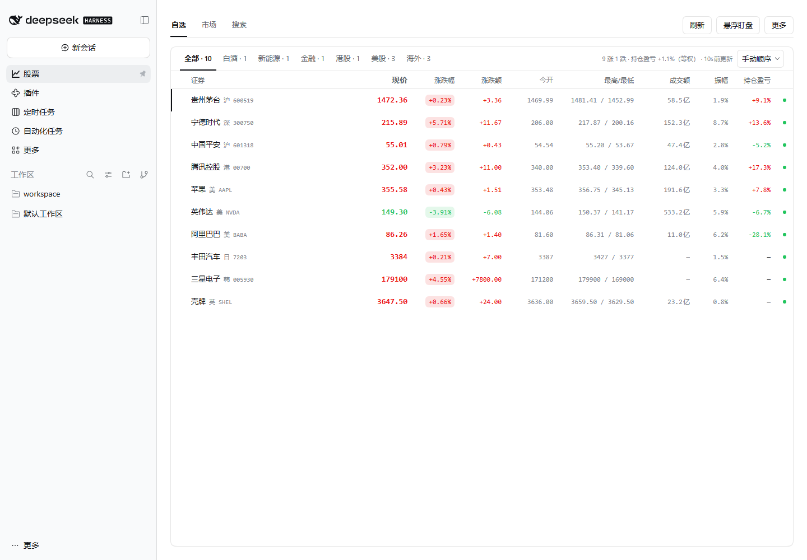
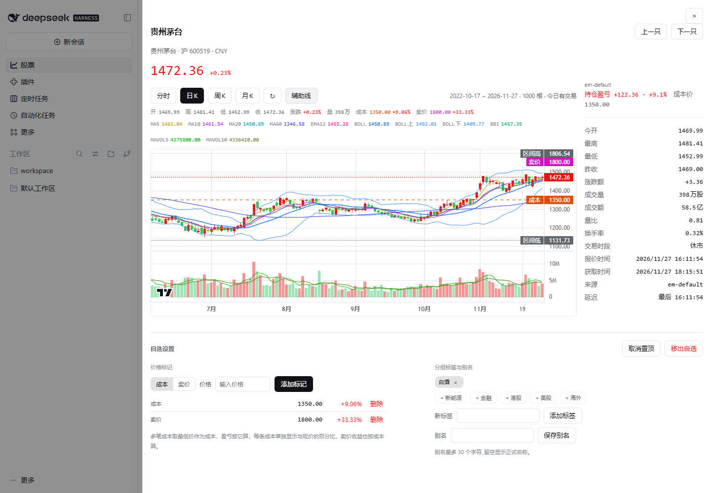
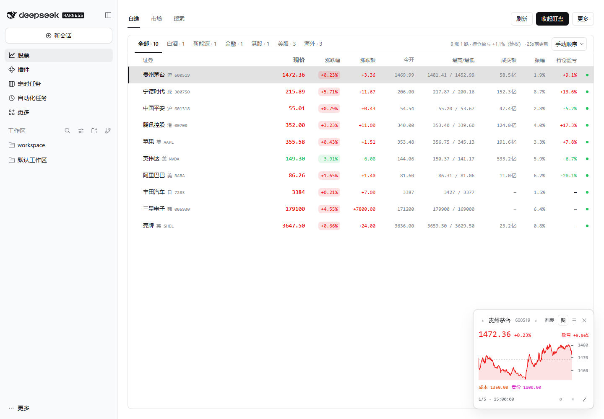
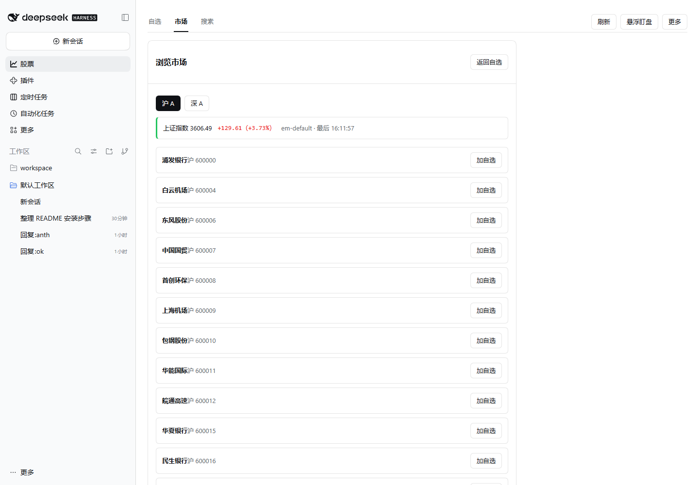
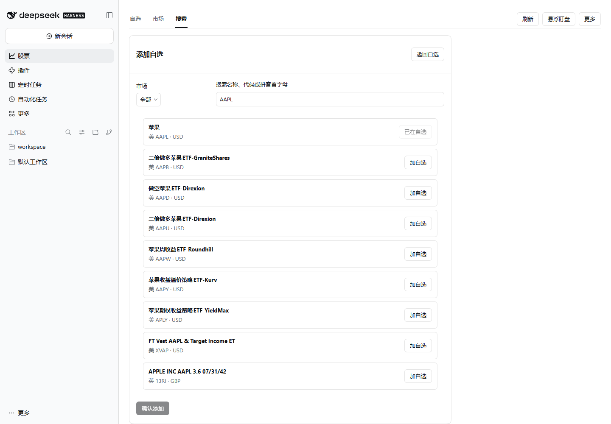
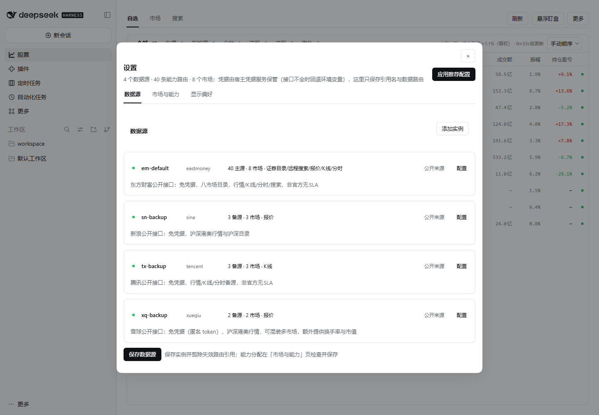
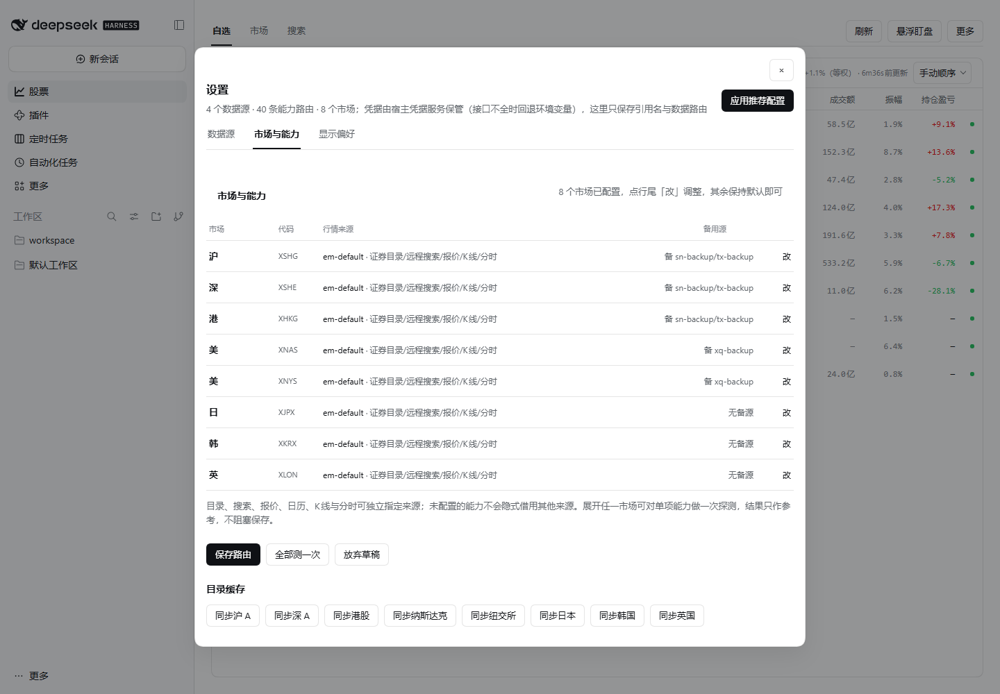

# @mzzsfy/dsh-stock-assistant

DSH 全局股票工具。左侧“股票”入口打开独立主页面，无会话也可使用。切换、关闭 DSH 会话或临时打开其他工具，不会清除股票工具的搜索、详情、排序、滚动位置和设置草稿。

支持八个市场（沪/深 A 股、港股、美股 NYSE/NASDAQ、日经、韩证、伦敦）：自选（多标签分组；市场自动分组：解散某市场分组后新增同市场票不再自动归组，该市场自选清空后仍按默认归组，手动加回市场标签即恢复；分组 tab 与 tab 内涨跌/持仓统计、置顶、拖拽排序、别名、删除撤销）、名称/代码/拼音首字母搜索（多市场候选带币种徽标）、行情与 K 线图表（分时/日K/周K/月K，MA/EMA/BOLL/BBI/MAVOL 可分别开关，分时与日周月的成交量副图同源按分钟量柱/当日总量柱绘制，量副图上叠 MAVOL5/MAVOL10 均量线，昨收/价格标记/区间高低参考线，lightweight-charts 渲染；K 线首屏最多显示最近 120 根、按 1000 根上限请求历史（实际根数以来源返回为准），时间轴不会滚到最新一根右侧；悬浮分时滚轮以指针为锚缩放时间、拖动平移、双击复位）、价格标记（成本/卖价，单只最多 12 条，多笔成本取最低价计浮盈、卖价按成本计潜在收益）、悬浮盯盘（列表与图形双模式、只盯勾选的标的、图形模式报价行给设了成本的标的补持仓盈亏、刷新间隔五档 3/5/10/15/30 秒、默认 10 秒、可拖动、常驻在所有面板之上）、基础详情（含量比与换手率，来源不给时按缺失呈现）、涨跌排序、手动刷新、暂停采集，以及数据源与能力路由设置（含"应用推荐配置"与按市场配置 K 线/分时）。不做交易、持仓管理或资讯；价格提醒仅限自选标记价穿越，经页内/系统通知或已安装的通知插件呈现。

## 预览









## 数据结构与持久化

**不使用 DSH 默认设置系统。** 本插件不声明 `Config`，不调用 `settings` 或 `configEditor`。配置界面位于股票工具自己的“设置”视图中。

通过宿主 `storageDomain` 只持久化一条记录（2026-10-30 前为 `stock_sidebar` 数据域，随包改名一并更名）：

| 表 / 记录 | 内容 | 默认 json backend 的介质 |
| --- | --- | --- |
| `control/root` | 自选证券、手动顺序、置顶、别名、标记、分组标签、显示偏好、Provider 实例、能力路由、控制版本、近期幂等操作结果 | `~/.dsh/storages/stock_assistant.json`（version=1、layout=single，约十几 KB） |

K 线、分时当日缓存、标准证券目录、交易日历都是可重建的派生数据，只放内存：目录/日历 64 条、K 线 512 条、分时当日缓存 128 条三个独立池，各自最久未写先淘汰，重启宿主后按需重拉（分时缓存与报价拍点重启即空）。旧版本把这个缓存写进了同一个文件，把它撑到 3.3 MB：打开时 `cache` 表被忽略，下一次控制写入后文件自然缩回十几 KB，不需要手动清理。打开时对整文件做严格校验：JSON 不可解析、版本号不认、控制记录不合 schema 都直接拒绝打开、原字节不动；只有文件不存在、或文件里没有 `control/root` 时才初始化为空自选。

开发过程中曾短暂改成过 `<域>/<表>/<记录>.json` 目录布局（未发布，生产从未以该布局运行）。如果某个数据目录被那个中间版本写过，`stock_assistant/` 里的自选不会被读取，需要按 [CHANGELOG](CHANGELOG.md) 里的步骤手工搬回。

**密钥不在这个文件里**：数据源密钥与代理账号密码写进宿主的凭据存储（或留在启动宿主进程的环境变量里），文件里只有引用名。备份时需另行备份凭据或环境变量。报价只保留在 Host 内存；搜索、详情、设置草稿等浏览状态由每个浏览器页面持有，刷新会重建。

**浏览器本地另存三组窗口级状态**，不进 `control/root`：悬浮盯盘的开关/位置/勾选目标/暂停开关/列表或图形模式（`ssb-floating`）、K 线辅助线开关（`ssb-guides`）与标记价提醒开关（`ssb-float-alert`）。这些状态跟着当前窗口与这块屏幕走，多设备之间没有同步价值；放进宿主 `preferences` 的话，每加一个开关都要改协议 schema 并重启宿主才能生效，收益不成比例。代价是不随账号同步、清空站点数据会丢。跨页面共享且影响全局语义的配置留在宿主侧：列表刷新间隔（15/30/60）、悬浮盯盘刷新间隔（3/5/10/15/30 秒，默认 10）与涨跌配色；暂停开关虽然决定是否发请求，但它只属于当前窗口、无需跨设备同步，因此留在本地。业务数据（自选、成本、别名、分组标签、数据源与路由）一律只走宿主存储。

写操作在单一队列中执行，并携带版本及操作 ID。持久化成功后才发布；版本冲突保留用户输入并要求重新确认，写盘失败保留原数据。删除撤销有效期为8秒，恢复到当前列表原邻居附近，不回滚别页修改。控制文件不可解析时拒绝打开、原文件不动，不会用空自选覆盖。

## 初次使用

全新安装即内置默认数据源：东财、新浪、腾讯、雪球四个免凭据公开源（东财主源，新浪/腾讯/雪球按市场做报价或 K 线备用；保守预算 60 次/分起步），八个市场的目录、搜索、报价、K 线、分时共 40 条能力路由全部配好，无需任何注册。悬浮盯盘选 3 秒档时，交易中每拍检查一次批量报价：过期或缺失的报价才回源，与列表采集重叠的在途标的一次请求合并。单批不超过 20 只，实际批量上限取决于来源，与列表采集共享来源额度。休市或午休时复用最近一次成交价；触限时来源退避、底部给出失败文案并可重试，也可调慢报价档位或减少勾选。打开后即可浏览市场并直接加自选，或按代码/中文名/拼音首字母搜索；设置页的「全部测一次」只是可选诊断，保存配置不要求先检查通过。日经、韩证、伦敦三个市场由东财全球搜索与目录页覆盖，其成交额字段来源恒给 0，界面按缺失呈现而不是显示「0」。

- 顶栏「浏览市场」提供无目的浏览：按市场分页查看全部 A 股，行内一键加自选；目录未同步时页内有同步引导。
- 悬浮盯盘由面板顶部按钮打开：☰ 勾选观测目标，列表与「图」切换，底部切换暂停；报价档位在设置页调。列表行是单选高亮——单击其它行只换选，留在列表且不取分时；再点当前行、按 Enter 或点「图」才进入图形模式。拖动只从标题条发起，位置记在当前浏览器本地；浏览器窗口缩小或页面缩放后卡片自动收回视口内，放大回原尺寸就回到你拖到的位置。
- 搜索在目录未就绪时不再死路：错误提示带「前往浏览市场」直达入口。
- 设置页在配置被清空时提供「启用默认数据源」一键恢复（与初始安装同一配置来源）。

需要目录/日历（搜索、日历休市调度）或更正式的数据合同（权限表、配额文档、服务协议）时走 Tushare：

1. 当前 main 的凭据优先由宿主凭据服务托管：在“股票 → 设置 → 数据源”实例卡的密钥输入框直接录入（写入宿主凭据存储，不回显、不落插件配置）；服务接口不全时回退 **启动 DSH 的 Host 进程环境变量** `DSH_STOCK_TUSHARE_TOKEN`（或同层 `.env`）。0.4.0 发布版没有凭据服务，只读该环境变量。插件只保存引用名/变量名与数据路由；修改引用名不会迁移已有密钥。
2. 打开“股票 → 设置”，添加数据源实例，填写账号实际允许的请求预算。同一账号的实例使用同一“共享额度组”。新实例额度默认为未知；未填写时只允许每组最多每10秒一次主动探针，实际目录同步与报价采集均禁用，不假设任何免费套餐额度。
3. 为上海/深圳分别选择证券目录、报价、交易日历来源。可以只启用自己需要的市场和能力。
4. （可选）点“全部测一次”查看各来源的连通性与耗时；保存配置不要求检查通过。检查消耗该来源请求额度，检查通过不代表任何第三方展示许可。
5. 同步需要的市场目录和日历，搜索证券、选择候选并确认添加。
6. 列表或任何入口打开的详情可见时自动采集；浏览/搜索主视图、设置、隐藏页面或暂停时停止自动采集。暂停期间手动刷新可更新当前静态快照。

设置页按「① 数据源 → ② 市场与能力 → ③ 显示偏好」递进组织；每个数据源实例卡内可见适配器一句话说明、「接口反代」端点覆盖（自建反向代理/镜像时替换地址，留空用官方默认；东财五个端点、腾讯三个端点）、高级预算折叠组与「运行状态」最近请求轨迹（内存里留最近 20 条、界面显示最近 5 条：时间/能力/状态/耗时，用于确认上游是否可达；不记请求地址）。实例还支持可选 HTTP 代理出口（`http(s)://host:port`，URL 不带账号密码；需要认证时填写“代理凭据引用名”并在凭据框录入 `用户名:密码`，经 undici ProxyAgent；一般无需配置）。列表页顶部常驻数据源概览横幅：启用数/最近请求失败实例一目了然，「管理」直达设置。

Tushare 的 `rt_k`、`stock_basic`、`trade_cal` 权限分别由账号决定。目录与日历权限不足不等于“市场为空”。`rt_k` 使用 HTTPS；本插件不使用 HTTP 降级，也不通过浏览器直接访问来源。具体能力检查以实际账号结果为准。

## 数据源适配器

生产内置六个适配器，各自独立文件（`src/providers/`），互不依赖：

| 适配器 | 能力 | 凭据 | 边界 |
| --- | --- | --- | --- |
| `tushare` | quotes / catalog / calendar | 宿主凭据服务或环境变量（默认引用 `DSH_STOCK_TUSHARE_TOKEN`） | 唯一有正式权限表、配额文档与服务协议的渠道；三种能力可分开路由 |
| `finnhub` | quotes | 宿主凭据服务或环境变量（默认引用 `DSH_STOCK_FINNHUB_TOKEN`） | 美股 XNAS/XNYS 实时报价；免费档不含 K 线，单只一请求，不适合持续轮询 |
| `tencent` | quotes / kline / trend | 免凭据 | 公开网页接口；非官方、无 SLA，协议随时可能变化；分时覆盖沪深港（美股没有分钟线），畸形行逐行校验丢弃；换手率与量比只在沪深口径取值（港美同列位是别的字段，按缺失呈现） |
| `sina` | quotes / catalog | 免凭据 | 同上；价格恒三位小数，适配器裁剪到分；目录仅沪深；不提供换手率/量比 |
| `eastmoney` | quotes / catalog / search / kline / trend | 免凭据 | 同上；目录分页抓全量（单市场约2500只，页频受限流退避约束），联想搜索支持中文/代码/首字母拼音；K 线覆盖日/周/月，分时是独立能力（trends2），时间戳统一按北京时间解析；`f8`/`f10` 在八个市场都给换手率与量比 |
| `xueqiu` | quotes | 免凭据（匿名 token） | 同上；可混装多市场，额外提供换手率与市值（不含量比） |

**零注册全流程**：只添加 `eastmoney` 实例（设置页选适配器即标"免凭据"，默认保守预算 60 次/分），八个市场各配 catalog/search/quotes/kline/trend 五条路由，保存→同步目录→搜索添加→看行情，全程不需要任何账户。分时（trend）是独立能力，与 K 线分开选源：把 K 线配给只有日/周/月的来源（如腾讯）不会连带关掉分时。日历能力仅 Tushare 提供；缺日历时按内置各市场时段与周末判断，休市/午休同样停采，功能不受阻。

混合路由：可把沪深行情分别路由到不同来源（沪市腾讯、深市东财、新浪备用等），目录/搜索用东财、日历用 Tushare——全部在设置页按市场/能力勾选。同一报价的现价、昨收、涨跌和时间始终来自同一适配器，不混拼字段。

免凭据机制：实例 `credentialRef=null` 时跳过凭据解析（宿主凭据服务或进程环境变量），但 schema 强制其声明保守预算（防无界请求）；凭据型适配器切换回档时自动恢复引用名输入框。

新增平台步骤：在 `src/providers/` 实现标准合同（`descriptor.credential` 声明 `'none'` 或默认引用名 + 能力方法 + `probe`；`probe` 返回 `{status, capability, market, instrument}`，`capability` 必须等于被探的能力——拿别的接口冒充会在设置页判为不可用），在 `application.mjs` 的 registry 登记，测试放 `test/public-providers.test.mjs` 或 `test/<adapter>.test.mjs`。UI、存储、自选模型零改动。

报价与 K 线路由最多可以挂三个备用源，主源与备用源排成一个环。默认配置里报价在沪深港美五个市场挂了备用源，K 线在沪深港挂了备用源；分时默认单源指向东财，腾讯也声明并实现了分时，可作分时主源或备源（其分时量按分钟差分后与东财同口径）。报价在一轮刷新里全网络失败时当轮就改打环上的下一格，K 线与分时也是当轮顺次试下一格。当前选择的失败照旧计入三轮判定，同轮顺链试下一格不另计；连续三轮 NETWORK/TIMEOUT 失败才把整条路由移一格，走过最后一个备用源后回到主源，权限错误、额度限制与逐证券缺失不触发。面板活跃时每 5 分钟回探一次已降级路由的上级，重新打开面板也立刻探一次；探针由各家适配器自己实现，用的是该能力的真实业务方法；首个汇报就绪的上级胜出，多个就绪时取最上面那个。刚被降级的来源先冷却，探不通的按 5 分钟起倍数退避、封顶 1 小时；面板不活跃时不探测。有备用源可退时网络失败不进退避，没有备源可退时才退避。切换增加运行代次并丢弃旧请求。设置视图按顺序列出备用源、可增删（最多三个），并显示当前备用选择与回主源操作。

## 调度与接口

同额度组顺序执行，上游启动间隔至少1秒；最多两个额度组并发。每个数据源实例另有兜底节拍：相邻两拍的开拍间隔不小于 `0.9 × min(列表刷新, 浮窗刷新)`，一拍内允许报价分批、分时与详情 K 线连续发出（仍受组内 1 秒约束），拍的后半段才封到下一拍。探针与目录同步是一次性动作，不受节拍约束。总账号、能力子额度、每日额度和证券计费额度共同约束请求。网络错误按路由指数退避，有备用源可退的报价路由例外（失败交给路由器的三轮计次）；K 线请求走同轮候选链，不参与这条退避。Tushare 的 429 映射为 RATE_LIMIT 并读取 Retry-After（头缺失时按 60 秒），Finnhub 的 429 固定退避 60 秒，公开网页源的非 2xx 通常按 NETWORK 处理；分时的 429 与带 `Retry-After` 的 503 按该头退避（头缺失或不可解析按 60 秒）；额度层自身的拒绝同样映射 RATE_LIMIT 并带 retryAfterMs。AUTH/PERMISSION/BAD_PAYLOAD暂停该能力，检查或修改后恢复。已知休市/午休不持续采集；无日历时按内置市场时段与周末判断，不再按未知状态持续轮询。

HTTP 路径前缀 `/api/stock-assistant`：`snapshot/search/browse/watchlist/preferences/configuration/provider-check/credential/catalog-sync/route-selection/refresh/kline`。写接口均为POST，读接口`GET`（`browse`/`kline` 为 GET）。普通请求上限10秒、单次上游8秒；目录同步120秒，多能力检查最多60秒。刷新直接等待批次并回快照，同价也有获取时间回执。周期启动下界同时考虑用户周期与来源额度。

悬浮窗的列表和图形模式都按所选档位检查全部勾选标的的报价。图形模式中当前证券的分时打开时读一次整段当日分时，交易中至多每分钟重新校准一次（距上一轮结束也不少于一分钟）；校准就是用新的真实分时覆盖本地补点。两次校准之间，图表用新鲜成交报价在真实分时之后补画价格点，只画收盘价，不估算成交量，也不把上一交易日走势和今天的报价连在一起。自动报价与列表采集合并重叠的在途标的，仍然新鲜且路由、交易阶段一致的报价直接复用；手动刷新仍可主动取数。悬浮窗全部标的处于休市或午休时，报价检查降为约一分钟一次；休市与盘前的收盘价只在属于最近收盘日时复用，午休沿用当天上午收盘价，跨过完整交易日后重新取数。

`kline` 的分时（`period=trend`）在同一宿主内，按证券、请求长度、有效路由和市场当地日期共享在途请求。一轮结束后至少等一分钟才允许再次取数；一轮可尝试主备来源，不等于只有一个上游 HTTP 请求。详情手动刷新也遵守该限制，窗口内点 ↻ 不产生新的上游请求；重新打开详情时若已过刷新窗口会补一次取数，持续打开不自动校准；切换或更换分时来源立即取新源，不在一分钟内复用旧来源的图（切回也会换路由代次，旧窗口不可复用）。来源返回更长的重试时间时继续等待（最长按一小时计），并要求同一轮改试备源；分时冷却只落该证券分时窗口，不冻结额度组，避免分时限流拖住同组报价。取数失败时，同一证券、请求长度下完整、非空的当日真实分时可用于离线兜底，换源后仍然有效（`offline.kind=cache`，`cachedAt` 为毫秒时间戳，`appended` 为报价补点数，`reason` 为上游错误文案）；补点只追加晚于最后一根真实分时的点，开高低取该收盘价、无成交量，此时 `complete=false`。没有合格缓存时服务端返回错误；客户端可保留同路由已显示的曲线并提示失败，错误态的重试会清掉提示、跳过本地上一次窗口立即再取，窗口内不产生新的上游请求，已有成功结果时直接返回该结果，只有冷却/失败窗口才返回限流文案或原错误；不完整结果不写入窗口，窗口内再取仍返回限流或原错误。日/周/月仍使用 `routingRevision` 内的 TTL 缓存，手动刷新可跳过该缓存。

通知复用 `@mzzsfy/dsh-common-tools` 的页面共享 WS，不创建股票专用 socket。失效通知与快照拉取分别合并；快照单飞、至少1秒启动间隔，失败不自循环重试。页面需求通过同一总线续租，不以 HTTP 心跳维持。

## 安装与开发

已发布 npm（当前 0.9.0），安装与升级走正式包：

```sh
dsh plugin --profile web add @mzzsfy/dsh-stock-assistant
```

随后重启该 profile 的宿主。仓库 README 对应 `main`（可能含尚未发版的改动），npm 页面上的说明是发版时的快照。仓库开发挂载遵循根目录 `scripts/dev-link.mjs dsh-stock-assistant`（工作副本 junction），装载层变更不走热重载，同样需要重启宿主。

要求 Node >= 22.19（`undici@8` 的最低版本），宿主已有 `webServer`、`storageDomain` 与有效 backend。本包 0.4.0 及更早的发布版只读 Host 进程环境变量；本包 0.5.0 起优先用宿主 `credentials` 服务托管凭据；该服务缺失或接口不全时回退进程环境变量，不因此禁用插件。公共总线的 upgrade 通道缺失时降级为无推送：面板只在打开、切换与手动刷新时取快照，行情不会自动更新（客户端没有轮询兜底）。client 需要 `slots/layout`。缺 `webServer` 或 `storageDomain` 干净禁用。公共 client 依赖 `@mzzsfy/dsh-common-tools` 由本包 `cordis.patch.yml` 自带的装载行 `stock-assistant-dsh-common-tools` 引入，装本包即可独立运行；宿主按包名把各消费插件的装载行合并成一份 client 模块。本包声明公共依赖范围 `^0.5.0`(与库同 minor,当前 0.5.x)与 `dsh.client.external`，该依赖是普通 npm 包，不进 profile 依赖清单、不单独成插件卡（只在所属插件详情页作为只读部件行出现）。Host/client 使用同代 common-tools 0.5.x，装载与兼容窗口规则见 [DEVELOPMENT/client-dependency.md](../../DEVELOPMENT/client-dependency.md)。

```sh
npm install --omit=peer
npm test
```

上述开发命令只在源码仓库 checkout 内执行;npm 发布包不包含 `test/`(含浏览器夹具),安装副本没有测试套件。安装副本上的 `npm test` 不会运行任何用例,不能作为测试通过依据。

生产 client 是原生 ModuleLoader 单入口，没有生产打包步骤、独立状态库或 React 副本。devDependencies 的 React/ReactDOM/esbuild/playwright 仅用于实际组件测试和隔离验收夹具，不进入生产运行路径；`npm test` 里的浏览器用例以无头模式启动 playwright 与 `test/browser-fixture.mjs`，不连接生产宿主。

浏览器夹具可运行 `node test/browser-fixture.mjs`，输出随机本地端口。它使用固定行情、内存存储、真实client组件和真实公共快照调度器，测试传输替为夹具事件桥；不能将其作为真实Tushare账户或宿主WS验收证据。使用后终止该进程。自动化用例默认无头；人工打开夹具页面验收时有头。

## DSH 版本兼容

| 版本 | 状态 | 证据边界 |
| --- | --- | --- |
| 0.2.2-rc.3 | compatible | manifest 登记；本轮未做包级隔离宿主复测（同 rc.5 的证据边界） |
| 0.2.2-rc.1 | compatible | 2026-11-09 隔离真宿主：导航入口、自选/搜索/浏览市场/详情/K线/悬浮盯盘/设置、真实东财行情与八市场路由；截图资产同源采集 |
| 0.2.1-rc.5 | compatible | manifest 登记；仅有 `.compat/0.2.1-rc.5` 的 crash-only 装载记录（page true），未做功能复测 |
| 0.2.1-rc.2 / 0.2.1-rc.3 | compatible | 早期隔离验证：导航入口、main 页面、样式、快照路由、WS ready→invalidate、重载后偏好保留；rc.3 另验证无凭据 AUTH 检查拒绝（当时的“检查通过才能保存”闸门已在后续版本移除） |
| 其余版本 | unknown | 未实测不声明 |

逐项证据和局限见[兼容性测试](./兼容性测试.md)，变更记录见[CHANGELOG](./CHANGELOG.md)。界面截图（2026-11-09 隔离宿主实采）见[assets/screenshots/dsh-stock-assistant](../../assets/screenshots/dsh-stock-assistant)。实现规格与研究分别见[开发文档](../../docs/开发-股票侧边栏插件.md)、[调研文档](../../docs/调研-股票侧边栏插件.md)。

