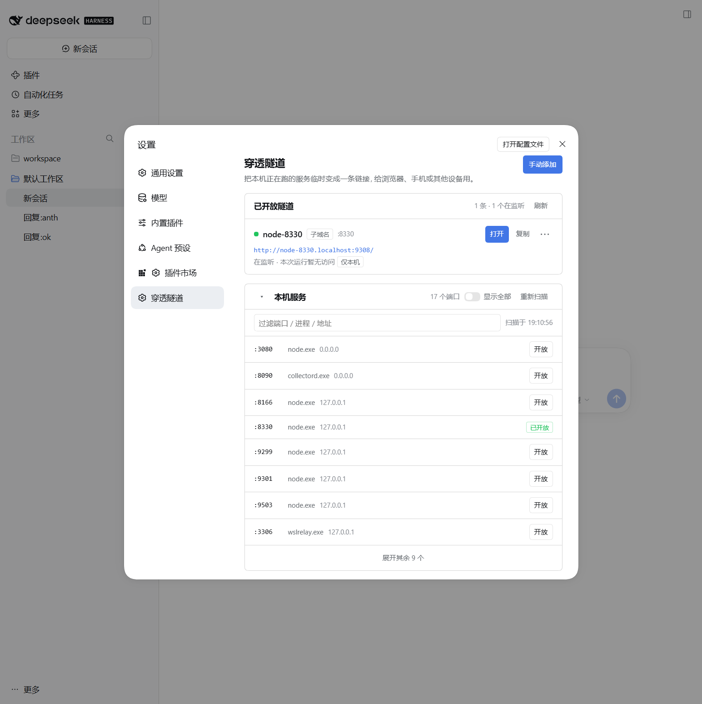

# dsh-tunnel

穿透隧道:在 dsh 宿主进程内把本地端口反向代理出来。管理入口只有一个——**设置 > 穿透隧道**;有隧道开放时,窗口底部常驻一行状态条,点击打开内嵌管理弹窗,无隧道时不占高度。同一张隧道表同时服务 GUI 与 ai,不引入 nginx/caddy 等外部反代。

## 预览

## 0.2.0 变化

- 移除主面板、`sidebar.panellist` 页签、设置 > 插件卡片、插件管理页配置卡与 `betterSidebar` 适配;低频功能收进设置分区,不再占主页与侧栏。
- 设置分区:已开放隧道、完整可点击地址、状态/本次运行统计、本机监听端口发现、手动添加、编辑/停用/删除。
- `tunnel_open` 的 `name` 可省略,自动生成 `app-<port>`;返回 `url`(本机)与 `lanUrl`(同网段,仅路径入口)。
- 新增 `tunnel_ports` 工具与 REST `GET /api/tunnel/ports`、`GET /api/tunnel/probe`、`PATCH /api/tunnel/tunnels/:name`。
- 持久化行新增 `enabled`(旧行默认启用);状态由运行期派生,不落盘。

## 双入口形态

### path(默认)——子路径模式

`http://<host>:<port>/p/<name>/` → 本机 targetPort:

- HTTP 前缀 strip 纯字节转发, 保留原 Host, 附 `x-forwarded-host/for/proto`;3xx 同源根绝对路径的 `Location` 单头补前缀
- WebSocket 任意路径可用, 无需声明
- 应用需支持子路径部署(vite `--base` / jupyter `base_url` / gradio `root_path` / streamlit `baseUrlPath`)
- 同源访问, cookie 与安全上下文共享;手机/同网段设备用局域网地址

### subdomain——子域名模式

`http://<name>.<泛解析到本机的域名>:<port>/` → 本机 targetPort(本机浏览器可用 `<name>.localhost:<port>`):

- 全路径全协议透传: 无 strip、不改写 Location、WebSocket 任意路径可用
- 应用按根路径正常启动, 无需 base 参数
- 限制: 隧道名至少含一个字母(纯数字会与纯 IP 访问首段冲突);子域名隧道名等于**当前设置页地址**首标签时拒绝(保存后该地址会被隧道接管, 含 `/api/*`), 换名或改用其它地址打开设置页后再建;HTTPS 需泛域名证书
- 分流只按 Host 首标签命中, 不读宿主 `trustedHosts`: 该集合由 `dsh-auto-trust-all` 按到达的 Host 动态累积, 泛解析部署下用它判入口会把每个试用过的子域当成入口

## 使用

- GUI: 设置 > 穿透隧道。顶部「手动添加」;「本机服务」默认折叠, 展开后按端口/进程/地址过滤, 一键开放;行内「打开/复制/⋯」, `⋯` 里有复制局域网地址、编辑(可改名)、停用/启用、删除(二次确认)。菜单挂在 body 上, 不会被设置面板滚动区裁剪。
- 底部状态条: 有启用隧道时出现在窗口最底部(宿主 `shell.bottom`), 固定单行。单条显示名称与开放时长, 多条显示「隧道 N 条运行中」;有超过 24 小时未关的追加警示文案。悬停可看全部地址。整行可点击, 打开与设置分区同一套内容的内嵌管理弹窗(创建/编辑/停用/删除), 不提供一键关闭, 避免误关。停用隧道不计入;超过 24 小时未关时,单条时长用警示色、多条追加「有隧道开放超过 24 小时」。无隧道、加载中或旧宿主无该槽时不渲染, 不占高度。
- ai: `tunnel_open(targetPort, name?, entry?)` / `tunnel_list(probe?)` / `tunnel_ports(all?, refresh?, limit?)` / `tunnel_close(name)`。「允许 ai 使用」关闭即向 ai 注销工具, GUI/REST 不受影响。
- 自动命名: 省略 `name` 时服务端生成 `app-<port>`, 冲突自动加 `-2`;显式重名返回 400。
- 访问地址: path 为同源 `/p/<name>/`;subdomain 按当前域名派生 `<name>.<域名>`, IP/localhost 访问退回 `<name>.localhost` 并标注仅本机。
- 状态: 停用 > 路由错误 > 健康探测(在线/离线) > 未检测;健康探测为 TCP `localhost` 500ms, 缓存 3s, 不做 HTTP/title 探测。
- 持久化 `~/.dsh/dsh-tunnel/tunnels.json`(随 `DSH_HOME`): `name/targetPort/entry/enabled/createdAt`;运行期统计(请求数/错误数/最近访问)不落盘。目标拒连 502, 响应头等待超时(默认 10s, 头到即解除, SSE 不受影响)504。

## REST

- `GET /api/tunnel/tunnels?probe=1` → `{items}`(含 `status/health/stats/enabled`)
- `POST /api/tunnel/tunnels` → 创建;`PATCH /api/tunnel/tunnels/:name` → `{name?, targetPort?, entry?, enabled?}`(改名会重建路由并回收旧地址连接);`DELETE /api/tunnel/tunnels/:name`
- `GET /api/tunnel/ports?all=1&refresh=1`;`GET /api/tunnel/probe?port=8090`
- `GET /api/tunnel/status` → `{ui,total,lanOrigin}`
- `POST /api/tunnel/ui-settings` → `{aiTools}`

所有写路由强制 JSON 且校验 Origin 与 Host 同源(浏览器 CSRF 防线);每个路由先走宿主 `connection.requestRejection` 闸门。

## client 依赖

设置分区通过 `@mzzsfy/dsh-common-tools/client` 订阅数据变更, 装载行 `tunnel-dsh-common-tools` 随本包 `cordis.patch.yml` 自带(依赖 `^0.5.0`), 宿主按包名合并成一份 client 模块。公共模块缺失时装载层报告具体依赖错误;宿主 React 缺失时控制台报告原因并禁用分区。剪贴板在非安全上下文(内网 http)自动降级到选区复制。

## 验证

- `npm test`: 148 用例全绿, 覆盖双入口行为、故障边界、REST/CSRF/超限 413、统一路由闸门、ai 开关注销、端口发现、自动命名、enabled/PATCH、IPv6 目标、状态矩阵、设置分区与底部状态条注册、可见性门控、空态判定、超时摘要、常量同源(状态条渲染与弹窗交互由真机覆盖)。
- 隔离宿主 + 真机浏览器: 设置分区可见、创建/打开/停用/启用/编辑/删除、path/subdomain 转发与统计更新;底部状态条随隧道出现/消失,单条/多条文案正确,点击打开内嵌管理弹窗,嵌套弹窗 Esc 只关最上层。

## dsh 版本兼容

按仓库动态窗口验证(`scripts/compat/window.mjs`), 主测 = 渠道 dist-tag 最新 rc, 基线 = npm latest。逐轮实测结论见 `兼容性测试.md`。
