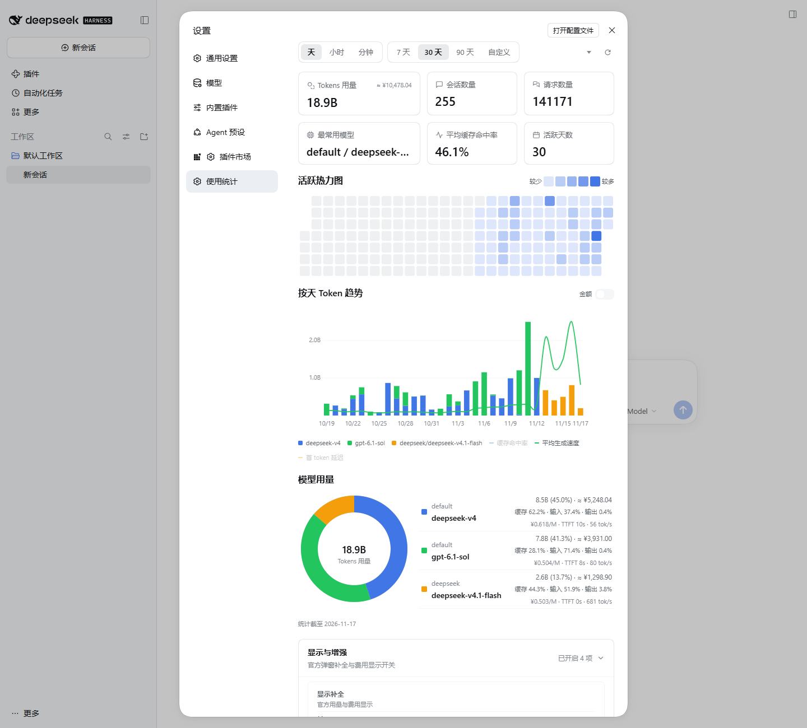
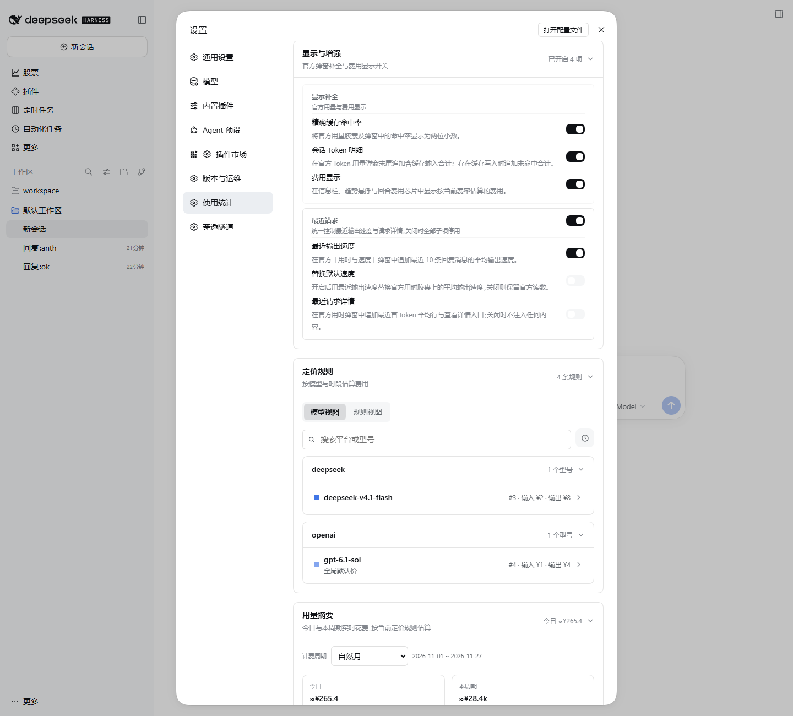
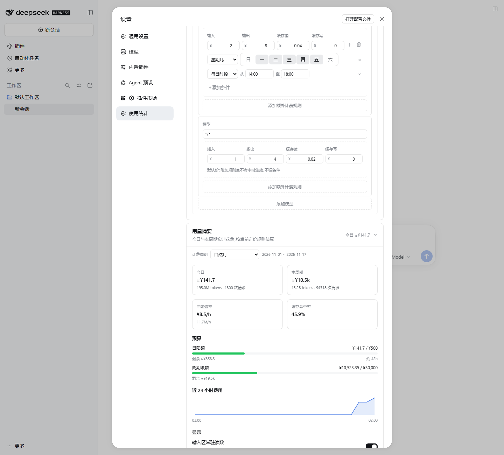
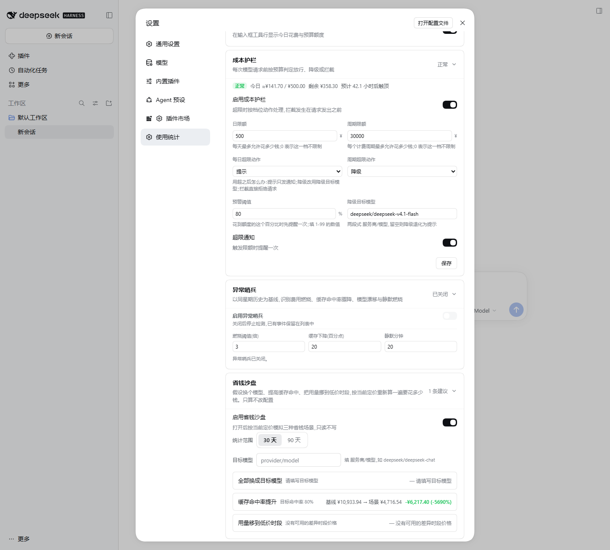
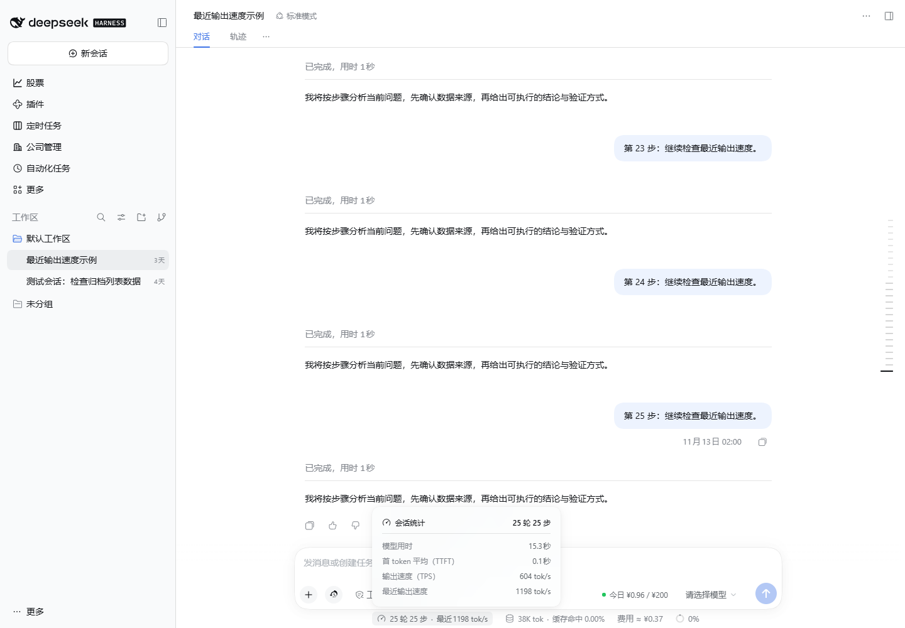
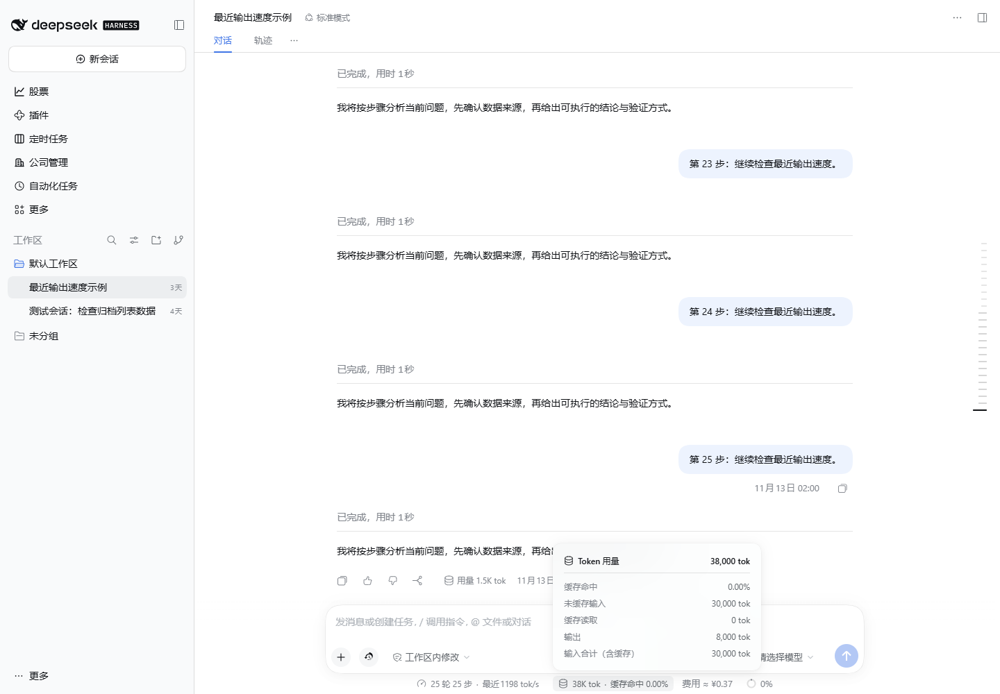
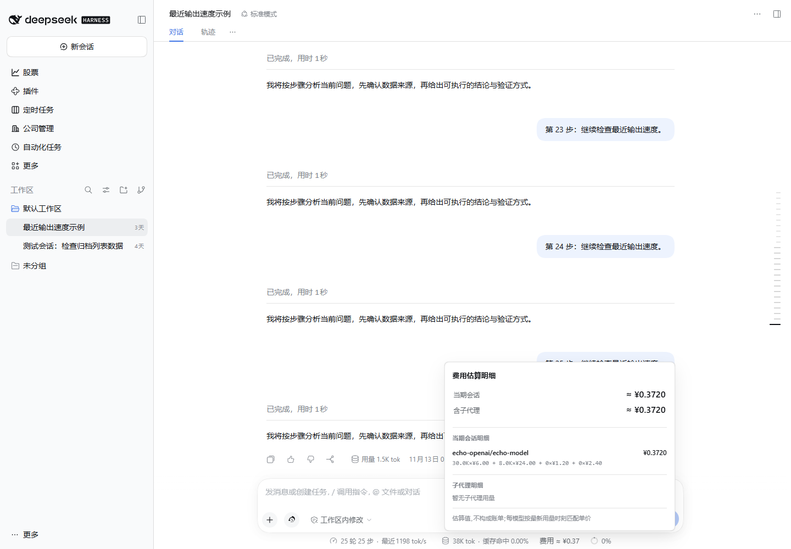
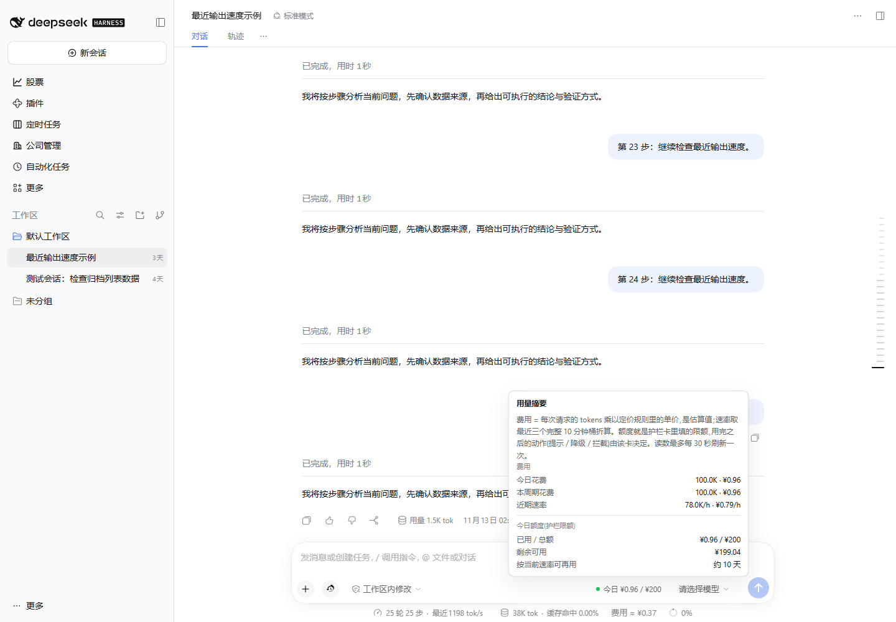

# @mzzsfy/dsh-usage-dash

用量统计面板(dsh 插件)。天/小时/分钟三粒度 token 与请求统计,设置页自绘面板:汇总卡、活动热力图、缓存命中率曲线、模型 donut 与列表、回扫状态行、会话底栏追加、回合费用芯片与官方用时弹窗最近请求详情,支持 en/zh 双语与可选费用估算;另含成本控制四模块:省钱沙盘、成本护栏(预算超限拦截/降级)、异常哨兵与用量摘要(设置页卡片 + 输入区常驻读数)。复刻自 [HaoyueQin/dsh-usage-statistics-panel](https://github.com/HaoyueQin/dsh-usage-statistics-panel),感谢原作者。

## 预览










## 功能(全阶段已交付)

设置页「使用统计」区块:

- 三粒度视图,全部支持自定义时间范围:天(7/30/90 天/自定义日期段)、小时(24 小时/3 天/7 天/15 天/自定义时刻段)、分钟(3 小时/24 小时/3 天/7 天/自定义时刻段,10 分钟桶粒度),预设挡为滚动窗口;自定义时刻段为起止 datetime 双输入,两端归一到桶边界(小时取所在整点、分钟起点对齐 10 分钟且终点保留原分钟,均闭区间),跨度上限与数据保留期一致(小时 15 天、分钟 7 天,超限自动钳起点;15 天预设取「起始整点 → 当前整点」闭区间,合计 361 个整点桶,客户端按墙钟回推起点,夏令时回拨日也不会越界),首次切到自定义挡预填最近 24 小时,时/分两视图共享同一对自定义输入;已知限制:自定义输入残缺(任一端为空)时面板不发请求且图表静默空白,与天视图行为一致,交互反馈留待后续增强
- 汇总卡六张:Tokens 用量(服务商总口径)、会话数量(窗口内真实会话去重计数,不含子 agent 会话)、请求数量、最常用模型、平均缓存命中率、活跃天数(恒按天口径,不随视图切换);配置定价规则后 Tokens 卡头部行右侧显示估算费用。Tokens 卡与模型列表的 token 数字统一按「三位整数 + 两位小数」缩写(K/M/B/T/Q,最大到 Q,如 `1.80K`、`205.60M`、`812.50M`、`134.10B`),悬浮显示完整千分位数字
- 活动热力图:GitHub 风格周列×星期行,26 周窗口,五档色阶,悬停明细(token 用量按三位整数 + 两位小数带单位缩写,如 `893.05M`,读数与汇总卡同一 formatter;配置定价规则后附「费用 ≈」估算行,受「费用显示」开关;费用数据优先按小时桶计价;小时桶过保留期的历史日回落日桶起点计价,不因缺少小时行显示为零);仅按天视图展示
- 缓存命中率曲线:日粒度命中率 + 右侧副轴,并叠加平均生成速度曲线与首 token 延迟曲线(各自单独颜色,读数走悬停;仅含配对数据的槽参与,整图无数据不绘制),悬停按已启用曲线显示当前时段命中率、平均生成速度、首 token 延迟,模型明细随 Token/金额视图与图例筛选联动(配置定价规则后 Token 视图可附所选模型估算费用行,受「费用显示」开关;三粒度趋势图通用)
- 模型 donut 与列表:按 token 排序的模型占比环形图(中心为总量,模型不超过 5 个时全展示,超过时折叠为前 4 +「其他」,「其他」可展开),每行名称两行展示(厂商/模型名),右侧三排:第一排 token 数·占比·估算总费用,第二排输入输出占比构成(缓存/输入/输出 三段各占该模型 token 总量,缓存=读+写,三段合计 100%,无四桶数据不显示),第三排每百万均价·TTFT·生成速度(均价与费用需配置定价规则,TTFT/速度无配对数据不显示),悬停明细含输入/缓存读/缓存写/输出四桶 token 拆分并联动
- 三粒度堆叠柱状趋势图(数据量大时裁最旧并提示);节头「金额」开关把柱状图从 token 消耗切到金额消耗——柱按模型堆叠估算费用,标题、左轴和悬停的总计/逐模型/「其他」明细同步切金额读数(带货币符号和「≈」),三粒度通用;开关仅在存在正计价数据时显示(未配置规则或全量未计价时不渲染,避免全零金额柱误导)。槽内全部模型未命中规则时该槽不挂费用,悬停显示「—」而不是冒充 ¥0.00;部分模型未定价时仅列已定价模型的金额。图例点击单选、再点恢复默认显示(全部模型及有数据的速度线),Ctrl+点击多选,隐藏最后一项无效;换窗口时只保留仍可用的所选项,全部失效则恢复默认显示;柱高、提示合计、辅助费用和均价均按可见模型计算,「其他」子项不重复计入合计,金额模式「其他」明细按费用降序。命中率/速度/首 token 延迟曲线保持整个时段的统计口径,提示中标注「时段整体指标」,仅显示已启用且当前桶有数据的曲线读数(速度或延迟为零仍属有效值,独立 timing 桶没有 Token 也可展示);仅选曲线时不再显示模型合计与费用。零用量模型不显示,有用量的零费用模型保留零费用读数,未定价模型显示「—」;无可见模型用量且没有启用曲线的有效读数时不显示提示;切换时间窗口时提示绑定时间桶,不复用旧位置。金额模式主费用读数不受「费用显示」开关控制;有可见模型用量且所选费用为正时显示均价,该均价亦不受此开关控制。Token 模式辅助费用与均价仍受「费用显示」开关控制
- 回扫状态行默认隐藏:首次启用自动回扫历史会话,运行中显示进度(常显);右上角为折叠箭头与刷新图标,折叠层内展开扫描异常日志块(逐条:时间/类型/明细,计数即明细条数,上限 200 条超限丢最旧,重建时清空)与「重建」入口(二次确认 3 秒后清库重扫),采集错误常显;折叠且有待读信息(异常日志或写入失败)时箭头带红点提醒,展开后消失;工具栏分主区与右侧操作区,窄宽度时挡位组在主区内换行
- 设置区折叠:面板底部「显示与增强」「定价规则」为默认收起的折叠区块,标题显示已开启项数与规则条数;「显示与增强」内拆成「显示补全」「最近请求」两个小分组,「最近输出速度」「替换默认速度」「最近请求详情」集中到最近请求分组;最近请求分组标题右侧总开关联动全部子项,关闭时子项置灰并复位,打开时统一启用最近输出速度与最近请求详情;折叠只隐藏 body,编辑器草稿与开关状态不丢失
- 会话底栏追加(append 模式):本插件在官方 activity/usage 胶囊之后仅显示估算费用,不另建底栏明细按钮;费用条目本身是可点击按钮(`aria-haspopup="dialog"`),点击展开估算明细浮层,再点条目、按 Esc 或点击面板外关闭,浮层 portal 到 body 并按元素上方锚定(抄官方 ContextMeter 的展开形态)。浮层分两档合计:「当期会话」与「含子代理」;每档按模型聚合,每个模型一行,给四桶 token × 命中单价的展开式与金额;公式项里的 token 按三位整数 + 两位小数缩写(如 `103.10M`、`134.10B`),悬浮到任一项显示完整 token、单价、该项金额与命中规则(带 conditions 时给条件摘要,避免同一模型多个单价无法分辨);底部标注估算口径与未定价计数。费用按宿主 `usageDashModelUsage` 会话投影的四桶 token 按模型聚合,单价取该模型最新用量时刻命中的规则;投影缺席或模型没有 routes 时显示「—」,不再用 `*/*` 的全局价冒充会话价;规则表为空时整个费用项不显示(编辑器仍保留未配置的全局槽)。精确缓存命中率开关(`cachePrecision`)原位修改官方 usage 胶囊的命中率文字、按钮 `aria-label` 与官方弹窗原命中率 `dd`,统一显示两位小数;关闭开关或卸载增强时还原,保留官方节点与交互。「会话 Token 明细」开关(`tokenDetail`)只在已打开的官方 `[data-session-stats-usage]` 用量弹窗 `dl` 末尾追加「输入合计（含缓存）」(未缓存输入+缓存读+缓存写),仅当 `cacheWriteTokens > 0` 再追加「未命中合计（含缓存写入）」(未缓存输入+缓存写入)。合计使用完整千分位计数,官方已有的总量、缓存读写、输出与命中率不重复追加;无输入用量时不追加零值合计。存在子代理时在同一位置追加「子代理用量」行与「查看 N 个子代理明细」按钮,点击打开独立 modal(二级页):每个子代理一行,列标题/模型/未缓存输入/输出/缓存读/缓存写/合计 Token/费用,费用按小时投影按模型聚合;只有 `tokenUsage` 摘要的标「仅摘要」不给费用,两者都缺失的标「未取到用量」,表尾给合计 Token 与已定价费用合计。子代理取 `sessions.list.byId` 中 `origin='subagent'` 且 `parentId` 归到当前会话的后代,普通 fork 不计入;打开 modal 时才懒拉各子会话全量投影。「最近输出速度」开关(`recentSpeed`)在官方 `[data-session-stats-details]`「用时与速度」弹窗的输出速度行之后追加一行读数:取当前会话最近最多 10 条助手消息,数值为这些消息的输出 token 合计除以 decode 时长合计,单条时长取首个 token 到消息完成,数据来自本插件注册的 `usageDashRecentSpeed` 会话投影,与官方「输出速度」同一套 decode 定义(step/start 建窗、assistant/attempt 锁首 token、assistant/message 结算),宿主按会话推送,几十个并行会话互不干扰;投影不可用(旧宿主或本会话无读数)时才回落到窗口节点估算(客户端节点实测不记录首 token,此时按端到端含首字等待,与官方投影差异通常低于 3%),零输出消息只添分母;投影状态随会话持久化,rescan 可从事件流重建,重启后读数仍准确,不跨会话、不读服务端统计面板历史;窗口内无可用步骤时不渲染该行,不显示占位符。其子开关「替换默认速度」(`replaceSpeed`)仅在最近请求总开关与统计开关都开启时可操作,开启后把官方 activity 胶囊上的整会话平均速度原位替换为最近输出速度(文本与按钮 `aria-label` 同步,读数前带「最近」,关闭或卸载还原),默认关。胶囊替换按宿主语言的每秒单位匹配(`tok/s`、`jetons/s`、`ток/с`),官方胶囊悬浮提示仍由宿主 props 生成,替换后悬停显示的仍是官方平均速度;宿主紧凑用量模式(performance usage=compact)不渲染统计弹窗,读数行不可达,仅胶囊替换生效。偏好卡展示项四个开关默认全开、替换与最近请求详情默认关;六项开关统一存宿主 settings `usage-dash.statsLine`,客户端经 `configForms` 读写,刷新、换浏览器或清缓存后按宿主配置恢复,不使用浏览器 localStorage;「费用显示」控制底栏费用、Token 趋势 tooltip 的辅助费用行与回合费用芯片;金额趋势主读数不受此开关控制。官方弹窗关闭时不挂载补充行;空用量无插件可见条目,精度或明细单独开启均不产生底栏入口。官方未公开用量弹窗扩展 slot,上述增强依赖宿主 DOM 语义标记,标记改变或无法唯一确认弹窗归属时停用相应增强,底栏费用仍独立显示。
- 最近请求详情(`requestDetails`,默认关):设置页「使用统计」开关,关闭时不向官方用时弹窗注入任何节点。开启后在官方 `[data-session-stats-details]` 的「首 token 平均（TTFT）」行之后追加「最近首 token 平均」行(取最近 10 次请求的 TTFT 算术平均,单位秒,不改官方平均值),并在同一弹窗底部追加「查看最近请求详情」按钮;按钮打开独立 modal,不改变官方弹窗内容。modal 主表按完成时间倒序展示最近 10 条:时间、状态、模型、首字延迟、生成速度、输出 token、总 Token、按请求开始时刻命中的当前定价规则预估费用;行内生成速度为输出 token 除以首 token 到完成的 decode 时长,decode 窗口短于 100ms 的行视为样本不足并显示「—」,不参与表尾速度均值,避免毫秒级事件时间放大短请求读数;当前生成中的 step 固定为首行,TTFT/usage 未上报时显示「—」,已上报时带 `~` 部分值。行可展开查看完整请求信息:轮次/步骤、尝试次数、完整模型、开始/首字/完成时刻、首字延迟与生成时长、未缓存输入/缓存读/缓存写/输出四桶、输入合计、总 Token、缓存命中率、分项费用、命中规则与货币。表尾展示已完成请求的均值(首字算术平均、速度按 Σ输出÷Σdecode 加权、Token 平均、费用按已定价行平均),当前行与错误/中止行不计入;费用是客户端按当前规则重算的估算值,不落投影、不标账单。数据来自本插件 `usageDashRecentRequests` 会话投影(按 `turn:step` 去重、窗口 10 条、rescan 可重建),官方 TTFT 行缺失或窗口内无请求时不注入。
- 回合费用芯片:经官方 `conversation.chat.assistant-actions` 槽注入动作行(复制与分支图标之间,官方赞/踩与上下文跳转同排),每轮对话结束后显示该轮估算费用(悬停显示 token 摘要与估算口径;显隐节奏随官方动作行——最新一轮常显,历史轮悬停显现;受「费用显示」开关;官方用量芯片弹窗已有 token 明细,芯片只承载费用)。旧宿主无该插槽时告警禁用
- 定价规则分为「模型」「规则」「编辑」三页。「模型」按平台查看统计范围内已观测型号的单价和命中规则，也可搜索未观测型号试算；没有用量数据时不显示汇总卡。「规则」按有无 `*` 分组，组内按平台、型号排序，每条规则占一行，整行可点开查看实际接管与四桶价格；只有确实计费或接管到型号时才出现计费/被接管徽章，点徽章先打开型号列表，列表内可再看匹配规则或跳到模型。「编辑」提供四桶价格、生效条件、全局币种及批量套用；匹配说明仅在编辑页悬浮或聚焦时显示，不占规则列表行内空间。修改写入草稿，点「保存」后全局计费使用新规则。
- 统一悬浮提示:全面板共用一套自绘浮层。图表读数跟随指针(偏移 14px,右侧或下方放不下时翻到另一侧,夹取边界为面板),同一柱/格内移动持续跟手;整块说明(汇总卡、费用角标、状态日志明细、底栏费用、回合费用芯片)按元素上方锚定,鼠标在块内移动不抖。首次显示延迟 80ms,已显示后跨元素切换不再等待;内容统一为「标题 + 分组 + 标签/数值两列」(等宽数字右对齐),替代信息性原生 `title`。图例项、模型行与 donut 扇区悬停联动趋势图:同模型柱段保持原色、其余降透明;热力图悬停单元格描边高亮
- 双语:跟随宿主语言设置(设置 → 通用 → 语言)即时切换 en/zh
- 数据 API 守卫:十四端点经共享 `withRouteGate` 在注册处统一下沉宿主闸门(`connection.requestRejection`)与写路由守卫(Origin↔Host 同源比对,大小写不敏感;content-type 媒体类型精确匹配 `application/json`,允许 charset 参数;`text/plain; application/json` 之类子串不再放行),与 dsh-usage-panel 同构;拒绝响应为共享信封 `{ error }`(跨源 403 / 非 JSON 400),业务错误仍为 `{ ok:false, error:{ code, message } }`;pricing 端点 POST 与其余写路由同规则(GET 读不需 content-type);局域网远程访问可用

口径:token 总量 = 未缓存输入 + 输出 + 缓存读 + 缓存写;命中率 = 缓存读 / (缓存读 + 未缓存输入 + 缓存写);桶按 host 本地时区,分钟桶按本地墙钟向下取整到 10 分钟(偏移非整十分钟的时区如尼泊尔 +5:45、查塔姆 +12:45 也落同一桶边界,客户端与服务端同口径,不按 UTC 纪元取整)。聚合响应 `models` 数组每模型带 `inputTokens`/`outputTokens`/`cacheReadTokens`/`cacheWriteTokens` 四桶拆分(与定价四桶同口径),模型列表据此展示输入输出对比。平均生成速度 = decode 配对分子 ÷ 解码时长,两者均取官方吞吐口径(与官方 session-stats 投影同构):解码时长为该步首 token 时刻(首个产出 token 的 attempt 流,回落 message 自带流)到 usage 汇报时刻,不含首 token 前的排队与提示处理等待;首 token 延迟(TTFT)= 首 token 时刻 − `step/start`(起点不随 `llm/retry-started` 重置,即含失败尝试时间)。首 token 时刻在 chunk token 样本上不可得,由后续 usage 报告(message 为主)补发零桶 timing 增量行承载(decodeTokens 与时长同源配对,不重复计 token);存量旧行(时长为旧全时长口径)速度分子回落输出 token,聚合随新数据自然收敛,重建(重扫)可全量按新口径重建。保留策略:天桶永久,小时桶固定 15 天,分钟桶默认 7 天且上限 7 天(设置项 `minuteRetentionDays`,0 = 禁用分钟桶)。会话数量口径:窗口内至少产生过一个用量样本的真实会话去重计数,按会话 id 跨桶并集;子 agent 会话(`SessionHeader.origin === 'subagent'`,旧记录为 `parentSession` 存在且 `delegationDepth >= 1`)只计用量、不计会话数——普通 fork 仅带 `parentSession` 不判子会话。会话索引与用量桶同库但独立表:天行永久、小时行随小时桶保留期清理,升级旧数据后首次 boot 自动补建索引(只写索引不碰桶);分钟视图没有独立会话行,按覆盖小时行的并集近似,窗口边界最多外扩一小时。归档会话不改变统计口径:归档只影响主视图可见性,其历史用量与会话索引照常计入(消耗真实发生),本插件不读取归档集合做过滤,也不因归档/取消归档触发重建。

写入模型:样本先同步合并进内存 pending,按 2 秒周期批量落盘(单布局存储域每次持久化写都全量重发布 unit 文档,合并把每样本 3 次写降为每脏行 1 次,回扫万级样本写放大降约 99%);查询前自动 flush 保证读己之写;flush 失败的行留 pending 下轮重试并经异常日志可观测,崩溃丢失窗口 = flush 周期,统计可由会话重扫重建。同一存储服务复用现有健康实例;主域已占用时新实例报告降级,不会关闭占用者或中断其待写数据。备份域占用仅停用备份,主采集继续。清库(孤儿行清理、重建、回退)与实时采集并存:本 boot 实时增量在内存累积器里全程保留,清表后按累积器整体重建,清表期间新到的实时样本、写游标失败或备份快照失败后的重试都不会丢读数。重建的重放上界取「本 boot 实时起点」而非当前日志尾部:累积器自该 seq 起累积,若按尾部重放会把实时区间既从日志重放一遍又由累积器回填一次(双计并随落盘固化);无实时增量的会话按尾部重放,死会话全量重放。回退接口在无备份快照时返回 409 而不是清空全量与游标。更换全局缓存结构后须冷重启宿主,不热迁移仍在使用的存储域。

## 定价与费用估算

规则存于独立的 `usage_pricing` 存储域(`~/.dsh/storages/usage_pricing.json`,单表单行),不进 profile 配置节——逐条规则的嵌套结构写在 YAML 里会把整节配置撑散;经 `GET/POST /api/usage-dash/pricing` 读写(响应含单调 revision)。旧版本把规则写在 profile `cordis.patch.yml` 的 `usage-dash.config.pricing.rules`:升级后首次启动把规则搬进新域,并从补丁中删除该键。导入失败(域不可用)时中止迁移、配置节原样保留,下次启动重试;导入成功后删键失败时域已有一份,下轮只重试删键,域内已有记录时不再覆盖配置节来源。底栏六项增强偏好存同一设置条目的 `statsLine` 字段(客户端 `configForms` 读写,无浏览器本地存储);设置面板编辑器为常规入口。单页内价格请求合并为一个在途请求,缓存有效期内复用;保存成功会同步更新已挂载底栏/费用芯片,并重取面板日范围、热力图及当前时/分数据。迟到的低 revision 不覆盖缓存中的新价格。各窗口维护独立草稿，保存会用该窗口的草稿整表替换规则，多窗口以最后一次成功保存为准。价格不存本机持久缓存。

规则形态:`{ model, currency, price: { input, output, cacheRead, cacheWrite }, conditions }`,单价单位固定「每百万 token」;存量规则缺 `conditions` 或为 `null` 时按无条件默认规则参与匹配。货币为编辑器级全局设置:在「编辑」页切换,仅 ¥/$ 两档(无「空」档),打开编辑器即按首个非空货币归一显示(无非空回落 ¥),切换或保存后整表统一;wire 形态不变(仍为逐规则字段),存量空货币规则经编辑器保存后归一。**服务端单币约束**:pricing POST 整表替换时非空 currency 全表必须一致,混币提交 400 拒绝——费用聚合按数值直接相加,混币相加无意义。费用显示为全局价格定位:汇总卡/趋势悬浮/模型列表/底栏费用项/回合费用芯片的货币符号统一取规则表首个非空货币(数值仍按命中规则单价计算),切换并保存后全部显示点随之变更。**计价时点口径**:时间条件按「估算时点」匹配当前规则表——面板聚合与底栏都按小时桶时点(底栏使用宿主 `usageDashModelUsage` 投影返回的小时/模型桶),回合费用芯片优先取回合结束事件时刻(节点缺时刻的旧形态才冻结在首次观测时刻,重渲染不漂移);规则表变更后按当前规则重算历史为既定选择,不做价格版本化存储。

- 模型匹配采用 `vendor/model` 格式，以首个 `/` 分段，模型名可含 `/`。每段最多一个 `*`，匹配零个或多个字符。`*/deepseek-v*` 可跨平台覆盖一组型号，`vendor/deepseek-v3` 可设置单一平台与型号的价格。
- 计费先比较平台，再比较型号。每段依次优先精确、含字面字符的通配、单独 `*`。通配按字面字符数降序，同长时按前缀、后缀、中缀排序。所有条件须满足。同优先级规则优先条件数较多的一条，仍相同则取规则表中第一条。规则页按有无 `*` 分组（无星组在前），组内按平台、型号字母序，仅作展示；计费按上述优先级，只有同优先级平局才沿用规则表顺序。历史费用会应用新优先级重新估算，例如 `vendor/*` 优先于 `*/deepseek-v3`。
- 全局兜底采用无条件 `*/*`。保存任一非空规则表都需要填写这四项价格，显式填零代表免费。空表表示未配置。在编辑页可通过「停用定价」清空草稿，再保存空表。旧表若缺兜底仍可读取，保存时须补齐。首次未配置时读取返回 200（`rules: []`、revision 0）；保存空表后 `rules` 仍为空，但 revision 自增。定价存储域不可用时 GET/POST 均返回 503，界面显示「定价规则不可用」并提供重新加载；GET 成功但回包畸形（存量规则无法渲染）且无可用缓存时同样显示不可用，重试通常无效，可二次确认清空为空表自救（该出口仅在 GET 已成功、存储可写时有意义）。同一模式保留首条无条件价及全部条件规则，保留这些规则的相对顺序。
- 模型、规则与批量预览按宿主时区的快照时点匹配现价。宿主未提供时区时使用浏览器本地时区。快照估算将所选时点的单价应用于窗口总用量，历史费用仍逐桶计价。批量套用保留来源规则的平台模式、四桶价格及条件。同范围的现有规则自动跳过，确认后写入草稿。
- 条件类型(数组内 AND,空数组恒生效),**所有范围条件统一双侧包含**(含起始含结束,from===to 即单点/单日;相邻区间请写 1~15 与 16~31,端点重叠时先比较匹配优先级和条件数，再比较规则表顺序),编辑器支持添加/编辑/删除:每条计费规则下方「+添加条件」按钮追加一条默认条件(时段默认全天 00:00~23:59,行内类型下拉切换即重置为该类型默认值:周几默认空、号段默认全月 1~31、日期段默认当天单日);编辑器端校验拒绝非法时刻(需 24 小时制 HH:MM)、周几(需 0-6)、月号(需 1-31)、非规范日期与日期段倒序(时段/号段倒序是跨午夜/跨月环绕,合法);每日时段为自绘 HH:MM 文本输入(原生 time 控件的段位由浏览器按系统区域决定,部分环境渲染秒段导致带秒值被拒),全角数字折半角,凑满四位自动补冒号,粘贴带秒串自动截取前四位
  - `dailyWindow`:`{ from: 'HH:MM', to: 'HH:MM' }` 每日时段双侧包含,from<to 正向,from>to 跨午夜,from===to 单点;全天即 00:00~23:59
  - `weekdays`:`{ days: [0-6] }` 星期几(集合,非范围),0=周日,空数组不成立;编辑器为日~六七枚 pill 多选
  - `monthDays`:`{ from, to }` 月内号段双侧包含整数(1-31),from>to 跨月环绕(账单周期),from===to 单日(如 5~5 即 5 号);2 月无 31 号自然不触发
  - `dateRange`:`{ from: 'YYYY-MM-DD', to: 'YYYY-MM-DD' }` 零填充字典序双侧包含,from===to 单日,from>to 倒序不成立(不可保存)
- 费用精度:**小时级**——聚合按小时桶起点时刻匹配价格,分钟槽费用由其所属小时桶价格导出;日档历史日在小时桶过保留期后按日桶起点兜底计价,避免小时保留期外的天显示无费用;底栏按会话投影的小时/模型桶逐项计价,回合芯片按回合结束时刻匹配一次;改价即时生效,历史费用下次查询按新规则重算(不回溯账单)。定价激活且有规则时聚合响应在槽级携带 `cost` 与逐模型拆分 `costByModel`(金额柱状图与悬浮读数的数据源);规则为空时不挂 `cost`/`unpriced`,汇总卡不把「未配置」显示成 `¥0.00`
- 时区口径:匹配与聚合均用 host 进程本地时区;底栏的小时桶由 host 投影生成,条件按桶时刻在**浏览器本地时区**评估;回合芯片按回合结束时刻在浏览器本地时区评估;跨时区访问时与面板费用存在预期内偏差;所有费用均为按当前费率的估算值(标注「≈」与「估算」),不构成账单
- 子代理口径:展开面板的「含子代理」档 = 当期会话费用 + 全部后代子代理费用,子代理身份来自宿主会话列表(槽标准 props `useSessions` 的 `SessionListState`),判定条件与宿主一致——只有 `origin === 'subagent'` 算子代理,普通 fork 虽带 `parentId` 但不算;遍历按 visited 防环,孤儿(父行不在列表内)不可达。所有子代理的小时投影合并后**按模型聚合**,每个模型一行、只算一次,与当期档共用同一计价函数;取不到小时数据的子代理只计数并在脚注提示,不伪造零值。该投影声明了 `summary: false`(逐时逐模型体积大,不进会话列表行),所以面板展开时经 client `sessions` 服务对当前会话与每个子会话调用 `refreshProjections` 再读 `projectionsBySession`——与官方子代理面板同一取数面,同一会话重复展开不会重复请求(`projectionLoads` 就绪后短路);拉取失败或宿主无该服务时该子代理计入「未取到用量」。当期未命中价时说明「当前模型未定价」,两档合计只累加已定价模型行;旧宿主不提供 `useSessions` 时面板只显示当期会话档并说明子代理不可统计,不显示伪造的零值。面板明细不落存储、不自建插件 HTTP 接口;展开时才订阅会话列表,并经宿主 client `sessions` 服务按会话拉取投影(宿主内 RPC,不经过本包 `/api`,同一会话拉过一次后短路)

## 成本控制

在统计之上做四件事,全部基于已有的 `usage_stats` 桶与定价规则,不新建采集链路、不回落浏览器存储。四模块共用 `GET /api/usage-dash/budget` 的配置节(设置存储域 `usage-dash.budget`)与 `sentinel` 节;计费周期单独存在 `usage-dash.cycle` 节(`kind` 取 `calendar`/`monthly`/`rolling`,`startDay` 取 1-31,`days` 取 1-366),由摘要卡的「计费周期」一行经 `GET|POST /api/usage-dash/cycle` 读写。

**四模块各有独立开关,默认全关**(`features` 节,`GET/POST /api/usage-dash/features`)。装上插件不拦请求、不产检测事件、不占界面,想用再逐项打开(关闭态的拦截钩子与检测定时器都在,但每请求/每周期立即早退,不做周期查询);摘要本身是设置页「使用统计」里的一张卡,不占侧栏也不占主区面板。开关与各模块自身的额度 / 阈值分开存:预算配置里没有 `enabled`,运行期由 `features.guard` 投影到拦截器与 `/budget` 回包的 `config.enabled`/`status.enabled`,哨兵同理。关闭态不轮询、不拦请求;护栏卡与哨兵卡仍显示已存配置,状态行只说明「未启用」。

- **省钱沙盘**(设置页「省钱沙盘」卡,只读):按当前定价重算三种假设场景,给「基线 → 场景」与差额。`model-swap` 把全部用量按目标模型单价重算(目标模型两段式,缺价则该场景标记不可用);`cache-leverage` 保持总输入不变,把缓存读占比提到目标命中率后再计价;`offpeak-shift` 把指定比例的用量按 12 小时后的同模型价格重算。全量未定价、目标模型缺价、无差异时段价三种情况分别给出原因文案而不是 ¥0.00;规则表为空时整卡显示定价引导。
- **成本护栏**(设置页「成本护栏」卡):日/周期两档限额(存储键 `budget.monthly` 不变),每档可设动作——提示、降级模型、拦截。判定发生在 `llm/stream` 前置 waterfall:拦截时直接抛 `BUDGET_EXCEEDED`,不调用 provider、不产 chunk,因此不会进入任何重试或「继续工作」回路;降级把会话 `modelSelection` 切到目标模型(只影响下一次模型步,当前请求的 envelope 由宿主深冻结不可改写,且只降不还——花费回落不会自动切回)。判定必须同步返回,所以花费读数走 30 秒缓存窗口:窗口过期或首次读时本次请求先放行并异步刷新,刷新落地即置熔断锁,之后同进程内持续拒绝,面板确认(ack)后解除且本轮不再重新武装,读数回到限额内后熔断重新生效。熔断态是进程内存态,不持久化。护栏对总线上的全部模型调用生效(含子代理与辅助调用),不做会话豁免。
- **异常哨兵**(设置页「异常哨兵」卡):四类规则——费用燃烧突增、缓存命中率骤降、主用模型漂移、静默燃烧。基线取 26 周同星期几的日费用分位;不足 7 个有效计费日不产任何事件(避免把正常波动当异常)。燃烧规则先把窗口费用外推到整日同口径再与同星期 p95 比较,否则窗口费用永远小于日基线、规则不会触发。同一类事件 30 分钟冷却、事件表上限 50 条、确认后移除,全部为进程内存态;定时器 60 秒一跳且随插件卸载清理。
- **用量摘要**(设置页「用量摘要」卡 + 输入区工具行读数):今日/本周期费用、速率、剩余额度、ETA、近 24 小时费用走势(纯 SVG)与缓存命中率。数据来自 `GET /api/usage-dash/summary`,一次调用最多三次桶查询(日/小时/分钟);输入区读数常驻并自带 30 秒刷新(页面隐藏时停),摘要卡展开后同样按 30 秒节流刷新,两处共用同一份快照;读数只做展示不可点击。无定价规则时不显示金额而显示 token 与用量。**计费周期**由卡内「计费周期」一行配置(自然月 / 每月账单日 / 滚动天数,`GET|POST /api/usage-dash/cycle`):套餐按 15 号结算或按 30 天滚动时,「本周期」不用自然月口径凑数;窗口起点到今天的累计花费由宿主按日桶聚合,账单日超出当月天数时落到月末(31 号在 2 月即 28/29 号),周期限额(`budget.monthly`)与「本周期」共用同一窗口。

口径:今日/本周期按日桶起点时刻命中当前规则计价,速率取最近三个完整分钟桶(不含当前未记完的那个)折算每小时;与主面板的时段费用在存在条件价(分时段/星期几/日期段)时可能出现尾差,两处都标注为估算。`/budget` 的 `status` 由摘要层给出预算评估(顶层即 `enabled`/`action`/`budgets`/`eta`/`ratePerHour`/`tokensPerHour`/`currency`;速率窗口内没有分钟行时 `tokensPerHour` 为 `null`,界面省略速率 token 文本),`guard` 字段给出进程内熔断态(读数时刻、阻断范围、降级记录),两者分开是因为前者可重算、后者只存在于运行中的拦截器。

未配置定价规则时的降级形态:护栏状态行报「今日 已用 / 限额」纯数字(限额是用户配的数,不因为没单价而变成「—」),输入区读数同样报「今日 0 / 50」;摘要卡的金额卡显示「—」并注明费用不可用,但预算进度条照常按数字绘制。没有定价就没有币种,此时不伪造货币符号。`/budget` 连续失败超过 10 个刷新周期(约 5 分钟)后不再沿用旧额度,额度段按缺失处理——沿用旧值会让 ETA 长期冒充现值。

暗色/亮色:四模块的全部样式只用宿主语义色变量(`--dsw-alias-*`)与圆角 token,零裸 hex/rgb/hsl(主面板图表调色板例外:多模型色阶是固定 hsl,不随主题切换),因此颜色随宿主主题自动切换,不依赖截图比对。

请求量:面板渲染时按视图拉取;输入区读数自带 30 秒刷新(页面隐藏时停),摘要卡同样 30 秒一次(折叠时由折叠行自己刷、展开后由正文刷,三者都判页面可见性,离开设置分区才停),共用 24 秒节流窗口,都无秒级轮询。哨兵卡客户端轮询 30 秒、宿主检测周期 60 秒,护栏读数缓存 30 秒。预算或定价保存成功后强制刷一次快照,配置改动即时反映到常驻条,不必刷新页面。隔离宿主实测:摘要卡打开期间 `summary`/`budget` 各两次(挂载 + 一次节流刷新),收起后 45 秒内至多一次,离开设置分区后才为零新增。

输入区读数挂在 `conversation.input.right`,与输入区工具行的其他控件同排——输入区的元信息放进输入区,不另起一行占垂直空间。三层显示条件:开关打开(摘要卡「显示」节)、配置过定价规则或填过预算额度、快照已就绪;任一不满足就不渲染,不占位也不闪。**额度只在护栏启用时显示**:护栏开着且有额度,读数与摘要卡给 `已用 / 总额度` 并在超限时标状态;护栏关掉就只报今日花费,额度段整段不画——关了限制还显示分母会让人以为仍在被约束。状态行单独说「未启用,不拦截请求」或当前熔断态。形态是 12px 的轻量控件:语义色小圆点(正常 / 预警 / 熔断)+ 数值,无底色无描边,hover 只弹 tooltip 不改底色,亮暗两套主题只靠语义 token 切换;圆点表示成本状态:正常绿、预警黄、熔断红;护栏关闭且没到阈值时没有状态可表示,不画圆点,只剩中性数字。主文本只写一件事——`今日 已用 / 总额度`(如 `今日 ¥82.68 / ¥200`),要人自己心算的两段信息(剩余、速率、触顶预估)全部收进 tooltip;金额去掉尾随零(`50.00` 写 `50`,`0.35` 保持两位)。有定价无额度时没有分母,只报今日花费。

## 与 dsh-usage-statistics-panel 的关系

本插件复刻自 [HaoyueQin/dsh-usage-statistics-panel](https://github.com/HaoyueQin/dsh-usage-statistics-panel)(npm 包 [dsh-usage-statistics-panel](https://www.npmjs.com/package/dsh-usage-statistics-panel)),感谢原作者 HaoyueQin 的开源实现。在其基础上补足缺失的小时/分钟粒度与热力图/曲线/donut,移除其远程访问限制。路由(`/api/usage-dash/*`)与存储域(`usage_stats`)均不冲突,共存只是重复采集。

同装时两插件争抢会话底栏 'stats' 槽位(append 后位增强条目):槽注册表对同 id 同 priority 直接抛错,本插件以更低 priority 注册遮蔽原插件(lowest renders),同装时本插件胜出、卸载本插件后原插件恢复。仍建议卸载原插件以避免重复采集。

## 存档兼容

回扫经内部存档读取适配层(`src/archive-reader.js`)访问宿主 `sessionPersistence`:按能力检测在宿主 API 代际间分派(现役 `open('read')` 句柄式 / 旧代 `inspect` 一次整读),宿主再变只增适配器,回扫主体不动。旧格式会话存档文件(v0 起)由宿主迁移链在读路径统一转换为当前事件词汇,新旧多版本存档均可解析。

### 降级直读(宿主拒读时的恢复能力)

宿主对部分档案 fail-closed 拒读(descriptor 元数据校验、格式代际校验、seq gap 等),但档案数据本身完好。适配层在宿主 `open`/`read`/`inspect` 拒读时自动降级为**文件直读**(`src/direct-log-reader.js`):定位 `sessions/` 下的会话档案,按 zstd 帧解压(Node 内置 `node:zlib`,零外部依赖、零宿主模块),JSONL 宽松解析出 usage 词汇交由统计折叠。统计只消费 `assistant/message` 的用量与 `request/context` 路由,无需完整会话语义——corrupt(seq gap)与 legacy(未知成员)对统计无影响,直读天然免疫。`list` 同样并入磁盘直扫,补齐旧宿主不枚举的新代文件名档案;档案代际按 `session[.vN].jsonl[.zstd]` 识别,同目录多代并存时取最新代(同代压缩优先),不回落旧代快照。

实测(0.1.5-alpha.1,同一批 1023 个可见档案):纯宿主读取 503 成功 / 520 拒读;直读降级后 **1023 全部恢复,skipped=0**,近 7 天统计从 30.5 亿 tokens 回补至 35.2 亿(+4.7 亿 tokens、+7857 请求为拒读档沉淀的真实用量)。

### 宿主可见性边界(0.1.1-rc.2 / 0.1.2-rc.1 / 0.1.5-alpha.1 实测)

三代宿主对同一批 1036 个会话档(1000 个旧格式 `session.jsonl.zstd` + 36 个 V3 格式 `session.v3.jsonl.zstd`)的枚举与解析能力各不相同:

| 宿主 | 列出 | 宿主可解析 | 直读补齐后 |
|---|---|---|---|
| 0.1.1-rc.2 | 1000 | 566 | V3 档经直读可见可解析 |
| 0.1.2-rc.1 | 1000 | 993 | V3 档经直读可见可解析 |
| 0.1.5-alpha.1 | 1023 | 503 | 520 个拒读档经直读全部恢复 |

插件无法修正宿主自身的解析语义,但拒读档的恢复不再依赖宿主修复:失败不进游标,每轮扫描自动重试直读。

### 跨宿主互补回扫

游标与统计存于全局 storage-domain(跨 profile/宿主共享):某代宿主读得动的档,扫过即永久入账;读不动的档留给能读的宿主。遇到 0.1.5 下 skipped 偏多时,可用旧宿主跑一轮互补:

```sh
# 以 0.1.2-rc.1(实测兼容性最好)挂同一份会话数据启动,扫完即走
dsh --profile <profile> --no-open --port 9191
```

两代扫描的并集即当前可达的历史全集。

> **警告:多宿主测试必须隔离 `DSH_HOME`**,仅建独立 profile 不够——`~/.dsh/storages/` 全局共享,旧版本插件(旧 store schema)在旧宿主上扫描后会把统计域覆盖成旧格式,新版本宿主读到不认识的 schema 即清空重建(游标与样本丢失,靠全量回扫自愈)。正确姿势:
>
> ```sh
> $env:DSH_HOME = "$env:USERPROFILE\.dsh-probe"   # PowerShell;bash 用 export DSH_HOME=...
> dsh web --no-open --port 9191
> ```

## 注意

装载本插件需要它在 `dsh.profile.bundles`(`dsh plugin --profile web add @mzzsfy/dsh-usage-dash`);bundles 表变化不支持热重载,需重启 dsh 生效。之后代码改动:宿主半区经 dev-link 自动热重载,client 半区刷新页面即生效。

双语能力经宿主 `locale` 服务声明装载(与官方插件同构);极端旧宿主无该服务时插件整体未激活(cordis 门控,升级宿主即自愈)。

## dsh 版本兼容

按仓库动态窗口验证(scripts/compat/window.mjs),不预置任何固定版本槽:主测 = 渠道 dist-tag 最新 rc,完全适配口径;基线 = npm latest,不崩溃底线口径;主测与基线同版时收敛单槽。兼容面以窗口实测为准,不逐版本承诺。逐轮实测结论见 `docs/兼容性测试/逐包测试进度.md`(本地维护,不入库)与本包 `兼容性测试.md`。
